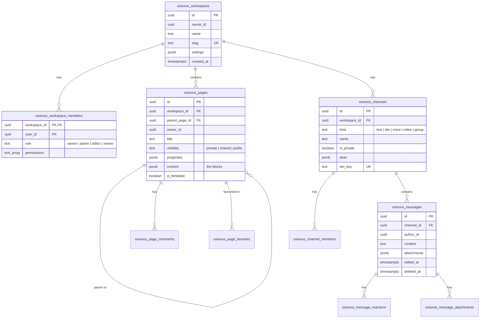

*This project has been created as part of the 42 curriculum by dlesieur, serjimen, danfern3, vjan-nie, shashemi.*

# Prismatica — ft_transcendence

**Prismatica** is a collaborative workspace built on our own self-hostable
Backend-as-a-Service. Users sign up on the public **prismatica** site, land in
**osionos** — a Notion-style block editor with real-time collaboration, chat and
video rooms — and can connect their Gmail and Google Calendar. Every one of
those apps is served by **grobase**, a generic backend that the team wrote in
Go, Rust and TypeScript, with no per-application server code.

> Naming: *Prismatica* is the project; *osionos* is the workspace app;
> *prismatica* (`apps/opposite-osiris`, repository
> [`Univers42/prismatica`](https://github.com/Univers42/prismatica)) is the
> marketing landing. Infrastructure identifiers keep the old codename
> `track-binocle` (the compose project, image names, `TRACK_BINOCLE_*`
> variables, `*.track-binocle.test` hosts, the local CA file): renaming them
> would break scripts and issued certificates.

---

## Table of contents

1. [Description](#description)
2. [Instructions](#instructions)
3. [Team Information](#team-information)
4. [Project Management](#project-management)
5. [Technical Stack](#technical-stack)
6. [Database Schema](#database-schema)
7. [Features List](#features-list)
8. [Modules](#modules)
9. [Individual Contributions](#individual-contributions)
10. [Resources](#resources)
11. [Known limitations](#known-limitations)
12. [Further documentation](#further-documentation)

---

## Description

### Goal

Almost every web project rebuilds the same backend before it can start on the product:
authentication, user management, CRUD, access control, file upload, email, logs. Our goal was to
turn that repeated work into infrastructure — **one backend, any frontend, zero per-project server
code** — and to prove it by building a real product on it.

The project therefore has two halves:

- **grobase** — a Backend-as-a-Service (about 290,000 lines of Go, Rust and
  TypeScript at its pin, roughly a third of the code the team wrote; lines
  include tests). An application is declared in a JSON *contract* (its database,
  isolation strategy, roles, permissions and API keys); a generic provisioner
  creates everything from that file. Routes carry no domain logic: a request
  names the table it targets, and access rules are stored as data, not code.
- **The products** that run on it — the prismatica landing and sign-in site, the
  osionos workspace, the hydrawn whiteboard, and mail and calendar integrations.

### Overview

| Product | Tech | What it is |
|---|---|---|
| **prismatica** (`apps/opposite-osiris`) | Astro | Public site: landing page, docs, sign-up / sign-in, legal pages. The entry point. |
| **osionos** | React + Vite | The block editor: pages, databases-as-blocks, real-time collaboration, chat, video rooms. **The flagship.** |
| **mail** | React + Vite | Gmail integration over Google OAuth |
| **calendar** | React + Vite | Google Calendar integration over Google OAuth |
| **hydrawn** | SvelteKit + Fastify + Rust/WASM | Collaborative whiteboard, embedded in osionos |

These products are supported by platform services (not applications in their own
right): the **auth-gateway** (Node, shipped by the prismatica repository:
sessions and sign-in), the **osionos-bridge** (Node: turns a site session into
an editor session), **Kong** (grobase's API gateway, behind its WAF) and
**LiveKit** (the WebRTC media server for video rooms).

### Key features

- **Contract-driven backend.** A whole application — database, isolation, roles,
  keys, frontend configuration — is one JSON file. `POST /v1/tenants/me/apps`
  creates a new isolated application with its own database and scoped API key
  (mounted only when `APPS_SELFSERVE_ENABLED` is on).
- **Per-request owner isolation.** The Rust data plane scopes queries to their
  owner on each request, not by connection-pool state; permissions are rows
  (RBAC, plus flag-gated ABAC conditions), not `if` statements.
- **One API over many databases.** PostgreSQL, MySQL (MariaDB image), MongoDB,
  Redis, SQLite, SQL Server and even remote HTTP APIs are queried through the
  same envelope and the same API key. DynamoDB is an opt-in build, left out of
  the default one
  ([`wiki/platform/08-engines.md`](wiki/platform/08-engines.md)).
- **Collaborative editor.** Block-based pages, a database block with table / board / calendar
  views, real-time co-editing, channels and direct messages, video rooms.
- **Single-command deployment.** `make all SKIP_SYNC=1` builds the pinned
  commits in Docker, starts the backend and the frontends over local HTTPS with
  a trusted CA, and health-checks them (`utils/mk/pipeline.mk:10`).

---

## Instructions

### Prerequisites

| Requirement | Detail | Source |
|---|---|---|
| **Linux host** | Tested on Debian 13 (trixie), the system the born2root VM installs; the CA-trust step uses `sudo` + `update-ca-certificates` | `vendor/born2root/docker/Dockerfile:14`, `vendor/born2root/generate/create_custom_iso.sh:120`; `utils/mk/certs.mk` |
| **Docker Engine ≥ 25** + **Compose v2** | Healthchecks use `start_interval`, which needs Docker 25. Tested with Docker 29.8. | `docker-compose.yml:10` |
| **RAM ≥ 8 GB** | Measured: the VM peaked at ~6.5 GB of 8 GB during `make all` | `wiki/runbooks/fresh-machine.md` (6266 MiB peak, v1.0.0-rc4, 2026-10-05) |
| **Disk ≥ 30 GB free for Docker** | Measured on the dev VM with the stack running (`docker system df`, 2026-10-01): images 13.5 GB, build cache 9.5 GB, volumes 1.4 GB | measured |
| **bash, GNU Make, git, curl, openssl, ssh** | Make drives everything; curl runs the health check; openssl generates the local secrets | `utils/mk/app.mk:12-15`, `scripts/gen-local-env.sh:253` |
| **A GitHub SSH key** | `.gitmodules` uses `git@github.com:` URLs, so the recursive clone needs SSH access to GitHub | `.gitmodules` |
| **Google Chrome** | Current stable — the browser the project is evaluated on | [`wiki/project/01-subject.md`](wiki/project/01-subject.md) |
| `certutil` (optional) | Imports the local CA into the browsers' NSS stores. Absent, `make certs-trust-user` unpacks `libnss3-tools` into `~/.cache/born2root/nss` without root (Debian only: it needs `apt-get` and `dpkg-deb`, bounded at 120 s); if that fails it warns and exits 0, and the CA is imported by hand (see [Access](#access-and-the-local-ca)) | `scripts/certs-trust-user.sh` |

**Nothing else is installed on the host** — no Node, npm, Go or Cargo. Everything builds and runs
in containers.

`make all` asks for **one `sudo` password** the first time: it copies the local CA into the system
trust store. This is intended (`certs-trust-local` in `utils/mk/certs.mk`). Without
sudo, `CERT_TRUST_MODE=user` trusts the browsers only and `skip` trusts nothing (see
[Access](#access-and-the-local-ca)).

**Ports bound on the host** (from `docker-compose.yml`, all on `127.0.0.1`
except inside a QEMU/VirtualBox NAT VM, where
`infrastructure/scripts/detect-bind-addr.sh` binds `0.0.0.0` so the host can
reach the guest): 443, 3001, 3002, 3003, 3007 (always loopback), 4000, 4100,
4200, 4322, 4323 and 7880 (always loopback: plain HTTP), 7881, 8444, 8446
(always loopback: the IDE edge), 8787 and UDP 50000–50060. A busy port moves to
the next free one (`scripts/host-ports.sh`). grobase adds Kong on
`127.0.0.1:8000` (literal loopback in its
`orchestrators/compose/base/gateway.yml:56`; its WAF is the public entry).

### Defense bring-up (pinned)

This is the path rehearsed on a clean machine, and the stack the
[Modules](#modules) are graded on. It builds `main` and the submodule commits
`main` pins, and does **not** follow submodule branch tips (`SKIP_SYNC=1`, see
`sync-submodules-soft` in `utils/mk/pipeline.mk`).

```bash
git clone --recursive git@github.com:Univers42/groot.git
cd groot
git checkout main
git submodule update --init --recursive
make all SKIP_SYNC=1
```

Requirements, the VM + host-browser case, the verify script (`scripts/verify/fresh-bringup.sh`) and
troubleshooting: [`wiki/runbooks/fresh-machine.md`](wiki/runbooks/fresh-machine.md).

grobase on another machine (the born2root VM, a LAN box, a VPS, a Kong URL) with
the frontends here, no sudo: put the kind of connection in `./.env.grobase-link`
(`GROBASE_TARGET=ssh://b2b`; `.env.grobase-link.example` lists the kinds), then
`make link` and `make link-frontends-up`. The latter also applies `models/*.sql`
to that grobase (`make link-models-migrate`), sets the demo account's password
there (`make link-demo-login-ensure`; `make demo-login` prints it), hands the
demo rows to the app's API key (`make link-live-data-ensure`) and trusts the
local CA in this user's browser stores (`make certs-trust-user`, no sudo). Both
end with `make link-verify`: one request per grobase service from inside every
frontend, the TLS edge, then the browser stores —
[`wiki/runbooks/grobase-link.md`](wiki/runbooks/grobase-link.md). To serve the
frontends to the internet through this host's Tailscale Funnel (443; add 8443
and 10000 with `PUBLIC_PORTS=all`), `make public-env` and `make public-up`;
`make public-down` closes it:
[`wiki/runbooks/public-funnel.md`](wiki/runbooks/public-funnel.md). `make
roundtrip` then proves persistence (account, sign-in, editor hand-off, a page,
the rows in postgres) and `make link-e2e` runs the Playwright smoke through the
link.

Measured time from a cold machine: **9–17 minutes** (8m55s on a fresh VM, 16m44s
on a laptop, 2026-09-30, [`wiki/STATUS.md`](wiki/STATUS.md); later runs in
[`wiki/runbooks/fresh-machine.md`](wiki/runbooks/fresh-machine.md)).

No `.env` needs to be written by hand. With no vault key present, grobase generates its own
secrets into `apps/grobase/.env`, and `env-local-ensure` derives the root `./.env.local` from it,
including random `OSIONOS_*` secrets and the demo account's `DEMO_LOGIN_PASSWORD`
(`scripts/gen-local-env.sh`). An older `.env.local` without it gets one minted on the next
`make all`, which says so by name.

`make all` runs, in order (`utils/mk/pipeline.mk`): submodule sync → secrets →
local TLS certificates → trust the local CA → grobase backend → derive
`.env.local` → restore data if the engines are empty → set the demo account's
password → SQL migrations → live-data key and owner fix → mount re-encryption →
frontends → health check → URL list. On a machine that holds vault42
credentials, `make all` deploys against the data-center VM instead and starts no
local grobase (ADR 0047,
[`wiki/runbooks/datacenter.md`](wiki/runbooks/datacenter.md)); `make all
GROBASE_DATACENTER=` forces the local path.

### Development bring-up

```bash
git checkout develop
make all
```

Without `SKIP_SYNC=1`, `make all` first fast-forwards every submodule to the tip
of its tracked branch (`sync-submodules-soft`), so you build the newest code
rather than the pinned commits. It skips dirty submodules, and leaves at its
recorded commit any submodule whose branch tip does not contain that commit; it
never blocks the pipeline.

The exception is any submodule that `.gitmodules` marks `update = none`, today `apps/graph_render`. Its
gitlink is the build input, so neither mode moves it:
- `git submodule update --recursive` skips it, which also keeps its SSH-only nested `SciGraphs` out;
- the sync skips it and everything under it;
- `frontends-up` runs `make submodules-pinned` (`scripts/pin-submodules.sh`), which checks it out
  at the recorded commit if it is absent, and fails if it is anywhere else or has edits to tracked files.

What the check does not do:
- It does not move a checked-out copy. After a pointer bump, run the fix it prints:
  `git submodule update --checkout -- apps/graph_render`.
- It ignores nested submodules and untracked files.
- It reads `.gitmodules`, so a local `.git/config` `update` override is not seen.
- It cannot guard a raw `docker compose build`.
- It is not offline-safe: the first `make all` after the pin lands clones graph_render over HTTPS,
  and fails if the network is down. A refused connection fails at once. A black-holed one waits
  for the TCP connect timeout (~1.5 min per attempt, and git retries once) before it fails.

The osionos pointer's own `branch = main` override is out of scope here (tracked with the pin audit).

### Finding make targets

`make help` lists every root target by section; `make help-<target>` prints one target's summary,
prerequisites and usage lines (for example `make help-link`). Each target in `utils/mk/*.mk`
carries its summary after `##` on the target line and sits under a `##@ Section` heading; those
markers are the only source of the help output. The convention and the list of deleted targets
are in [ADR 0016](docs/adr/0016-self-documenting-pruned-root-make.md).

### Checks

| Command | What it proves |
|---|---|
| `make healthcheck` | grobase auth, bridge, osionos, website (and HTTP→HTTPS redirect), auth gateway, hydrawn board list (`utils/mk/app.mk`) |
| `make e2e` | Playwright smoke in a pinned container against the running stack: DW3 Whiteboard tab, DW8 two browsers on one board, DW9 the board inside osionos, DW10 Mail/Calendar (`tests/e2e/README.md`) |
| `make mail-up calendar-up` | Start the opt-in Mail and Calendar apps. Without them DW10 **skips** and prints the reason; it never passes silently. |
| `make e2e-clean` | Soft-delete the `e2e-*` boards the smoke leaves behind |

### Access and the local CA

| Service | URL |
|---|---|
| prismatica site (start here) | `https://localhost:4322` |
| osionos editor | `https://localhost:3001` |
| Whiteboard (hydrawn) | `https://localhost:3007` |
| mail (opt-in) | `https://localhost:3002` |
| calendar (opt-in) | `https://localhost:3003` |
| osionos-bridge | `https://localhost:4000` |
| auth-gateway | `https://localhost:8787/api/auth` |
| grobase API (TLS edge) | `https://localhost:8444` |
| LiveKit signalling (video rooms) | `wss://localhost:4000/livekit` |

Only the TLS ports above are entry points. Kong's own plain-HTTP listener (`127.0.0.1:8000`) and
LiveKit's `127.0.0.1:7880` are bound to the host's loopback for the backend's own tools; a browser
never gets them (`scripts/verify/https-only.sh`, run in CI, fails on any `ws://` or `http://` URL
handed outside the backend).

`make showcase` prints the list of what is actually running.

Every frontend is served with a certificate from the local CA
`apps/grobase/certs/track-binocle-local-ca.pem`. `make all` trusts it in two places: the system
store (one `sudo`) and every browser store this user owns, through `scripts/certs-trust-user.sh`
(no sudo). That script covers Chrome and Chromium (`~/.pki/nssdb`, snap Chromium's
`~/snap/chromium/current/.pki/nssdb`) and every Firefox profile under `~/.mozilla/firefox`, the snap
and the flatpak locations. It matches old copies by the CA's subject, not by nickname, replaces
them, and adds the current file as "Track Binocle Local Development CA".

- `make certs-trust-check` prints one line per store (`ok|FAIL <kind> <path>
  current|stale|missing|untrusted`) and exits 1 if any store is not current.
  Without `certutil` it fails.
- `make certs-trust-user` fixes the stores without sudo; it mints the CA first only if it is missing.
- `CERT_TRUST_MODE=system|user|skip` (or `TRACK_BINOCLE_CERT_TRUST`) picks what `certs-trust-local`
  does: system store plus browsers (default), browsers only, or nothing.
- **Relaunch the browser afterwards.** A browser reads its store at launch only; the script never
  restarts one. `vendor/born2root/setup/host/restart_browsers.sh` does it with session restore.

If the CA is not trusted, the browser shows a warning on each port, and the **Whiteboard tab in
osionos stays blank**, because the embedded `:3007` iframe is refused silently. Two causes of a
warning while `curl --cacert` succeeds:

- **The CA was regenerated.** `make certs` on a fresh tree mints a new CA, and a
  store still holding an older copy does not trust it. `make certs-trust-check`
  then reports those stores `stale`, and `make certs-trust-user` replaces the
  old copy.

- **A snap refresh.** Snap Chromium's `HOME` is the revision directory behind
  `~/snap/chromium/current`, so a new revision starts without the store.
  `make certs-trust-check` reports it missing; `make certs-trust-user` recreates it.

Flatpak Firefox profiles can exist without the flatpak installed; they are imported too, harmlessly.
The script does not restart browsers, does not touch Safari or the macOS and Windows stores, and
does not trust the CA on another machine (see `wiki/runbooks/fresh-machine.md` for a browser on the
host of a VM). To import by hand: Chrome Settings → Privacy and security → Security → Manage
certificates → Authorities → Import, or run `make certs-trust`.

### Demo

1. Open `https://localhost:4322`, create an account, and continue to osionos. Or sign in with the
   seeded demo account: `make demo-login` prints its email and password. The password is
   generated per machine and kept only in `./.env.local` (git-ignored); it is never committed.
   It applies to the local stack only, not to production.
2. In osionos, open **View → Whiteboard**, click **+ New Board**, give it a title.
3. Open the same board URL in a second window and draw: the strokes appear live in the other
   window (the e2e smoke asserts within 5 s — `tests/e2e/specs/dw8-realtime.spec.ts`).

Honest limitations of this demo: board editing is **loopback-only** and has **no
per-user authorization yet** — hydrawn is bound to `127.0.0.1:3007` for exactly
that reason (`docker-compose.yml:35-40`). We make **no end-to-end-encryption
claim**: traffic is TLS to the local proxy, nothing more.

### Environment configuration

- Real credentials live only in git-ignored `.env*` files; the committed template is
  [`.env.example`](.env.example), which documents every key as **required**, **recommended** or
  **optional**.
- Optional integrations turn themselves off cleanly when left blank:
  - `LIVEKIT_API_KEY` / `LIVEKIT_API_SECRET` — default to a local dev value; video rooms still work.
  - `GOOGLE_CLIENT_ID` / `GOOGLE_CLIENT_SECRET` in `apps/mail/.env.local` and
    `apps/calendar/.env.local` — without them, the mail and calendar OAuth flows are disabled.
  - `SONAR_TOK`, `FLY_API_TOKEN`, `DOCKER_PAT` — operator tooling only (a local
    SonarCloud scan, the Fly deploy, a Docker Hub login); CI uses its own
    repository secrets.

### Team setup (with the vault)

Inside the team, secrets are shared through **vault42**, our zero-knowledge
secret store, via the **42ctl** CLI. A machine that holds a vault identity in
`~/.config/42ctl/` pulls the `.env` tree during `make all` when
`apps/grobase/.env` is absent (`secrets-ensure`), or on demand with `make
vault42-pull-all APPLY=1`. With the vault passphrase also present, `make all`
deploys against the data-center VM instead (see [Defense
bring-up](#defense-bring-up-pinned)). A new identity is created with `42ctl keys
init` and enrolled with an invitation from the vault's operator. Details:
[`DATA-MIGRATION.md`](DATA-MIGRATION.md).

The vault42 CLI is wired in beside that path: the `Secrets (vault42)` section of `make help`, and
[`vendor/scripts/vault42/README.md`](vendor/scripts/vault42/README.md). Status and retirement
checklist: [ADR 0017](docs/adr/0017-vault42-cli-beside-the-old-path.md).

### Everyday commands

| Command | What it does |
|---|---|
| `make all` | Full lifecycle: secrets → certs → backend → env → data → migrations → frontends → health check → URLs |
| `make healthcheck` | Probe backend, site, editor, bridge, auth gateway and whiteboard |
| `make showcase` | Print the URL list for what is actually running |
| `make pulls` | Fetch and pull the root repository and every submodule |
| `make -C apps/grobase editions` | List the available backend shapes |
| `make all GROBASE_EDITION=full` | Bring up every grobase plane except the playground demo UI, including extra engines and monitoring |
| `docker compose ps` | Service status |
| `docker compose logs -f <service>` | Follow one service's logs |
| `docker compose down` | Stop the frontends (data is kept) |

**Backend editions.** `make all` starts grobase in the **`devlean`** edition
(`GROBASE_EDITION ?= devlean` in `utils/mk/grobase.mk`; listed in grobase's
`orchestrators/makes/00-config.mk:148-154`): the core engines (PostgreSQL,
MySQL, MongoDB, Redis, MinIO), the full application / control / data planes and
realtime — without the heavy extra engines and without the monitoring stack.
`GROBASE_EDITION=migrate` adds every snapshot engine; `GROBASE_EDITION=full`
turns on every plane except the playground demo. Some module demonstrations need
a larger edition or a feature flag — see [Modules](#modules).

---

## Team Information

One owner per role, as the team confirmed on 2026-11-04 (the earlier working notes in
[`wiki/project/03-team.md`](wiki/project/03-team.md) named two Product Owners and two Project Managers).
The "Areas in the history" column is what each member's commits touch
([Individual Contributions](#individual-contributions) has the numbers).

| Member | Login | GitHub | Role(s) | Responsibilities | Areas in the history |
|---|---|---|---|---|---|
| Dylan Lesieur | `dlesieur` | [@LESdylan](https://github.com/LESdylan) | Product Owner · Developer | Product vision, backlog and priorities; validates completed work | grobase, osionos, mail, calendar, root infrastructure and CI |
| Daniel Fernández | `danfern3` | [@danielfdez17](https://github.com/danielfdez17) | Tech Lead · Developer | Architecture, stack decisions, code quality, reviews | monkey-bot (security test bot), grobase Docker and Kubernetes deployment, osionos editor fixes |
| Sergio Jiménez de la Cruz | `serjimen` | [@DjSurgeon](https://github.com/DjSurgeon) | Developer | Frontend, secrets management, deployment | the public site (opposite-osiris), osionos accessibility and editor features |
| Vadim Jan Nieto | `vjan-nie` | [@vjan-nie](https://github.com/vjan-nie) | Project Manager · Developer | Planning, tracking, communication, unblocking | QA tooling, end-to-end tests, documentation, Docker |
| Seyed Mostafa Hashemian | `shashemi` | [@SMOSTAFAH1](https://github.com/SMOSTAFAH1) | Developer | No responsibility beyond development is recorded | security fixes and SAST, the site's legal pages, TLS edge |

`rstancu` (Roxana Stancu, [@esettes](https://github.com/esettes)) is on the original roster
([`archive/wiki-2026-09/CONTRIBUTORS.md`](archive/wiki-2026-09/CONTRIBUTORS.md)) and committed
between 2026-03-18 and 2026-05-02; see [Who committed where](#who-committed-where).

---

## Project Management

Part of this project was an experiment in managing a team. We ran it as if it
were a demanding, high-output professional team, with a Scrum mindset in which
every member is treated as an expert and anyone may change anyone's code. The
aim was that **nobody is indispensable**. The evidence below separates what the
repositories record from what is the team's own account, and the last part
measures how far we got towards that aim.

**How the tracking evolved.** Work started in February 2026: the first commits
by `dlesieur`, `danfern3` and `vjan-nie` date from that month (`git log
--reverse` across the submodules). Between then and the autumn the team tried
GitHub Projects, Jira tickets and Notion pages (team account: none of the three
left a trace in commit messages, and the Projects board was not readable with
our token). The only written trace is osionos
[`docs/DoD.md:39`](https://github.com/Univers42/osionos/blob/develop/docs/DoD.md),
a Definition-of-Done template that asks for evidence "in your Pull Request
description or your Trello/Jira" ticket (2026-04-11).

**How it works now: issues, labels and pull requests on GitHub.**

| Practice | What the repositories record (2026-11-04) |
|---|---|
| Issues | 129 on osionos, 38 on groot, 20 on prismatica, 16 on grobase (`gh issue list --state all`). Branches and commits name them: `fix/issue-278-database-probe-diagnostics` (osionos #284), `fixes #N` in 40 commit messages across groot, grobase, osionos and prismatica |
| Labels | Triage labels `priority: high`, `subject-blocker` and `account-platform` on groot and osionos, plus GitHub's defaults (`gh label list`) |
| Pull requests | 144 on groot, 182 on osionos, 78 on grobase, 50 on prismatica; merged into `develop`, and `develop` promoted to `main` by a merge commit |
| Peer review | Since 2026-09-21 (grobase, hydrawn) and up to 2026-11-04 (groot `develop`), a GitHub ruleset on each main repository requires one approving review and forbids force-pushes and branch deletion (`gh api repos/<repo>/rulesets`). CodeRabbit reviews every PR since 2026-10-23 |
| Stacked branches | Feature chains merged one on top of another: groot #84–#87 (`feat/ide-*`), grobase #69–#70 (`feat/multidb-g1b…g1d`), the osionos `release/acct-w1` … `w9` series |
| Commit rhythm | At least one commit on 174 of the 232 days between 2026-03-18 and 2026-11-04, across all repositories |

**Strict CI from the start.** CI arrived within days of each repository's first
commit: grobase `ci.yml` on 2026-03-29, osionos on 2026-04-12, groot on
2026-05-13. SonarCloud is configured in groot since 2026-05-04 and comments on
its pull requests since #9 (2026-06-01). Security scans (Semgrep, Trivy,
gitleaks, TruffleHog, ZAP, cargo-audit, govulncheck) run on every pull request,
and groot rejects one-word commit subjects
(`.github/workflows/commit-subjects.yml`).

**Rituals.** Two-week sprints since the start, daily stand-ups and a weekly
meeting, mostly on Discord (team account, confirmed 2026-11-04; Discord leaves
no trace in the repositories). The method was Scrumban (Scrum rituals plus a
Kanban board), as described in
[`docs/dossier-project-dylan/dossier-projet.md:390-416`](https://github.com/Univers42/osionos/blob/develop/docs/dossier-project-dylan/dossier-projet.md)
in osionos.

**How far we got.** We publish these numbers so the claims above can be checked:

- **Sprints.** The sprints were planned outside GitHub: no milestone and no
  sprint label exists in any repository. Merges come in bursts: 250 of the 442
  merged pull requests on the six main repositories landed in two weeks (ISO
  weeks 43–44).
- **Review.** The rulesets let a maintainer bypass them, and in a sample of the
  40 most recent merged pull requests per repository, 0–22 % carry an approval
  from someone other than the author.
- **Nobody indispensable.** Shared ownership is real in breadth: `vjan-nie`
  committed in 12 areas and `shashemi` in 8, osionos has six authors with five
  or more commits, and prismatica's main author is `serjimen`. In depth we are
  not there yet: `dlesieur` wrote 86 % of the 8,571 human commits, and in 17 of
  18 areas one author holds more than half of the commits. Commit counts are not
  effort: one large commit and a typo fix weigh the same.

---

## Technical Stack

### Frontend

| Technology | Used in | Why |
|---|---|---|
| **Astro 7** + **Sass** | prismatica (`apps/opposite-osiris`) | Mostly static marketing content: Astro ships near-zero JavaScript by default and pre-renders pages, which keeps the public site fast. |
| **React 19** + **Vite 6** + **TypeScript** | osionos, mail, calendar | A block editor is a heavily interactive UI; React's component model fits, and Vite gives fast builds. |
| **Tailwind CSS 4**, **lucide-react** | osionos | Utility-first styling framework and an icon set. |
| **Zustand** | osionos | Small, explicit client state store. |
| **Zod 4** | osionos | Schema validation: the diagram spec on the client, and the inputs of the AI service and the MCP server. |
| **livekit-client** | osionos | WebRTC video rooms. |
| **Playwright** | osionos, groot `tests/e2e/` | End-to-end browser tests. |
| **SvelteKit**, **Fastify**, **Rust → WebAssembly** | hydrawn | The whiteboard: a WASM drawing engine with its own API and realtime services. |
| **Tailwind CSS 4** | mail, calendar | `src/styles.css` imports Tailwind's theme and utilities through `@tailwindcss/vite`, without preflight; the app's own rules sit on top. |

### Backend — grobase

grobase is split into **planes** — groups of responsibilities that can be sized and replaced
independently — each written in the language that suits it.

| Plane | Technology | Role | Why this language |
|---|---|---|---|
| **Control plane** | **Go** | Provisioning, tenancy, identity (`POST /v1/keys/verify` turns an API key into an identity) | Long-running, concurrent I/O; a provisioner needs to be correct and readable, not fast. |
| **Data plane** | **Rust** | Executes every query, applies per-owner scoping and ABAC locally | The hot path: predictable latency with no GC pauses, and memory safety where a bug would be a cross-tenant data leak. |
| **Realtime plane** | **Rust** | Turns data changes into events; WebSocket subscriptions (an opt-in profile, included in the `devlean` edition `make all` starts) | Same reasons; pluggable event bus. |
| **Application plane** | **TypeScript / NestJS** | Query and storage routers, schema service, permission engine. The older session, email and GDPR services remain only under the `legacy-node` profile; the Go orchestrator does their work | The original backend, progressively replaced by the Go and Rust planes. |
| **Auth** | **GoTrue** (grobase) + a Node **auth-gateway** (shipped by prismatica) | Sign-up, sign-in, sessions, email OTP, the hand-off to osionos | Battle-tested auth server rather than a hand-rolled one. |
| **Gateway** | **WAF** (nginx + ModSecurity/OWASP CRS) in front of **Kong** | The WAF is the public entry; Kong behind it does key auth and rate limiting | Keeps every internal service off the public network. |

### Database

- **PostgreSQL 16** is the primary database: the control-plane registries
  (tenants, roles, policies, API keys) and all application data (see [Database
  Schema](#database-schema)). **Why:** row-level security (RLS), JSONB for block
  content and flexible properties, strong transactional guarantees, and a mature
  ecosystem. RLS is what makes per-owner isolation enforceable inside the
  database itself, not only in application code.
- **MySQL, MongoDB, Redis, MinIO** (object storage) run in the `devlean` edition
  that `make all` starts; **SQLite**, **SQL Server** (needs the `engines`
  plane), **DynamoDB** (an opt-in build) and remote **HTTP** APIs are supported
  through the same data-plane interface. This is a deliberate feature of the
  platform (one API over many engines), not a need of osionos itself.

### Other significant technologies

- **Docker / Docker Compose** — every component runs in a container; one `make all`.
- **A local certificate authority + TLS proxy** — all frontends served over trusted HTTPS locally.
- **LiveKit** — the WebRTC SFU for video rooms, a groot compose service started
  by `make all`; the osionos bridge mints its tokens.
- **vault42 / 42ctl** — our own zero-knowledge secret store and CLI (separate repositories).
- **CI security scanning** — on every pull request,
  [`.github/workflows/mini-baas-security.yml`](.github/workflows/mini-baas-security.yml)
  runs Semgrep (SAST), `npm`/`pnpm audit`, Snyk (when a token is set) and Trivy;
  Semgrep and Snyk report without blocking. Dependabot opens dependency updates.
  SonarCloud analyses every pull request through its GitHub app
  (`.sonarcloud.properties`), not through a workflow; `renovate.json` is present
  but nothing runs it.

### Justification of the major choices

- **Why build a BaaS instead of a single backend?** Because the same backend pieces are rebuilt
  for every project. We moved everything that varies between projects — routes, schemas, access
  rules, configuration — from code into data, so a new application is a contract, not a server.
- **Why three languages?** Each grobase plane has a different job (Node also
  runs the site's auth-gateway and the osionos bridge). Go for boring, correct
  orchestration; Rust where performance and memory safety protect tenant
  isolation; TypeScript where it already existed. The data plane was migrated
  from TypeScript to Rust behind a per-request switch
  (`RUST_DATA_PLANE_FORWARD`, on in the default compose), so the migration
  needed no downtime and could be rolled back without a deployment.
- **Why per-request isolation?** Scoping on every request (instead of per connection) means a
  pooled connection can never carry one user's permissions into another user's query.

---

## Database Schema

The schema lives in two places:

1. **Application schema** — idempotent SQL migrations in [`models/`](models/)
   (`*-migration.sql`), applied to grobase's PostgreSQL by `make all` through
   [`scripts/apply-models-migrations.sh`](scripts/apply-models-migrations.sh).
   That runner deliberately skips seven files that target a database with an
   integer `users.id` (used by the Electron native edition) or that later files
   supersede: `user.sql`, `gdpr-migration.sql`, `auth-security-migration.sql`,
   `rls-hardening-migration.sql`, `seeds.sql`,
   `osionos-folder-surface-migration.sql` and
   `osionos-wiki-surface-migration.sql`; its header explains why.
2. **Platform schema** — grobase's control-plane registries (tenants, mounts, roles, policies,
   API keys), created by grobase's own migrations, plus per-application databases created at
   runtime from each contract (e.g. `infra/config/contracts/website.schema.sql` in grobase).

### Core application tables (osionos)



Other table groups, by migration file:

| Area | Tables | Migration |
|---|---|---|
| Users & sessions (auth gateway DB) | `users`, `sessions`, `user_activities`, `user_tokens` | `user.sql` |
| Auth security & GDPR | `auth_audit_events`, `gdpr_requests`, `user_consents`, `newsletter_optins` | `auth-security-migration.sql`, `gdpr-migration.sql` (integer-id flavour); `auth-audit-events-migration.sql`, `newsletter-optin-migration.sql` (applied to grobase) |
| Site ↔ editor bridge | `osionos_bridge_identities`, `osionos_bridge_audit_events` | `osionos-bridge-migration.sql` |
| Social & communities | `osionos_communities`, `osionos_community_members`, `osionos_community_channels`, `osionos_connections`, `osionos_user_blocks`, `osionos_user_reports`, `osionos_feed_*` | `osionos-communities-`, `-social-`, `-chat-`, `-feed-engagement-migration.sql` |
| Databases-as-blocks | `osionos_object_databases`, `osionos_workspace_databases`, `osionos_app_connections` | `osionos-object-databases-`, `-workspace-databases-`, `-app-connections-migration.sql` |
| Publishing & sharing | `osionos_published_pages`, `osionos_share_rules`, `osionos_page_links` | `osionos-publish-`, `-share-rules-`, `-page-links-migration.sql` |
| Tasks & notifications | `osionos_tasks`, `osionos_notifications`, `osionos_push_subscriptions` | `osionos-tasks-`, `-engagement-`, `-push-migration.sql` |
| Mail & calendar | `mail_accounts`, `mail_messages`, `calendar_accounts`, `calendar_sources`, `calendar_event_cache` | `mail-migration.sql`, `calendar-migration.sql` |

### Platform (grobase) registries

Access control is stored as data: `roles`, `user_roles` and `resource_policies`
tables, evaluated by the SQL function `public.has_permission(...)` and mirrored
by the Rust data plane's own ABAC evaluator. Every table created through
grobase's schema API gets an `owner_id` column appended when the caller does not
declare one (contract schemas declare it themselves), which is what makes one
isolation rule apply to any table.

**Two `users` tables.** `models/user.sql` defines `users.id` as `SERIAL` (integer): it belongs to
the auth gateway's database. The osionos tables reference users by `UUID`, in grobase's
PostgreSQL, where `make all` never applies `user.sql` — doing so fails on the uuid/integer
foreign-key clash (`scripts/apply-models-migrations.sh:27-38`).

---

## Features List

"Who" counts the non-merge commits that touch the feature's paths (last column),
reachable from the commit groot `main` pins for that repository, read through
the root [`.mailmap`](.mailmap), with bots and AI-agent identities left out;
largest share first. How the identities are joined:
[`wiki/project/contributions-method.md`](wiki/project/contributions-method.md).
A commit count is not effort, and pairing or review does not show in it.

| Feature | Description | Who (commits) | Paths counted |
|---|---|---|---|
| Sign-up / sign-in | Email and password on the public site, stored hashed by GoTrue; an email-OTP second step is off by default (`AUTH_LOGIN_EMAIL_OTP`) | dlesieur 9, serjimen 1 | opposite-osiris `src/pages/auth`, `src/pages/api/auth` |
| Site → editor handoff | After login, a one-time bridge session hands the user to osionos (`/api/auth/bridge/consume`) — the one-time token travels in the URL fragment and is redeemed once by `POST`, never in a query string | dlesieur 4 | osionos `scripts/bridge-auth*` |
| Legal pages | Privacy Policy, Terms of Service, Cookie Policy, Data Rights, linked from the site | shashemi 5, vjan-nie 3, serjimen 2, dlesieur 2 | opposite-osiris `src/pages/legal` |
| Block editor | Pages built from blocks, nested pages, templates, covers, favourites, search | dlesieur 164, vjan-nie 42, danfern3 29, rstancu 9, serjimen 8, shashemi 2 | osionos `src/features/block-editor` |
| Database block | A block that is a database, with table, board and calendar views over any mounted data source (the views live in the `notion-database-sys` submodule, `src/components/views/`) | dlesieur 125, vjan-nie 2, rstancu 2, shashemi 1, serjimen 1 | osionos `src/widgets/database*`, `src/features/*database*`, `src/shared/database*` |
| Real-time collaboration | Several users editing the same space live, over the protected `collab:<spaceId>` channel. Off in the default local build; `VITE_OSIO_COLLAB_SHARED=1` turns it on (osionos `src/shared/config/featureFlags.ts:73`) | dlesieur 45, shashemi 2 | osionos `src/features/collab`, `scripts/bridge-*collab*` |
| Chat | Workspace channels and direct messages, reactions, mentions, attachments, unread markers; new messages arrive over grobase's realtime WebSocket | dlesieur 72, vjan-nie 1 | osionos `src/features/chat`, `src/features/group-chat`, `scripts/bridge-*chat*` |
| Video rooms | LiveKit-based video channels inside workspaces | dlesieur 11, shashemi 1 | osionos `src/widgets/video-room`, `scripts/bridge-rtc*` |
| Comments, sharing, publishing | Page comments, share rules, public page publishing | dlesieur 45 | osionos `src/features/comments`, `src/features/share`, `scripts/bridge-*publish*`, `scripts/bridge-*share*` |
| Communities & social feed | Communities, connections, feed with likes, comments and shares; blocking and reporting | dlesieur 37, serjimen 2, shashemi 1 | osionos `src/features/communities`, `src/features/connections`, `scripts/bridge-*social*`, `scripts/bridge-*feed*` |
| Two-factor authentication and passkeys | TOTP codes and passkeys on the account | dlesieur 15 | osionos `scripts/bridge-account-mfa*`, `scripts/bridge-account-passkeys*`, `src/features/settings/profile/TwoFactorModal.tsx` |
| AI assistant | Streaming answers, retrieval over the workspace with citations, moderation, dictation and read-aloud; started with `--profile ai` | dlesieur 317, vjan-nie 9, shashemi 1 | osionos `services/osionos-ai`, `src/features/ai` |
| Whiteboard | Shared boards in osionos's Whiteboard tab; strokes reach every open copy of the board live | dlesieur 569, danfern3 20, shashemi 6, vjan-nie 4 | hydrawn, whole repository |
| Mail | Read Gmail inside the workspace via Google OAuth. Opt-in: `make mail-up` and Google OAuth credentials | dlesieur 39 | `apps/mail`, whole repository |
| Calendar | Google Calendar events via Google OAuth. Opt-in: `make calendar-up` and Google OAuth credentials | dlesieur 22 | `apps/calendar`, whole repository |
| Contract-driven provisioning | One JSON contract → isolated database, roles, keys and frontend `.env` | dlesieur 9 | grobase `scripts/provision-contract.sh`, `infra/config/contracts` |
| Self-serve applications | `POST /v1/tenants/me/apps` creates a new isolated app with its own database and key, behind `APPS_SELFSERVE_ENABLED` (off unless set) | dlesieur 32 | grobase `src/control-plane/internal/tenants` |
| Multi-engine data API | One API and one key over PostgreSQL, MySQL, MongoDB, Redis (default edition), SQLite, SQL Server (`engines` plane), HTTP and DynamoDB (opt-in build) | dlesieur 95, vjan-nie 3 | grobase `src/data-plane-router` |
| Public API | Key-authenticated, rate-limited API behind Kong, documented with OpenAPI at `/docs/` on the `:8444` edge | dlesieur 64, vjan-nie 5, shashemi 1 | grobase `infra/docker/services/kong`, `infra/config/openapi`; groot `infrastructure/tls/nginx.conf` |

---

## Modules

The subject requires **14 points** (Major = 2, Minor = 1). A module that cannot
be demonstrated live scores zero. Every row is graded against **the local stack
built from `main`** (`git checkout main`, `make all SKIP_SYNC=1`, which starts
grobase's `devlean` edition; see [Defense bring-up](#defense-bring-up-pinned))
by **one rule**, groot's own. It keeps the clause of osionos
[`docs/ai/README.md`](https://github.com/Univers42/osionos/blob/1c1d5d849c1dc43460a194f7ee3d97e17505205c/docs/ai/README.md)
lines 7–8 (a row is never A when its demonstration needs something switched off
or unmeasured), but it is stricter than that file's legend, which grades a
documented profile A:

- **A**: the demo works on that stack with nothing switched on, and a green CI
  job drives that path against a running service.
- **B**: it works, but the demo needs something switched on (a flag, a profile,
  an edition, a provider credential), or its only evidence is unit tests with
  fakes or a run that was never repeated.
- **C**: partial. **Not claimed.** These rows are listed under [Not claimed
  yet](#not-claimed-yet).

**Claimed = A and B only: 30 points against the 14 required. 8 of them are A.**
Paths are prefixed by repository: `G` groot, `GB` grobase (`apps/grobase`), `OS`
osionos (`apps/osionos/app`), `OO` opposite-osiris (`apps/opposite-osiris`).
They point at the commits pinned by groot's `main` branch. CI names a workflow
job: `GB-CI` is grobase `ci.yml`, `OS-CI` is osionos `ci.yml`, `OO-CI` is
prismatica `ci.yml`.

| # | Module | Category | Type | Pts | Grade | Core files | Tests → CI job | Docs | Demo (3 steps) |
|---|---|---|---|--:|:--:|---|---|---|---|
| 1 | Public API (key, rate limit, docs, ≥5 endpoints) | Web | Major | 2 | **A** | `GB infra/docker/services/kong/conf/kong.yml:221-245` (`/rest/v1`: key-auth + rate-limiting); `GB infra/config/openapi/grobase-public.json` | `GB scripts/verify/m102-gateway-query-path.sh` → GB-CI "Integration Tests" (`ci.yml:927`) | `GB infra/config/openapi/README.md` | `make all SKIP_SYNC=1` → `/rest/v1` without `apikey` answers 401, with it 200 → repeat until 429 |
| 2 | Backend as microservices | DevOps | Major | 2 | **A** | `GB orchestrators/compose/base/*.yml` (16 files); `GB orchestrators/makes/30-planes.mk:33`; `GB src/control-plane`; `GB src/data-plane-router` | GB-CI unit suites (`ci.yml:1436`) + "Engine conformance" legs (`ci.yml:1532`) | [`wiki/platform/02-planes.md`](wiki/platform/02-planes.md) | `make -C apps/grobase planes` → `docker compose ps` → `make healthcheck` |
| 3 | Real-time features via WebSockets | Web | Major | 2 | **A** | `GB infra/docker/services/realtime/realtime-agnostic/crates/realtime-server/src/server.rs:243` (`/ws`); `GB kong.yml:314-315` (`/realtime/v1/ws`); `OS scripts/bridge-social-core.mjs:192-201` (the bridge publishes); `OS src/services/realtime-messages/wsTransport.ts:81` (chat over the socket, on whenever a session exists) | `GB scripts/verify/m201-realtime-issuer.sh` opens `/ws` on the running realtime and expects `AUTH_OK` → GB-CI "Integration Tests" (`ci.yml:855`); m189 (`ci.yml:735`); `rust-realtime` suite and m184 (`ci.yml:1436,1479`) | [`wiki/platform/05-realtime.md`](wiki/platform/05-realtime.md) | sign in as two users in two browsers → open the same direct message in both → a message sent in one appears in the other without a reload. A second default demo: two windows on one Whiteboard board, where each stroke appears in the other (`G tests/e2e/specs/dw8-realtime.spec.ts`, `make e2e`, run by hand) |
| 4 | Use a framework for both the frontend and backend | Web | Major | 2 | **A** | Frontend: React 19 (`OS package.json:105-106`). Backend: axum 0.7 (`GB src/data-plane-router/Cargo.toml:59`; `GB infra/docker/services/realtime/realtime-agnostic/Cargo.toml:44`) | React: OS-CI "Browser tests", Playwright against the served app in 6 shards (`ci.yml:338-339`); axum: GB-CI "Integration Tests" (`ci.yml:652-653`) runs the data plane and realtime built from the pin | [`wiki/platform/02-planes.md`](wiki/platform/02-planes.md) | `make all SKIP_SYNC=1` → `docker compose ps` lists `mini-baas-data-plane-router-rust` and `mini-baas-realtime` (`GB orchestrators/compose/base/data-plane.yml:28,178`) → open osionos at `https://localhost:3001` |
| 5 | Allow users to interact with other users (chat, profile, friends) | Web | Major | 2 | **B** | `OS scripts/bridge-chat.mjs`; `OS scripts/bridge-account-profile.mjs`; `OS scripts/bridge-social.mjs`; `OS src/features/chat`; `OS src/features/connections` | `OS tests/canvas/chat-catch-up.test.ts` → OS-CI "quality (root)" Canvas unit tests (`ci.yml:285`); `OS tests/bridge/bridge-chat-reply-notify`, `bridge-account-profile`, `bridge-social-connections`, `bridge-connection-transitions` → Bridge tests (`ci.yml:291`). Unit tests with fakes: no CI job drives two users against a running stack | [`wiki/product/02-osionos.md`](wiki/product/02-osionos.md) | as row 3 → user A sends a friend request, user B accepts → each opens the other's profile |
| 6 | Standard user management and authentication | User management | Major | 2 | **B** | `OS scripts/bridge-account-profile.mjs`; `OS scripts/bridge-avatar.mjs`; `OS scripts/bridge-presence.mjs`; `OS src/features/collab/model/collabPresence.ts:63` (initials when there is no avatar) | `OS tests/bridge/bridge-avatar` (upload, type and size refusal), `bridge-presence` (online status), `bridge-account-profile` → OS-CI Bridge tests (`ci.yml:291`). Unit tests with fakes | [`wiki/product/02-osionos.md`](wiki/product/02-osionos.md) | sign up on `https://localhost:4322` → upload an avatar and edit the profile → a friend sees you online |
| 7 | Real-time collaboration | Web | Minor | 1 | **B** | `OS src/features/collab/model/{remoteCursors,collabPresence,blockSync}.ts`; `OS scripts/bridge-collab.mjs:626`; `GB …/realtime-auth/src/jwt/mod.rs:90-94` (`collab:` closed to wildcard tokens) | `OS tests/bridge/bridge-collab-*` (9) → OS-CI Bridge tests (`ci.yml:291`) | [`wiki/product/02-osionos.md`](wiki/product/02-osionos.md) | rebuild osionos with `VITE_OSIO_COLLAB_SHARED=1` (off by default) → two browsers on one page → watch the remote cursor and edit the same block from both |
| 8 | Advanced permissions | User management | Major | 2 | **B** | `OS scripts/bridge-roles.mjs:28-29`; `OS scripts/bridge-share-rules.mjs:38`; `OS scripts/bridge-page-access.mjs:217`; `OS src/features/admin-users/api.ts` | `OS tests/bridge/bridge-page-access*` (7), `bridge-share-rules-*` (2) → OS-CI Bridge tests | [`wiki/platform/07-isolation.md`](wiki/platform/07-isolation.md) | sign in as admin → change a member's role → that member loses access |
| 9 | Organisation system | User management | Major | 2 | **B** | `OS scripts/bridge-workspace-teams.mjs:229`; `OS scripts/bridge-workspace-invites.mjs:134`; `OS src/features/settings/teamspaces/TeamspacesPanel.tsx` | `OS tests/bridge/bridge-workspace-*` (7) → OS-CI Bridge tests | [`wiki/platform/06-contracts.md`](wiki/platform/06-contracts.md) | create a workspace → create a teamspace → invite a user, who accepts |
| 10 | Remote authentication with OAuth 2.0 | User management | Minor | 1 | **B** | `OO scripts/auth/oauth-providers.mjs`; `OO scripts/auth/oauth-link.mjs`; `OO src/scripts/portal-oauth.ts`; `GB orchestrators/compose/base/auth-api.yml:64-67` (GoTrue's Google provider) | `OO tests/unit/auth/oauth-providers`, `oauth-link`, `gateway-oauth-{start,link,collision}` (5) → OO-CI "Quality Gate" `pnpm test` (`ci.yml:31-32`) | `OO docs/adr/0002-oauth-link-existing-account.md` | set `GOOGLE_OAUTH_ENABLED=true`, `GOOGLE_CLIENT_ID` and `GOOGLE_CLIENT_SECRET` for grobase (Google provider credentials, not shipped) → `make all SKIP_SYNC=1` → "Continue with Google" on `https://localhost:4322` |
| 11 | Health/status page, backups, disaster recovery | DevOps | Minor | 1 | **B** | `GB infra/docker/services/status-page/{server,availability}.py`; `GB orchestrators/compose/base/ops.yml`; `GB scripts/verify/m241-status-backup-recovery.sh` | m241 → GB `operational-reliability.yml:27`; m192 → GB-CI (`ci.yml:582`), **red on grobase `develop`** ([run 41870904860](https://github.com/Univers42/grobase/actions/runs/41870904860)) | [`wiki/operations/04-troubleshooting.md`](wiki/operations/04-troubleshooting.md) | bring up the `ops` plane (not in the default edition) → open the status page → stop a container, then `m241 --live` |
| 12 | GDPR compliance | Data | Minor | 1 | **B** | `OS scripts/bridge-account-export.mjs:143`; `OS scripts/bridge-account-erasure.mjs:79`; `OS src/features/settings/ui/AccountExportSection.tsx`; `OS src/features/settings/ui/danger/AccountDangerZone.tsx` | `OS tests/bridge/bridge-account-export*` (3), `bridge-account-erasure` (1) → OS-CI Bridge tests; `G .github/workflows/models-grants.yml` | [`wiki/security/01-model.md`](wiki/security/01-model.md) | Settings › export my data → open the archive → delete the account |
| 13 | Two-factor authentication | User management | Minor | 1 | **B** | `OS scripts/bridge-account-mfa-totp.mjs:68`; `OS scripts/bridge-account-mfa.mjs:187`; `OS scripts/bridge-account-passkeys.mjs:100`; `OS src/features/settings/profile/TwoFactorModal.tsx` | `OS tests/bridge/bridge-account-mfa-*` (5), `bridge-account-passkeys` (1) → OS-CI Bridge tests | osionos `docs/account-platform` | enable TOTP → sign out → sign in with the code |
| 14 | **Module of choice:** contract-driven application factory | Free choice | Major | 2 | **B** | `GB src/control-plane/internal/tenants/selfserve_apps.go:55-58`; `GB src/control-plane/cmd/tenant-control/mount_appsselfserve.go:26`; `GB scripts/verify/m177-selfserve-apps.sh` | m176 → GB-CI (`ci.yml:192`, static leg, in the Shellcheck job); m176 and m177 → groot `modules-of-choice.yml:39-40`, static mode only | [`wiki/platform/06-contracts.md`](wiki/platform/06-contracts.md), [justification](#justification--module-of-choice-major-contract-driven-application-factory) | set `APPS_SELFSERVE_ENABLED` (empty by default) → OTP login, `POST /v1/tenants/me/apps` twice → one app's key reads the other: 4xx |
| 15 | **Module of choice:** SSRF guard on the HTTP engine | Free choice | Minor | 1 | **B** | `GB src/data-plane-router/crates/data-plane-pool/src/dial_guard/classify.rs:90-155`; `GB src/data-plane-router/crates/data-plane-pool/src/http/validate.rs:83-153` | `GB …/dial_guard/classify_tests.rs` → GB-CI `rust-data-plane` + "Engine conformance (http)" | [`wiki/security/04-network.md`](wiki/security/04-network.md), [justification](#justification--module-of-choice-minor-ssrf-guard-on-the-http-engine) | mount an `http` source at `169.254.169.254` → query it → refused. Whether the default edition mounts the `http` engine is unverified (guess: it does not) |
| 16 | Complete LLM system interface: text, streaming, error handling, rate limiting. Images exist but are **off by default** and not part of this claim | Artificial Intelligence | Major | 2 | **B** | osionos `services/osionos-ai/src/routes/runs.ts:178-324`, `src/runs/{runner,upstream,upstreamError,streamPump}.ts`, `src/rateLimit.ts:84`, `src/http.ts:108-129`; client `src/features/ai/model/runStream.ts`. All 12 hops: [`wiki/project/ai-llm-interface.md`](wiki/project/ai-llm-interface.md) | `services/osionos-ai/tests/{runs,complete,upstreamError*,runRateLimit,failover,quotaFailover}.test.ts` → OS-CI "AI service (tsc + suite)" (`ci.yml:314`); `tests/canvas/ai-{chat-store,run-dispatch,run-stream}.test.ts` → "quality (root)" Canvas unit tests (`ci.yml:285`) | [`wiki/project/ai-llm-interface.md`](wiki/project/ai-llm-interface.md), [`wiki/runbooks/osionos-ai.md`](wiki/runbooks/osionos-ai.md), [M1 sheet](https://github.com/Univers42/osionos/blob/develop/docs/ai/modules/m1-images.md) | `docker compose --profile ai up -d --build` → ask a question and watch it stream → reload mid-answer (it resumes), or stop it |
| 17 | Complete RAG on a large dataset | Artificial Intelligence | Major | 2 | **B** | osionos `services/osionos-ai/src/retrieval/search.ts:277,469,564`, `src/retrieval/rerank.ts:16`; `G models/osionos-ai-rag-migration.sql:60,91` | `services/osionos-ai/tests/{retrieval,aclAgreement,rerank}.test.ts` → OS-CI AI service | [M2 sheet](https://github.com/Univers42/osionos/blob/develop/docs/ai/modules/m2-rag.md), osionos `services/osionos-ai/eval/wiki/RESULTS-rag.md` | `--profile ai` → ask a workspace question → click a citation, then show the 110 363-chunk measurement (run on a separate eval stack; the reranker is off by default) |
| 18 | Content moderation AI | Artificial Intelligence | Minor | 1 | **B** | osionos `scripts/bridge-moderation-gate.mjs:70`; `services/osionos-ai/src/moderation/l1.ts:99` | `services/osionos-ai/tests/moderation*.test.ts` (4) → OS-CI AI service; `tests/bridge/bridge-moderation*` (5) → Bridge tests | [M4 sheet](https://github.com/Univers42/osionos/blob/develop/docs/ai/modules/m4-moderation.md) | set `OSIONOS_MODERATION_ACTIONS=hold` and `OSIONOS_MODERATION_STATE=1` → post a toxic comment → it waits in the admin console (no auto-removal, by design) |
| 19 | Voice / speech | Artificial Intelligence | Minor | 1 | **B** | osionos `services/osionos-ai/src/routes/voice.ts:104`, `src/features/voice/ui/DictationButton.tsx`, `src/features/voice/model/readAloud.ts`; `G docker-compose.yml:788-790` | `services/osionos-ai/tests/voice.test.ts` → OS-CI AI service | [M5 sheet](https://github.com/Univers42/osionos/blob/develop/docs/ai/modules/m5-voice.md) | `--profile ai`, with the speech model fetched into its volume → dictate into a page → read it aloud (read-aloud voices not measured yet) |

No separate framework Minor is claimed beside row 4.

**Point calculation** (free choice is capped at 3,
[`wiki/project/01-subject.md`](wiki/project/01-subject.md#points))

| | Before (2026-10) | After |
|---|--:|--:|
| Catalogue modules claimed (rows 1–13) | 18 | 21: 8 A (rows 1–4) + 13 B (rows 5–13) |
| Modules of choice (rows 14–15, cap 3) | 3 | 3, all B |
| Artificial Intelligence modules (rows 16–19) | 10 | 6, all B |
| **Total claimed** | **31 listed** | **30 (A + B)** |
| Of which A | 10 | **8** |
| Required | 14 | 14 |

What moved: under the old legend ("works as-is"), six rows were A. Under one
rule, the rows whose demonstration needs a switch or whose only evidence is
unit-level are B: real-time collaboration (off by default), the contract factory
and the SSRF guard. Row 3 stays A on the chat demo, which needs nothing switched
on, and row 4 is new at A. The rows below no longer count.

### Not claimed yet

| Module | Was | Why it is not claimed, in one line |
|---|---|---|
| Monitoring with Prometheus + Grafana, DevOps, Major | 2, C | The default edition ships no observability plane, and its gate m85 runs in no workflow |
| File upload and management, Web, Minor | 1, C | Avatars and page files upload (`OS scripts/bridge-media.mjs:160`), but no general file manager is verified, and gate m159 runs in no workflow |
| ML recommendation system, AI, Major | 2, B | Needs 20+ real users, the offline numbers are synthetic, and the `osionos-ml` Python tests run in no CI |
| Sentiment analysis, AI, Minor | 1, C | The model licence is undeclared |
| Image recognition and tagging, AI, Minor | 1, C | The browser flow is unverified. Locally the VLM starts with `--profile ai` (`G docker-compose.yml:1004-1006`); `--profile ai-vlm` exists only in `docker-compose.public.yml:211-212` |
| AI opponent, AI | — | osionos has no game |
| Multiple languages, Accessibility | — | `i18next` is a dependency (osionos `package.json:92`), but no source file imports it and no translation resource exists |

### Justification — Module of choice (Major): contract-driven application factory

- **Why this module.** It is the central idea of the project: a backend with zero
  application-specific code, where an application is a declarative contract.
- **Technical challenge.** From one JSON file, a generic provisioner must create an isolated
  database, apply its schema, create roles and policies, mint scoped API keys and emit the
  frontend's `PUBLIC_*` configuration — idempotently, on every boot. The self-serve endpoint
  `POST /v1/tenants/me/apps` does it on demand, with a fresh `CREATE DATABASE` per application.
- **Value.** A new application costs a contract instead of a new server.
- **Why it deserves a Major.** It spans the Go control plane, the Rust data plane and the
  database layer, and it comes with isolation proofs: gate `m177` proves self-serve creation, and
  gate `m176` proves one application cannot read another's data (a foreign mount resolves to zero
  rows — a 404, never a cross read).

### Justification — Module of choice (Minor): SSRF guard on the HTTP engine

- **Why this module.** The data plane can mount a remote HTTP API as if it were a database —
  which also means "let a user make our server fetch any URL", the classic SSRF hole.
- **Technical challenge.** The guard blocks loopback, private (RFC 1918), link-local — including
  the cloud metadata endpoint `169.254.169.254` — CGNAT, IPv6 ULA and link-local, IPv4-mapped
  addresses and internal hostnames, then **pins** the connection to the validated public IP so a
  later DNS rebind cannot redirect it inward.
- **Value and weight.** Small, self-contained and demonstrable in seconds (a
  mount pointing at `169.254.169.254` is refused), and it shows security
  judgement on a feature we chose to build.

---

## Individual Contributions

### Who committed where

Non-merge commits per member reachable from the commit groot `main` pins for
each repository, read through the root [`.mailmap`](.mailmap), bots and AI-agent
identities left out (counted on 2026-11-05 at `main` = `0bef3cb3`). The command,
the identity joins and what is left out:
[`wiki/project/contributions-method.md`](wiki/project/contributions-method.md).

Several members work almost only in submodules, so the root alone understates them.

| Member | GitHub | root | osionos | grobase | opposite-osiris | hydrawn | mail | calendar | QA | monkey-bot | First → last commit |
|---|---|--:|--:|--:|--:|--:|--:|--:|--:|--:|---|
| `dlesieur` | @LESdylan | 1394 | 2469 | 1279 | 103 | 569 | 39 | 22 | 1 | 2 | 2026-04-05 → 2026-11-05 |
| `vjan-nie` | @vjan-nie | 136 | 119 | 29 | 12 | 4 | | | 38 | | 2026-03-19 → 2026-11-04 |
| `serjimen` | @DjSurgeon | | 82 | | 134 | | | | | | 2026-04-09 → 2026-11-03 |
| `danfern3` | @danielfdez17 | | 84 | 73 | 4 | 20 | | | 1 | 10 | 2026-03-18 → 2026-10-02 |
| `shashemi` | @SMOSTAFAH1 | 42 | 17 | 15 | 39 | 8 | | | | | 2026-09-20 → 2026-11-04 |
| `rstancu` | @esettes | | 90 | | | | | | 2 | | 2026-03-18 → 2026-05-02 |

Dates are author dates in these nine repositories only. Work that is not on a
pinned commit does not show above: `danfern3`'s 44 root commits sit on `fix/ci`,
open as [#165](https://github.com/Univers42/groot/pull/165), and most of their
133 monkey-bot commits are on branches the pin does not reach. A commit count is
not effort: one large commit and one typo fix weigh the same, and pairing and
review do not show in it.

Merged pull requests per login in the project's repositories (groot, osionos, grobase,
prismatica = opposite-osiris, osionos-mail, osionos-calendar, hydrawn, QA, monkey-bot), from
`gh search prs --owner Univers42 --author <login> --merged` on 2026-11-04:

| GitHub | Merged PRs | Where |
|---|--:|---|
| @LESdylan | 260 | osionos 138, grobase 61, groot 56, prismatica 3, osionos-mail 1, osionos-calendar 1 |
| @vjan-nie | 72 | groot 45, osionos 17, prismatica 6, grobase 4 |
| @SMOSTAFAH1 | 57 | prismatica 20, groot 19, osionos 12, grobase 6 |
| @DjSurgeon | 8 | prismatica 7, osionos 1 |
| @danielfdez17 | 4 | prismatica 4 |

The numbers in brackets below are the member's commits in that row of the
[Features List](#features-list).

### dlesieur — Dylan Lesieur

- **Areas:** grobase (Go control plane, Rust data plane and realtime, Kong
  gateway, contracts and self-serve apps), osionos (editor, chat, collaboration,
  social, profile, the bridge, the AI service), mail, calendar, the root's
  infrastructure, TLS edge and CI; hydrawn (569 commits: `apps/web`, the engine,
  `docs/reference`).
- **Pull requests:** 260 merged (osionos 138, grobase 61, groot 56).
- **Features:** the largest share of every row of the Features List except the
  legal pages, for example the block editor (164), the database block (125),
  chat (72) and the AI assistant (317).
- **Challenges:** not recorded yet.

### danfern3 — Daniel Fernández

- **Areas:** `vendor/monkey-bot` (133 commits on all branches, 10 on the pinned
  commit: form-XSS and mutation testing, configuration); grobase Docker images
  built from scratch, Kubernetes deployment, the playground and Makefile (March
  2026); osionos breadcrumbs, trash, multi-line text in blocks, the markdown
  engine and code-quality fixes; hydrawn (20 commits, `apps/web`, `apps/api`,
  `packages/contract`, 2026-09-24: submodule clone paths, formatting); root
  submodule pins and the `make all` bats fix, on `fix/ci`
  ([#165](https://github.com/Univers42/groot/pull/165), open).
- **Pull requests:** 4 merged (prismatica).
- **Features:** block editor (29), whiteboard (20).
- **Challenges:** not recorded yet.

### serjimen — Sergio Jiménez de la Cruz

- **Areas:** the public site, opposite-osiris (134 commits on the pinned commit:
  hero animation performance, unit tests and benchmarks, security fixes, auth
  pages); osionos accessibility fixes, page links, move and delete, shared UI
  refactor, the node installer's self-update (#277) and database probe
  diagnostics (#278), the changelog.
- **Pull requests:** 8 merged (prismatica 7, osionos 1), among them the landing page in English,
  Spanish and Arabic with right-to-left layout (prismatica #21, #22, #23, #35), the accessible
  privacy policy and terms (#38) and a WCAG 2.2 AA audit pipeline with axe-core fixes (#39).
- **Features:** block editor (8), legal pages (2), communities and social feed
  (2), sign-up / sign-in (1), database block (1).
- **Challenges:** not recorded yet.

### vjan-nie — Vadim Jan Nieto

- **Areas:** `vendor/QA` (38 commits: registry, migrations, hooks, CLI); root
  end-to-end tests, the wiki and README, graph-studio tests, the hydrawn TLS
  edge and its CORS, submodule pins; osionos whiteboard and graph-studio fixes;
  grobase Docker infrastructure and dependency fixes; hydrawn (4 commits: engine
  bumps, the nested-shape binding fix).
- **Pull requests:** 72 merged (groot 45, osionos 17, prismatica 6, grobase 4).
- **Features:** block editor (42), AI assistant (9), public API (5), whiteboard
  (4), legal pages (3), multi-engine data API (3), database block (2), chat (1).
- **Challenges:** not recorded yet.

### shashemi — Seyed Mostafa Hashemian

- **Areas:** security fixes across root, grobase and opposite-osiris (SAST
  findings, nginx scan suppressions, IDE socket proxy hardening); the site's
  legal pages, SEO and accessibility; root CI triggers and the models' export
  erasure paths; osionos end-to-end fixes; hydrawn (8 commits, `apps/web`,
  `apps/api`, `packages/contract`: trail and notes, hydrawn #1, and the
  pen-thickness-with-zoom test, #8).
- **Pull requests:** 57 merged (prismatica 20, groot 19, osionos 12, grobase 6).
- **Features:** whiteboard (6), legal pages (5), real-time collaboration (2),
  block editor (2), database block, video rooms, communities, AI assistant and
  public API (1 each).
- **Challenges:** not recorded yet.

### Team-level challenges

From the project's history:

- **Migrating the data plane from TypeScript to Rust with no downtime**, behind
  a per-request switch (`RUST_DATA_PLANE_FORWARD`).
- **Keeping eight database adapters at parity**, enforced by a conformance battery that runs every
  adapter against a real engine and checks it serves exactly what it advertises.
- **Auditing our own authorisation path** and shipping a reversible mitigation for a weakness we
  found (see [`wiki/security/03-known-weaknesses.md`](wiki/security/03-known-weaknesses.md)).

---

## Resources

### References

- Docker Compose — <https://docs.docker.com/compose/>
- PostgreSQL row-level security — <https://www.postgresql.org/docs/current/ddl-rowsecurity.html>
- Kong Gateway — <https://docs.konghq.com/gateway/latest/>
- Supabase Auth (GoTrue) — <https://github.com/supabase/auth>
- The Go Programming Language documentation — <https://go.dev/doc/>
- The Rust Programming Language — <https://doc.rust-lang.org/book/>
- NestJS — <https://docs.nestjs.com/>
- Astro — <https://docs.astro.build/>
- React — <https://react.dev/> · Vite — <https://vite.dev/> · Tailwind CSS — <https://tailwindcss.com/docs>
- LiveKit — <https://docs.livekit.io/>
- NIST SP 800-162, *Guide to Attribute Based Access Control* — <https://csrc.nist.gov/pubs/sp/800/162/final>
- OWASP SSRF Prevention Cheat Sheet — <https://cheatsheetseries.owasp.org/cheatsheets/Server_Side_Request_Forgery_Prevention_Cheat_Sheet.html>
- OWASP Top 10 — <https://owasp.org/www-project-top-ten/>
- GDPR, full text — <https://gdpr-info.eu/>

### How AI was used

This project was built with **heavy AI assistance**, and we state it plainly.

- **Tools.** The repositories record these:
  - **Claude Code**, with the team's own configuration kit in groot's
    [`.claude`](.claude) submodule (`Univers42/claude-deal-with-the-devil`:
    agents, rules, skills and hooks).
  - **Gemini** in osionos (plans under `.gemini/plan/`), beside `.agents/` and
    an `.mcp.json`.
  - **opencode**, an AI coding agent that committed under its own name (1 root
    and 5 osionos commits at the pins), and the OpenCode agent team "Space
    Bunny" on hydrawn (68 commits at the pin, hydrawn `BUNNY.md`).
  - **GitHub Copilot** (`copilot-swe-agent`, 9 commits at prismatica's pin, and
    Copilot review on pull requests) and **CodeRabbit** (reviews on pull
    requests since 2026-10-23).
- **Commit history.** On 2026-11-04 the history of groot, osionos and grobase
  was rewritten to remove `Co-authored-by` trailers. Since then no commit
  carries a co-author line, so the history does not show which commits were
  written with an AI tool, and must not be read as AI-free
  ([`wiki/project/contributions-method.md`](wiki/project/contributions-method.md)).
- **Code.** AI wrote and refactored code across the stack: grobase planes and adapters, the
  frontends, SQL migrations, the Makefile pipeline and the Docker setup.
- **Testing and verification.** AI wrote verification gates and test scripts, including the
  Playwright smoke in [`tests/e2e/`](tests/e2e/), and ran them against the live stack.
- **Reviews.** AI-assisted code review of pull requests and security review of the authorisation
  path ([`wiki/security/03-known-weaknesses.md`](wiki/security/03-known-weaknesses.md)).
- **Documentation.** The wiki and this README were drafted and distilled with AI assistance from
  the project's own design documents and code, then checked against the repository.
- **How we kept control.** A human merges every pull request; nothing reaches
  `develop` or `main` by an agent alone. Approval by a second member is required
  by the rulesets but thin in practice (see [Project
  Management](#project-management)). A change is accepted only when its
  verification gate passes. Every member must be able to explain the AI-assisted
  code in their area.

---

## Known limitations

- **No game.** All gaming-dependent modules are out of scope.
- **Expressiveness is narrow by design.** grobase has no per-application server
  code; business rules are expressed as policies, schema constraints, database
  triggers, or functions in the flag-gated functions plane.
- **Documented security weaknesses.** Known and declared in
  [`wiki/security/03-known-weaknesses.md`](wiki/security/03-known-weaknesses.md).
- **Several features are behind flags that are off by default** — see the Grade
  column in [Modules](#modules).
- **No interface translation in osionos.** `i18next` is declared but no
  translation resource is loaded (see [Modules](#modules)). The prismatica site
  itself ships English, Spanish and Arabic.
- **Whiteboard editing is loopback-only and has no per-user authorization yet** (see
  [Demo](#demo)).

## License

- There is no `LICENSE` file at the repository root.
- grobase is open-core under the GNU AGPL v3 (`apps/grobase/LICENSE`);
  `apps/grobase/LICENSING.md` maps which parts carry which licence.
- osionos, opposite-osiris (prismatica), hydrawn, mail and calendar carry no
  licence file.

---

## Further documentation

- [`wiki/README.md`](wiki/README.md) — the documentation catalogue
- [`wiki/ONBOARDING.md`](wiki/ONBOARDING.md) — seven pages to understand the project, in order
- [`wiki/DEFENSE.md`](wiki/DEFENSE.md) — evaluation questions mapped to answers
- [`wiki/platform/`](wiki/platform/) — grobase: planes, data plane, contracts, isolation, engines
- [`wiki/security/`](wiki/security/) — security model, proofs, known weaknesses, network
- [`DATA-MIGRATION.md`](DATA-MIGRATION.md) — fresh-machine and migration runbook
- `apps/grobase/CLAUDE.md` — grobase's own authoritative technical document (inside the submodule)
- [Prismatica docs](https://prismatica-beta.vercel.app/docs/) — the landing's
  documentation site
