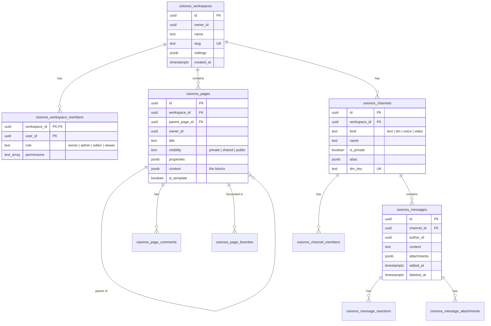

_This project has been created as part of the 42 curriculum by dlesieur, serjimen, danfern3, vjan-nie, shashemi._

# Track Binocle — ft_transcendence

> [!NOTE] > **A workspace where your data stays yours.** Users sign up on a public site and land in
> **osionos**: a block editor with live collaboration, chat, video rooms and an AI assistant. It all
> runs on **grobase**, the Backend-as-a-Service we wrote in Go, Rust and TypeScript, which contains
> no application-specific code.

|          🎯 Points          |    👥 Team    |        🧱 Backend        |   ⚡ Run it    |
| :-------------------------: | :-----------: | :----------------------: | :------------: |
| **16 claimed**, 14 required | **5 members** | **grobase**, built by us | **`make all`** |

Each section opens on what matters; click a ▶ line for the detail.

## Table of contents

1. [Description](#description)
2. [Instructions](#instructions)
3. [Team Information](#team-information)
4. [Project Management](#project-management)
5. [Technical Stack](#technical-stack)
6. [Database Schema](#database-schema)
7. [Features List](#features-list)
8. [Modules](#modules)
9. [Individual Contributions](#individual-contributions)
10. [Resources](#resources)
11. [Known limitations](#known-limitations)
12. [Further documentation](#further-documentation)
13. [To confirm before the evaluation](#to-confirm-before-the-evaluation)

---

## Description

### Goal

Almost every web project rebuilds the same backend before it can start on the product:
authentication, user management, CRUD, access control, file upload, email, logs. Our goal was to
turn that repeated work into infrastructure — **one backend, any frontend, zero per-project server
code** — and to prove it by building a real product on it.

The project therefore has two halves:

- **grobase** (roughly 70% of the work) — a Backend-as-a-Service. An application is declared in a
  JSON _contract_ (its database, isolation strategy, roles, permissions and API keys); a generic
  provisioner creates everything from that file. Routes carry no domain logic: a request names the
  table it targets, and access rules are stored as data, not code.
- **The products** that run on it — a marketing and authentication site, the osionos editor, and
  mail and calendar integrations.

### Overview

| Product             | Tech         | What it is                                                                                                  |
| ------------------- | ------------ | ----------------------------------------------------------------------------------------------------------- |
| **opposite-osiris** | Astro        | Public site: landing page, sign-up / sign-in, legal pages. The entry point.                                 |
| **osionos**         | React + Vite | The block editor: pages, databases-as-blocks, real-time collaboration, chat, video rooms. **The flagship.** |
| **mail**            | React + Vite | Gmail integration over Google OAuth                                                                         |
| **calendar**        | React + Vite | Google Calendar integration over Google OAuth                                                               |

These four products are supported by four platform services (not applications in their own
right): the **auth-gateway** (Node, sessions), the **osionos-bridge** (turns a site session into an
editor session), **Kong** (the single API gateway in front of grobase) and **LiveKit** (the WebRTC
media server for video rooms).

### Key features

- **Contract-driven backend.** A whole application — database, isolation, roles, keys, frontend
  configuration — is one JSON file. `POST /v1/tenants/me/apps` creates a new isolated application
  with its own database and scoped API key, behind `APPS_SELFSERVE_ENABLED`.
- **Per-request owner isolation.** The Rust data plane scopes every query to its owner on every
  request; permissions are rows (ABAC/RBAC), not `if` statements.
- **One API over many databases.** PostgreSQL, MySQL, MongoDB, Redis, SQLite, MSSQL, DynamoDB and
  even remote HTTP APIs are queried through the same envelope and the same API key.
- **Collaborative editor.** Block-based pages, a database block with table / board / calendar
  views, real-time co-editing, channels and direct messages, video rooms.
- **Single-command deployment.** `make all` builds and starts the whole stack in Docker, serves
  every frontend over trusted local HTTPS, and health-checks it.

---

## Instructions

### Prerequisites

Docker 25 or later with Compose v2, GNU Make, git, curl, openssl and a GitHub SSH key, on a Linux
host with 8 GB of RAM and 30 GB of free disk. **Nothing else goes on the host**: everything builds
and runs in containers.

<details>
<summary><b>Full requirements, sudo and ports</b></summary>

| Requirement                             | Detail                                                                                                                                                                                                                                                              | Source                                           |
| --------------------------------------- | ------------------------------------------------------------------------------------------------------------------------------------------------------------------------------------------------------------------------------------------------------------------- | ------------------------------------------------ |
| **Linux host**                          | Tested on Debian 13; the CA-trust step uses `sudo` + `update-ca-certificates`                                                                                                                                                                                       | `utils/mk/certs.mk`                              |
| **Docker Engine ≥ 25** + **Compose v2** | Healthchecks use `start_interval`, which needs Docker 25. Tested with Docker 29.8.                                                                                                                                                                                  | `docker-compose.yml:10`                          |
| **RAM ≥ 8 GB**                          | Measured: the VM peaked at ~6.5 GB of 8 GB during `make all`                                                                                                                                                                                                        | measured, 2026-09-30                             |
| **Disk ≥ 30 GB free for Docker**        | Measured on the dev VM with the stack running (`docker system df`, 2026-10-01): images 13.5 GB, build cache 9.5 GB, volumes 1.4 GB                                                                                                                                  | measured                                         |
| **GNU Make, git, curl, openssl**        | Make drives everything; curl runs the health check; openssl generates the local secrets                                                                                                                                                                             | `utils/mk/app.mk`, `scripts/gen-local-env.sh:68` |
| **A GitHub SSH key**                    | `.gitmodules` uses `git@github.com:` URLs, so the recursive clone needs SSH access to GitHub                                                                                                                                                                        | `.gitmodules`                                    |
| **Google Chrome**                       | Current stable — the browser the project is evaluated on                                                                                                                                                                                                            |                                                  |
| `certutil` (optional)                   | Imports the local CA into the browsers' NSS stores. Absent, `make certs-trust-user` unpacks `libnss3-tools` into `~/.cache/born2root/nss` without root; if that fails it warns and exits 0, and the CA is imported by hand (see [Access](#access-and-the-local-ca)) | `scripts/certs-trust-user.sh`                    |

**Nothing else is installed on the host** — no Node, npm, Go or Cargo. Everything builds and runs
in containers.

`make all` asks for **one `sudo` password** the first time: it copies the local CA into the system
trust store. This is intended (`certs-trust-local` in `utils/mk/certs.mk`). Without
sudo, `CERT_TRUST_MODE=user` trusts the browsers only and `skip` trusts nothing (see
[Access](#access-and-the-local-ca)).

**Ports bound on the host** (from `docker-compose.yml`, all on `127.0.0.1` except inside a
QEMU/VirtualBox NAT VM, where `infrastructure/scripts/detect-bind-addr.sh` binds `0.0.0.0` so the
host can reach the guest): 443, 3001, 3002, 3003, 3007 (always loopback), 4000, 4100, 4200, 4322,
4323 and 7880 (always loopback: plain HTTP), 7881, 8444, 8787 and UDP 50000–50060. grobase adds Kong on `127.0.0.1:8000`
(literal loopback in its `orchestrators/compose/base/gateway.yml`).

</details>

### Defense bring-up (pinned)

The path rehearsed on a clean machine. It checks out the release tag and does **not** follow
submodule branch tips.

```bash
git clone --recursive git@github.com:Univers42/groot.git
cd groot
git checkout "$(git describe --tags --abbrev=0 origin/main)"
git submodule update --init --recursive
make all SKIP_SYNC=1
```

Then open `https://localhost:4322` and create an account. Measured time from a cold machine:
**9–17 minutes**.

> [!WARNING] > **Three claimed modules need the deployed stack.** On a bare `make all`, live editing, the AI
> assistant and OAuth are off, which is 4 points. See [Modules](#modules).

<details>
<summary><b>What this does, and running grobase on another machine</b></summary>

The `git checkout` line checks out the latest release tag on `main`; `git tag -l 'v*'` lists them.

Requirements, the VM + host-browser case, the verify script (`scripts/verify/fresh-bringup.sh`) and
troubleshooting: [`wiki/runbooks/fresh-machine.md`](wiki/runbooks/fresh-machine.md).

grobase on another machine (the born2root VM, a LAN box, a VPS, a Kong URL) with the frontends
here, no sudo: put the kind of connection in `./.env.grobase-link` (`GROBASE_TARGET=ssh://b2b`;
`.env.grobase-link.example` lists the kinds), then `make link` and `make link-frontends-up`. The
latter also applies `models/*.sql` to that grobase (`make link-models-migrate`), sets the demo
account's password there (`make link-demo-login-ensure`; `make demo-login` prints it), hands the
demo rows to the app's API key (`make link-live-data-ensure`) and trusts the
local CA in this user's browser stores (`make certs-trust-user`, no sudo). Both end with
`make link-verify`: one request per grobase service from inside every frontend, the TLS edge,
then the browser stores — [`wiki/runbooks/grobase-link.md`](wiki/runbooks/grobase-link.md).
To serve the frontends to the internet through this host's Tailscale Funnel (443 first, then
8443 and 10000), `make public-env` and `make public-up`; `make public-down` closes it:
[`wiki/runbooks/public-funnel.md`](wiki/runbooks/public-funnel.md).
`make roundtrip` then proves persistence (account, sign-in, editor hand-off, a page, the rows
in postgres) and `make link-e2e` runs the Playwright smoke through the link.

No `.env` needs to be written by hand. With no vault key present, grobase generates its own
secrets into `apps/grobase/.env`, and `env-local-ensure` derives the root `./.env.local` from it,
including random `OSIONOS_*` secrets and the demo account's `DEMO_LOGIN_PASSWORD`
(`scripts/gen-local-env.sh`). An older `.env.local` without it gets one minted on the next
`make all`, which says so by name.

`make all` runs, in order (`utils/mk/pipeline.mk`): submodule sync → secrets →
local TLS certificates → trust the local CA → grobase backend → derive `.env.local` → restore
data if the engines are empty → set the demo account's password → SQL migrations → frontends → health check → URL list.

</details>

### Access and the local CA

| Service                          | URL                               |
| -------------------------------- | --------------------------------- |
| opposite-osiris (start here)     | `https://localhost:4322`          |
| osionos editor                   | `https://localhost:3001`          |
| Whiteboard (hydrawn)             | `https://localhost:3007`          |
| mail (opt-in)                    | `https://localhost:3002`          |
| calendar (opt-in)                | `https://localhost:3003`          |
| osionos-bridge                   | `https://localhost:4000`          |
| auth-gateway                     | `https://localhost:8787/api/auth` |
| grobase API (TLS edge)           | `https://localhost:8444`          |
| LiveKit signalling (video rooms) | `wss://localhost:4000/livekit`    |

<details>
<summary><b>Certificate trust and troubleshooting</b></summary>

Only the TLS ports above are entry points. Kong's own plain-HTTP listener (`127.0.0.1:8000`) and
LiveKit's `127.0.0.1:7880` are bound to the host's loopback for the backend's own tools; a browser
never gets them (`scripts/verify/https-only.sh`, run in CI, fails on any `ws://` or `http://` URL
handed outside the backend).

`make showcase` prints the list of what is actually running.

Every frontend is served with a certificate from the local CA
`apps/grobase/certs/track-binocle-local-ca.pem`. `make all` trusts it in two places: the system
store (one `sudo`) and every browser store this user owns, through `scripts/certs-trust-user.sh`
(no sudo). That script covers Chrome and Chromium (`~/.pki/nssdb`, snap Chromium's
`~/snap/chromium/current/.pki/nssdb`) and every Firefox profile under `~/.mozilla/firefox`, the snap
and the flatpak locations. It matches old copies by the CA's subject, not by nickname, replaces
them, and adds the current file as "Track Binocle Local Development CA".

- `make certs-trust-check` prints one line per store (`ok|FAIL <kind> <path>  current|stale|missing`)
  and exits 1 if any store is not current. Without `certutil` it fails.
- `make certs-trust-user` fixes the stores without sudo; it mints the CA first only if it is missing.
- `CERT_TRUST_MODE=system|user|skip` (or `TRACK_BINOCLE_CERT_TRUST`) picks what `certs-trust-local`
  does: system store plus browsers (default), browsers only, or nothing.
- **Relaunch the browser afterwards.** A browser reads its store at launch only; the script never
  restarts one. `vendor/born2root/setup/host/restart_browsers.sh` does it with session restore.

If the CA is not trusted, the browser shows a warning on each port, and the **Whiteboard tab in
osionos stays blank**, because the embedded `:3007` iframe is refused silently. Two causes of a
warning while `curl --cacert` succeeds:

- **The CA was regenerated.** `make certs` on a fresh tree mints a new CA, and a store still holding
  an older copy does not trust it. On 2026-10-08 the CA was regenerated at 17:06 and 7 stores were
  stale and 1 missing:

  ```text
  $ make certs-trust-check
  FAIL chrome   /home/dlesieur/.pki/nssdb  stale
  FAIL chrome   /home/dlesieur/snap/chromium/current/.pki/nssdb  stale
  FAIL firefox  /home/dlesieur/snap/firefox/common/.mozilla/firefox/pqdn9c63.default-release-1  stale
  FAIL firefox  /home/dlesieur/.var/app/org.mozilla.firefox/config/mozilla/firefox/2vgnvz7b.default  missing
  [certs] 8 browser store(s) do not hold the current CA; run: make certs-trust-user, then relaunch the browser
  ```

- **A snap refresh.** Snap Chromium's `HOME` is the revision directory behind
  `~/snap/chromium/current`, so a new revision (3507 to 3551 overnight) starts without the store.
  `make certs-trust-check` reports it missing; `make certs-trust-user` recreates it.

Flatpak Firefox profiles can exist without the flatpak installed; they are imported too, harmlessly.
The script does not restart browsers, does not touch Safari or the macOS and Windows stores, and
does not trust the CA on another machine (see `wiki/runbooks/fresh-machine.md` for a browser on the
host of a VM). To import by hand: Chrome Settings → Privacy and security → Security → Manage
certificates → Authorities → Import, or run `make certs-trust`.

</details>

### Demo

1. Open `https://localhost:4322`, create an account, and continue to osionos. Or sign in with the
   seeded demo account: `make demo-login` prints its email and password. The password is
   generated per machine and kept only in `./.env.local` (git-ignored); it is never committed.
   It applies to the local stack only, not to production.
2. In osionos, open **View → Whiteboard**, click **+ New Board**, give it a title.
3. Open the same board URL in a second window and draw: the strokes appear live in the other
   window (the e2e smoke asserts within 5 s — `tests/e2e/specs/dw8-realtime.spec.ts`).

> [!NOTE]
> Board editing is **loopback-only** and has **no per-user
> authorization yet** — hydrawn is bound to `127.0.0.1:3007` for exactly that reason
> (`docker-compose.yml:27-32`). We make **no end-to-end-encryption claim**: traffic is TLS to the
> local proxy, nothing more.

### Development and daily use

<details>
<summary><b>Development bring-up</b></summary>

```bash
git checkout develop
make all
```

Without `SKIP_SYNC=1`, `make all` first fast-forwards every submodule to the tip of its tracked
branch (`sync-submodules-soft`), so you build the newest code rather than the pinned commits.
It skips dirty submodules and never blocks the pipeline.

The exception is any submodule that `.gitmodules` marks `update = none`, today `apps/graph_render`. Its
gitlink is the build input, so neither mode moves it:

- `git submodule update --recursive` skips it, which also keeps its SSH-only nested `SciGraphs` out;
- the sync skips it and everything under it;
- `frontends-up` runs `make submodules-pinned` (`scripts/pin-submodules.sh`), which checks it out
  at the recorded commit if it is absent, and fails if it is anywhere else or has edits to tracked files.

What the check does not do:

- It does not move a checked-out copy. After a pointer bump, run the fix it prints:
  `git submodule update --checkout -- apps/graph_render`.
- It ignores nested submodules and untracked files.
- It reads `.gitmodules`, so a local `.git/config` `update` override is not seen.
- It cannot guard a raw `docker compose build`.
- It is not offline-safe: the first `make all` after the pin lands clones graph_render over HTTPS,
  and fails if the network is down. A refused connection fails at once. A black-holed one waits
  for the TCP connect timeout (~1.5 min per attempt, and git retries once) before it fails.

The osionos pointer's own `branch = main` override is out of scope here (tracked with the pin audit).

</details>

<details>
<summary><b>Everyday commands</b></summary>

| Command                            | What it does                                                      |
| ---------------------------------- | ----------------------------------------------------------------- |
| `make all`                         | Full lifecycle: certs → backend → frontends → health check → URLs |
| `make healthcheck`                 | Probe backend, site, editor, bridge, auth gateway and whiteboard  |
| `make showcase`                    | Print the URL list for what is actually running                   |
| `make pulls`                       | Update all submodules                                             |
| `make -C apps/grobase editions`    | List the available backend shapes                                 |
| `make all GROBASE_EDITION=full`    | Bring up everything, including extra engines and monitoring       |
| `docker compose ps`                | Service status                                                    |
| `docker compose logs -f <service>` | Follow one service's logs                                         |
| `docker compose down`              | Stop the frontends (data is kept)                                 |

**Backend editions.** `make all` starts grobase in the **`devlean`** edition
(`GROBASE_EDITION ?= devlean` in `utils/mk/grobase.mk`; listed in grobase's
`orchestrators/makes/00-config.mk:68`): the core engines (PostgreSQL, MySQL, MongoDB, Redis,
MinIO), the full application / control / data planes and realtime — without the heavy extra
engines and without the monitoring stack. `GROBASE_EDITION=migrate` adds every snapshot engine;
`GROBASE_EDITION=full` turns everything on. Some module demonstrations need a larger edition or a
feature flag — see [Modules](#modules).

</details>

<details>
<summary><b>Checks</b></summary>

| Command                    | What it proves                                                                                                                                                                                |
| -------------------------- | --------------------------------------------------------------------------------------------------------------------------------------------------------------------------------------------- |
| `make healthcheck`         | grobase auth, bridge, osionos, website (and HTTP→HTTPS redirect), auth gateway, hydrawn board list (`utils/mk/app.mk`)                                                                        |
| `make e2e`                 | Playwright smoke in a pinned container against the running stack: DW3 Whiteboard tab, DW8 two browsers on one board, DW9 the board inside osionos, DW10 Mail/Calendar (`tests/e2e/README.md`) |
| `make mail-up calendar-up` | Start the opt-in Mail and Calendar apps. Without them DW10 **skips** and prints the reason; it never passes silently.                                                                         |
| `make e2e-clean`           | Soft-delete the `e2e-*` boards the smoke leaves behind                                                                                                                                        |

</details>

<details>
<summary><b>Environment configuration</b></summary>

- Real credentials live only in git-ignored `.env*` files; the committed template is
  [`.env.example`](.env.example), which documents every key as **required**, **recommended** or
  **optional**.
- Optional integrations turn themselves off cleanly when left blank:
  - `LIVEKIT_API_KEY` / `LIVEKIT_API_SECRET` — default to a local dev value; video rooms still work.
  - `GOOGLE_CLIENT_ID` / `GOOGLE_CLIENT_SECRET` in `apps/mail/.env.local` and
    `apps/calendar/.env.local` — without them, the mail and calendar OAuth flows are disabled.
  - `SONAR_TOK`, `FLY_API_TOKEN`, `DOCKER_PAT` — CI and operations only.

</details>

<details>
<summary><b>Team setup with the vault</b></summary>

Inside the team, secrets are shared through **vault42**, our zero-knowledge secret store, via the
**42ctl** CLI. A machine that holds a vault identity in `~/.config/42ctl/` pulls the whole `.env`
tree automatically during `make all` (or with `make vault42-pull-all APPLY=1`). A new identity is
created with `42ctl keys init` and enrolled with an invitation from the vault's operator.
Details: [`DATA-MIGRATION.md`](DATA-MIGRATION.md).

The vault42 CLI is wired in beside that path: the `Secrets (vault42)` section of `make help`, and
[`vendor/scripts/vault42/README.md`](vendor/scripts/vault42/README.md). Status and retirement
checklist: [ADR 0017](docs/adr/0017-vault42-cli-beside-the-old-path.md).

</details>

<details>
<summary><b>Finding make targets</b></summary>

`make help` lists every root target by section; `make help-<target>` prints one target's summary,
prerequisites and usage lines (for example `make help-link`). Each target in `utils/mk/*.mk`
carries its summary after `##` on the target line and sits under a `##@ Section` heading; those
markers are the only source of the help output. The convention and the list of deleted targets
are in [ADR 0016](docs/adr/0016-self-documenting-pruned-root-make.md).

</details>

---

## Team Information

One owner per role, as the team confirmed on 2026-11-04.

| Member                                                                             | Role                           | Responsibilities                                                 | Areas in the history                                                       |
| ---------------------------------------------------------------------------------- | ------------------------------ | ---------------------------------------------------------------- | -------------------------------------------------------------------------- |
| Dylan Lesieur, `dlesieur` ([@LESdylan](https://github.com/LESdylan))               | **Product Owner**, Developer   | Product vision, backlog and priorities; validates completed work | grobase, osionos, mail, calendar, root infrastructure and CI               |
| Daniel Fernández, `danfern3` ([@danielfdez17](https://github.com/danielfdez17))    | **Tech Lead**, Developer       | Architecture, stack decisions, code quality, reviews             | monkey-bot, grobase Docker and Kubernetes deployment, osionos editor fixes |
| Vadim Jan Nieto, `vjan-nie` ([@vjan-nie](https://github.com/vjan-nie))             | **Project Manager**, Developer | Planning, tracking, communication, unblocking                    | QA tooling, end-to-end tests, documentation, Docker                        |
| Sergio Jiménez de la Cruz, `serjimen` ([@DjSurgeon](https://github.com/DjSurgeon)) | Developer                      | Frontend, secrets management, deployment                         | The public site, osionos accessibility and editor features                 |
| Seyed Mostafa Hashemian, `shashemi` ([@SMOSTAFAH1](https://github.com/SMOSTAFAH1)) | Developer                      | To confirm                                                       | Security fixes and SAST, the site's legal pages, TLS edge                  |

`rstancu` (Roxana Stancu, [@esettes](https://github.com/esettes)) is on the original roster
([`archive/wiki-2026-09/CONTRIBUTORS.md`](archive/wiki-2026-09/CONTRIBUTORS.md)) and committed
between 2026-03-18 and 2026-05-02; see [Who committed where](#who-committed-where).

---

## Project Management

> [!NOTE]
> Work lands through pull requests into `develop`, then `main`. A change is done when its
> verification gate passes.

|                        | How we worked                                                                                                                                                                                |
| ---------------------- | -------------------------------------------------------------------------------------------------------------------------------------------------------------------------------------------- |
| **Communication**      | Discord, with a weekly meeting                                                                                                                                                               |
| **Task tracking**      | GitHub Issues on [`Univers42/groot`](https://github.com/Univers42/groot/issues) and on each submodule's repository; milestones in [`archive/wiki-2026-09/todo/`](archive/wiki-2026-09/todo/) |
| **Tools**              | GitHub pull requests, [Dependabot](.github/dependabot.yml) and [GitHub Actions](.github/workflows/)                                                                                          |
| **Branches**           | Short-lived `feat/`, `fix/`, `docs/`, `test/` and `chore/` into `develop`, then `develop` into `main`                                                                                        |
| **Repositories**       | A change lands in its submodule first, then the root records the new commit                                                                                                                  |
| **Definition of done** | Numbered verification gates (`apps/grobase/scripts/verify/run-gate-battery.sh`); grobase CI runs named gates on pull requests and the full `--enterprise` battery nightly                    |
| **Who did what**       | See the merged pull requests per login under [Who committed where](#who-committed-where)                                                                                                     |

---

## Technical Stack

### Frontend

| Technology                                         | Used in                 | Why                                                                                                                                     |
| -------------------------------------------------- | ----------------------- | --------------------------------------------------------------------------------------------------------------------------------------- |
| **Astro 6** + **Sass**                             | opposite-osiris         | Mostly static marketing content: Astro ships near-zero JavaScript by default and pre-renders pages, which keeps the public site fast.   |
| **React 19** + **Vite 6** + **TypeScript**         | osionos, mail, calendar | A block editor is a heavily interactive UI; React's component model fits, and Vite gives fast builds.                                   |
| **Tailwind CSS 4**, **Radix UI**, **lucide-react** | osionos                 | Utility-first styling framework plus accessible, unstyled primitives for menus and popovers.                                            |
| **Zustand**                                        | osionos                 | Small, explicit client state store.                                                                                                     |
| **Zod**                                            | osionos                 | Schema validation of user input on the client side.                                                                                     |
| **livekit-client**                                 | osionos                 | WebRTC video rooms.                                                                                                                     |
| **Playwright**                                     | osionos                 | End-to-end browser tests.                                                                                                               |
| **Tailwind CSS 4**                                 | mail, calendar          | `src/styles.css` imports Tailwind's theme and utilities through `@tailwindcss/vite`, without preflight; the app's own rules sit on top. |

### Backend — grobase

grobase is split into **planes** — groups of responsibilities that can be sized and replaced
independently — each written in the language that suits it.

| Plane                 | Technology                                  | Role                                                                                       | Why this language                                                                                                     |
| --------------------- | ------------------------------------------- | ------------------------------------------------------------------------------------------ | --------------------------------------------------------------------------------------------------------------------- |
| **Control plane**     | **Go**                                      | Provisioning, tenancy, identity (`POST /v1/keys/verify` turns an API key into an identity) | Long-running, concurrent I/O; a provisioner needs to be correct and readable, not fast.                               |
| **Data plane**        | **Rust** (axum)                             | Executes every query, applies per-owner scoping and ABAC locally                           | The hot path: predictable latency with no GC pauses, and memory safety where a bug would be a cross-tenant data leak. |
| **Realtime plane**    | **Rust** (axum)                             | Turns data changes into events; WebSocket subscriptions                                    | Same reasons; pluggable event bus.                                                                                    |
| **Application plane** | **TypeScript / NestJS**                     | Query and storage routers, schema, session, permissions, email, GDPR services              | The original backend, progressively replaced by the Go and Rust planes.                                               |
| **Auth**              | **GoTrue** + Node **auth-gateway**          | Sign-up, sign-in, sessions, email OTP                                                      | Battle-tested auth server rather than a hand-rolled one.                                                              |
| **Gateway**           | **Kong**                                    | The only public entry to the backend; key auth and rate limiting                           | Keeps every internal service off the public network.                                                                  |
| **Media**             | **LiveKit**                                 | WebRTC SFU for video rooms                                                                 |                                                                                                                       |
| **AI service**        | **Node** (`services/osionos-ai` in osionos) | Streams model answers as server-sent events                                                | Keeps provider keys on the server; every frame is written to a Redis stream, so a dropped client resumes.             |

### Database

- **PostgreSQL** is the primary database: the control-plane registries (tenants, roles, policies,
  API keys) and all application data (see [Database Schema](#database-schema)).
  **Why:** row-level security (RLS), JSONB for block content and flexible properties, strong
  transactional guarantees, and a mature ecosystem. RLS is what makes per-owner isolation
  enforceable inside the database itself, not only in application code.
- **MySQL, MongoDB, Redis, MinIO** (object storage) run in the default edition; **SQLite, MSSQL,
  DynamoDB** and remote **HTTP** APIs are supported through the same data-plane interface. This is a
  deliberate feature of the platform (one API over many engines), not a need of osionos itself.

### Justification of the major choices

- **Why build a BaaS instead of a single backend?** Because the same backend pieces are rebuilt
  for every project. We moved everything that varies between projects — routes, schemas, access
  rules, configuration — from code into data, so a new application is a contract, not a server.
- **Why three languages?** Each plane has a different job. Go for boring, correct orchestration;
  Rust where performance and memory safety protect tenant isolation; TypeScript where it already
  existed. The data plane was migrated from TypeScript to Rust behind a per-request switch with a
  _shadow mode_ (Rust computes and discards results for comparison), so the migration needed no
  downtime and could be rolled back without a deployment.
- **Why per-request isolation?** Scoping on every request (instead of per connection) means a
  pooled connection can never carry one user's permissions into another user's query.

<details>
<summary><b>Other significant technologies</b></summary>

- **Docker / Docker Compose** — every component runs in a container; one `make all`.
- **A local certificate authority + TLS proxy** — all frontends served over trusted HTTPS locally.
- **vault42 / 42ctl** — our own zero-knowledge secret store and CLI (separate repositories).
- **CI security scanning** — on every pull request, [`.github/workflows/mini-baas-security.yml`](.github/workflows/mini-baas-security.yml)
  runs Semgrep (SAST), `npm`/`pnpm audit`, Snyk (when a token is set) and Trivy; Dependabot
  opens dependency updates. `sonar-project.properties` and `renovate.json` are present, but no
  workflow in this repository runs them.

</details>

---

## Database Schema

A **workspace** has members, pages and channels. A **page** can sit under a parent page and keeps
its blocks as JSONB. A **channel** has members and messages.



<details>
<summary><b>Where the schema lives</b></summary>

The schema lives in two places:

1. **Application schema** — idempotent SQL migrations in [`models/`](models/)
   (`*-migration.sql`), applied to grobase's PostgreSQL by `make all` through
   [`scripts/apply-models-migrations.sh`](scripts/apply-models-migrations.sh). That runner
   deliberately skips the files written for the auth gateway's own database (`user.sql`,
   `gdpr-migration.sql`, `auth-security-migration.sql`, `rls-hardening-migration.sql`, `seeds.sql`);
   its header explains why.
2. **Platform schema** — grobase's control-plane registries (tenants, mounts, roles, policies,
   API keys), created by grobase's own migrations, plus per-application databases created at
   runtime from each contract (e.g. `infra/config/contracts/website.schema.sql` in grobase).

</details>

<details>
<summary><b>Other table groups</b></summary>

Other table groups, by migration file:

| Area                                   | Tables                                                                                                                                                                   | Migration                                                                              |
| -------------------------------------- | ------------------------------------------------------------------------------------------------------------------------------------------------------------------------ | -------------------------------------------------------------------------------------- |
| Users & sessions (auth gateway DB)     | `users`, `sessions`, `user_activities`, `user_tokens`                                                                                                                    | `user.sql`                                                                             |
| Auth security & GDPR (auth gateway DB) | `auth_audit_events`, `gdpr_requests`, `user_consents`, `newsletter_optins`                                                                                               | `auth-security-migration.sql`, `gdpr-migration.sql`                                    |
| Site ↔ editor bridge                  | `osionos_bridge_identities`, `osionos_bridge_audit_events`                                                                                                               | `osionos-bridge-migration.sql`                                                         |
| Social & communities                   | `osionos_communities`, `osionos_community_members`, `osionos_community_channels`, `osionos_connections`, `osionos_user_blocks`, `osionos_user_reports`, `osionos_feed_*` | `osionos-communities-`, `-social-`, `-feed-engagement-migration.sql`                   |
| Databases-as-blocks                    | `osionos_object_databases`, `osionos_workspace_databases`, `osionos_app_connections`                                                                                     | `osionos-object-databases-`, `-workspace-databases-`, `-app-connections-migration.sql` |
| Publishing & sharing                   | `osionos_published_pages`, `osionos_share_rules`, `osionos_page_links`                                                                                                   | `osionos-publish-`, `-share-rules-`, `-page-links-migration.sql`                       |
| Tasks & notifications                  | `osionos_tasks`, `osionos_notifications`, `osionos_push_subscriptions`                                                                                                   | `osionos-tasks-`, `-push-migration.sql`                                                |
| Mail & calendar                        | `mail_accounts`, `mail_messages`, `calendar_accounts`, `calendar_sources`, `calendar_event_cache`                                                                        | `mail-migration.sql`, `calendar-migration.sql`                                         |

</details>

<details>
<summary><b>Platform (grobase) registries</b></summary>

Access control is stored as data: `roles`, `user_roles` and `resource_policies` tables, evaluated
by the SQL function `public.has_permission(...)` and mirrored by the Rust data plane's own ABAC
evaluator. Every table generated by grobase receives an `owner_id` column automatically, which is
what makes one isolation rule apply to any table.

**Two `users` tables.** `models/user.sql` defines `users.id` as `SERIAL` (integer): it belongs to
the auth gateway's database. The osionos tables reference users by `UUID`, in grobase's
PostgreSQL, where `make all` never applies `user.sql` — doing so fails on the uuid/integer
foreign-key clash (`scripts/apply-models-migrations.sh:27-38`).

</details>

---

## Features List

Who comes from the commits touching each feature's code (`scripts/contributors.sh --paths`). A
commit count is not effort.

| Feature                       | What it does                                                                                                               | Who (commits)                                                              |
| ----------------------------- | -------------------------------------------------------------------------------------------------------------------------- | -------------------------------------------------------------------------- |
| Sign-up / sign-in             | Email and password (hashed and salted) on the public site; email OTP enabled in production with real SMTP                  | dlesieur 11, serjimen 1                                                    |
| Site → editor handoff         | After login, a one-time bridge session hands the user to osionos (`/api/auth/bridge/consume`) — no token in a query string | dlesieur 4                                                                 |
| Legal pages                   | Privacy Policy, Terms of Service, Cookie Policy, Data Rights, linked from the site                                         | shashemi 5, vjan-nie 3, serjimen 2, dlesieur 2                             |
| Block editor                  | Pages built from blocks, nested pages, templates, covers, favourites, search                                               | dlesieur 162, vjan-nie 42, danfern3 29, serjimen 14, rstancu 9, shashemi 2 |
| Database block                | A block that is a database, with table / board / calendar views over any mounted data source                               | dlesieur 126, vjan-nie 2, serjimen 2, rstancu 2                            |
| Real-time collaboration       | Several users editing the same space live, over the protected `collab:<spaceId>` channel                                   | dlesieur 46, shashemi 1                                                    |
| Chat                          | Workspace channels and direct messages, reactions, mentions, attachments, read receipts                                    | dlesieur 72, vjan-nie 1                                                    |
| Video rooms                   | LiveKit-based video channels inside workspaces                                                                             | dlesieur 13                                                                |
| Comments, sharing, publishing | Page comments, share rules, public page publishing                                                                         | dlesieur 44                                                                |
| Communities & social feed     | Communities, connections, feed with likes, comments and shares; blocking and reporting                                     | dlesieur 38, serjimen 2                                                    |
| Mail                          | Read Gmail inside the workspace via Google OAuth                                                                           | dlesieur 35                                                                |
| Calendar                      | Google Calendar events via Google OAuth                                                                                    | dlesieur 18                                                                |
| Contract-driven provisioning  | One JSON contract → isolated database, roles, keys and frontend `.env`                                                     | dlesieur 9                                                                 |
| Self-serve applications       | `POST /v1/tenants/me/apps` creates a new isolated app with its own database and key                                        | dlesieur 33                                                                |
| Multi-engine data API         | One API and one key over PostgreSQL, MySQL, MongoDB, SQLite, MSSQL, DynamoDB, Redis, HTTP                                  | dlesieur 99, vjan-nie 3                                                    |
| Public API                    | Key-authenticated, rate-limited API behind Kong, documented with OpenAPI at `/docs/`                                       | dlesieur 41, vjan-nie 1                                                    |

<details>
<summary><b>Paths counted for each feature</b></summary>

- **Sign-up / sign-in:** opposite-osiris `src/pages/auth`, `src/pages/api/auth`
- **Site → editor handoff:** osionos `scripts/bridge-auth*`
- **Legal pages:** opposite-osiris `src/pages/legal`
- **Block editor:** osionos `src/features/block-editor`
- **Database block:** osionos `src/widgets/database*`, `src/features/*database*`, `src/shared/database*`
- **Real-time collaboration:** osionos `src/features/collab`, `scripts/bridge-*collab*`
- **Chat:** osionos `src/features/chat`, `src/features/group-chat`, `scripts/bridge-*chat*`
- **Video rooms:** osionos `scripts/bridge-*livekit*`, `src/**/*livekit*`, `src/**/*Video*`
- **Comments, sharing, publishing:** osionos `src/features/comments`, `src/features/share`, `scripts/bridge-*publish*`, `scripts/bridge-*share*`
- **Communities & social feed:** osionos `src/features/communities`, `src/features/connections`, `scripts/bridge-*social*`, `scripts/bridge-*feed*`
- **Mail:** `apps/mail`
- **Calendar:** `apps/calendar`
- **Contract-driven provisioning:** grobase `scripts/provision-contract.sh`, `infra/config/contracts`
- **Self-serve applications:** grobase `src/control-plane/internal/tenants`
- **Multi-engine data API:** grobase `src/data-plane-router`
- **Public API:** grobase `infra/docker/services/kong`, `infra/config/openapi`

</details>

---

## Modules

> [!TIP] > **10 modules, 16 points**: 6 Majors and 4 Minors. The subject requires 14, and bonus points stop
> at 19. A module is listed here only when every requirement of the subject was verified in the
> source at the pinned commits and, where it could be, on the running stack (2026-11-04).

| Module                                            | Category                | Type  |    Pts | Works on       |
| ------------------------------------------------- | ----------------------- | ----- | -----: | -------------- |
| Use a framework for both the frontend and backend | Web                     | Major |      2 | `make all`     |
| Real-time features via WebSockets                 | Web                     | Major |      2 | `make all`     |
| Allow users to interact with other users          | Web                     | Major |      2 | `make all`     |
| Standard user management and authentication       | User Management         | Major |      2 | `make all`     |
| Backend as microservices                          | DevOps                  | Major |      2 | `make all`     |
| Complete LLM system interface                     | Artificial Intelligence | Major |      2 | Deployed stack |
| Real-time collaborative features                  | Web                     | Minor |      1 | Deployed stack |
| Remote authentication with OAuth 2.0              | User Management         | Minor |      1 | Deployed stack |
| Custom design system                              | Web                     | Minor |      1 | `make all`     |
| Advanced search                                   | Web                     | Minor |      1 | `make all`     |
| **Total**                                         |                         |       | **16** |                |

> [!WARNING]
> On a bare `make all` the total is **12**, below the 14 required. Demonstrate the three
> deployed-stack modules there, or enable them locally.

<details>
<summary><b>Evidence and who worked on each module</b></summary>

| Module                                  | Evidence                                                                                                                                                                                                                                                                                                                                                                                                                                                                                                                                                                                                                                                                                                                                                                                                                                                                                                                                                                                                          | Who (commits)                                                                                                                                                        |
| --------------------------------------- | ----------------------------------------------------------------------------------------------------------------------------------------------------------------------------------------------------------------------------------------------------------------------------------------------------------------------------------------------------------------------------------------------------------------------------------------------------------------------------------------------------------------------------------------------------------------------------------------------------------------------------------------------------------------------------------------------------------------------------------------------------------------------------------------------------------------------------------------------------------------------------------------------------------------------------------------------------------------------------------------------------------------- | -------------------------------------------------------------------------------------------------------------------------------------------------------------------- |
| Backend as microservices                | groot [`Fresh-Machine Migration`](.github/workflows/fresh-machine.yml) runs `make all` on a clean runner and asserts every core, engine and app container healthy (green on `main`, [run 41676720776](https://github.com/Univers42/groot/actions/runs/41676720776), 2026-11-03). Demo: `docker compose ps` after `make all`                                                                                                                                                                                                                                                                                                                                                                                                                                                                                                                                                                                                                                                                                       | dlesieur 205, vjan-nie 2, shashemi 1 (grobase `orchestrators/compose`, `src/control-plane`)                                                                          |
| Real-time features via WebSockets       | grobase CI runs gate `m201-realtime-issuer`; groot [`Modules of choice`](.github/workflows/modules-of-choice.yml) runs `m175-collab-namespace-isolation` (the realtime-core subscribe/publish authorisation tests). Demo: two users in one chat channel, a message appears without a reload                                                                                                                                                                                                                                                                                                                                                                                                                                                                                                                                                                                                                                                                                                                       | dlesieur 43, vjan-nie 5, shashemi 1 (grobase `infra/docker/services/realtime`)                                                                                       |
| Users interact with other users         | osionos CI (`make test-canvas`, `make test-bridge`, green on `main` 2026-11-03) runs [`chat-catch-up.test.ts`](https://github.com/Univers42/osionos/blob/main/tests/canvas/chat-catch-up.test.ts) and [`bridge-chat-reply-notify.test.mjs`](https://github.com/Univers42/osionos/blob/main/tests/bridge/bridge-chat-reply-notify.test.mjs) (chat), [`bridge-account-profile.test.mjs`](https://github.com/Univers42/osionos/blob/main/tests/bridge/bridge-account-profile.test.mjs) (profile read and update), [`bridge-social-connections.test.mjs`](https://github.com/Univers42/osionos/blob/main/tests/bridge/bridge-social-connections.test.mjs) and [`bridge-connection-transitions.test.mjs`](https://github.com/Univers42/osionos/blob/main/tests/bridge/bridge-connection-transitions.test.mjs) (friends). Live on 2026-11-04 with two accounts: friend request sent, accepted, listed, removed; a DM shown in the other window without a reload ([#171](https://github.com/Univers42/groot/issues/171)) | dlesieur 72, vjan-nie 1 (chat); dlesieur 38, serjimen 2 (connections)                                                                                                |
| Standard user management                | osionos CI runs [`bridge-avatar.test.mjs`](https://github.com/Univers42/osionos/blob/main/tests/bridge/bridge-avatar.test.mjs) (upload, type and size refusal), [`bridge-presence.test.mjs`](https://github.com/Univers42/osionos/blob/main/tests/bridge/bridge-presence.test.mjs) (online status), and the profile and connections tests listed under user interaction. Members without an image get initials (osionos `src/features/collab/model/collabPresence.ts:63`). Live: friend listed with `online=True`, profile page `200` ([#171](https://github.com/Univers42/groot/issues/171))                                                                                                                                                                                                                                                                                                                                                                                                                     | dlesieur 34 (osionos `scripts/bridge-*profile*`, `*avatar*`, `*presence*`, `src/features/profile-binding`)                                                           |
| Remote authentication with OAuth 2.0    | opposite-osiris CI (`pnpm test`, green on `main` 2026-11-03) runs [`oauth-providers.test.ts`](https://github.com/Univers42/prismatica/blob/main/tests/unit/auth/oauth-providers.test.ts) and the `gateway-oauth-*` tests. Live: `GET /api/auth/oauth/providers` answers `["google","github"]`; the working account has a linked GitHub identity ([#171](https://github.com/Univers42/groot/issues/171)). On 2026-11-04 "Continue with GitHub" led to a 404 (the site stopped forwarding GoTrue's provider paths in 85063b0); fixed in opposite-osiris dda7f95, after which the button reaches GitHub's sign-in with `redirect_uri=https://prismatica-eta.vercel.app/auth/v1/callback` and Google answers 302 to `accounts.google.com`. Without provider credentials a bare `make all` hides the buttons, and OAuth is refused while `AUTH_LOGIN_EMAIL_OTP` is on. No 42 provider                                                                                                                                  | dlesieur 29, danfern3 1 (opposite-osiris `scripts/auth-gateway.mjs`, `src/scripts/portal-oauth.ts`, OAuth tests)                                                     |
| Framework for both frontend and backend | Frontend: osionos is React (osionos `package.json`). Backend: the data plane and the realtime gateway are built on axum 0.7, and the NestJS services carry storage and live queries (grobase `src/apps/storage-router`, `src/apps/query-router`): the data plane (grobase [`src/data-plane-router/Cargo.toml:59`](https://github.com/Univers42/grobase/blob/main/src/data-plane-router/Cargo.toml)) and realtime ([`infra/docker/services/realtime/realtime-agnostic/Cargo.toml:44`](https://github.com/Univers42/grobase/blob/main/infra/docker/services/realtime/realtime-agnostic/Cargo.toml)); grobase CI builds and tests both (`cargo test --workspace`), the Fresh-Machine workflow runs them. Live on 2026-11-04: `mini-baas-data-plane-router-rust` and `mini-baas-realtime` running on the production stack. Replaces the frontend-only Minor, which cannot be counted as well                                                                                                                          | dlesieur 1239, danfern3 78, vjan-nie 77, serjimen 76, rstancu 38, shashemi 8 (osionos `src`); dlesieur 126, vjan-nie 8, shashemi 1 (grobase data plane and realtime) |
| Real-time collaborative features        | osionos CI runs the `tests/bridge/bridge-collab-*.test.mjs` and `tests/canvas/collab-*.test.ts` suites; the real-time module's `m175` proves `collab:<spaceId>` is closed to wildcard tokens. Demo: two users on one page, each sees the other's cursor and edits. Live editing needs `VITE_OSIO_COLLAB_SHARED=1` and `COLLAB_PAGE_TOPICS=1`, both set on the public stack only. It merges per block (last write wins with Lamport clocks), not per character                                                                                                                                                                                                                                                                                                                                                                                                                                                                                                                                                     | dlesieur 46, shashemi 1 (osionos `src/features/collab`, `scripts/bridge-*collab*`)                                                                                   |
| Custom design system                    | osionos `packages/osionos-ui` (`@osionos/ui`): 20+ reused components, `Button` alone in 107 files; palettes generated by `scripts/tokens/palettes.mjs` into `src/app/styles/tokens.generated.css`; type tokens in `src/app/styles/global.css`. The glyphs are Lucide, drawn through our own `IconValueView` renderer. Demo: Settings > Preferences, switch the theme                                                                                                                                                                                                                                                                                                                                                                                                                                                                                                                                                                                                                                              | dlesieur 186, serjimen 16, rstancu 10, vjan-nie 10, danfern3 4 (osionos `packages/osionos-ui`, `scripts/tokens`, `src/shared/ui`)                                    |
| Advanced search                         | Search, filters, multi-key sort and the pager share one surface in the database view (`notion-database-sys` `components/topBar/TopBarActions.tsx`, `store/slices/computedSlice.ts`). Global search has no sort or paging, so the demo is a database view: set the view Limit to 5, search, filter, sort, page through                                                                                                                                                                                                                                                                                                                                                                                                                                                                                                                                                                                                                                                                                             | dlesieur 86 (`notion-database-sys` top bar, filters, sort, computed rows)                                                                                            |
| LLM system interface                    | Live on 2026-11-04: `POST /api/ai/runs` answered `200 text/event-stream` and the reply arrived in steps from a real model. Rate limits and error handling in osionos `services/osionos-ai/src/rateLimit.ts` and `src/gateway`. A bare `make all` has no `VITE_AI_URL`, so the assistant answers `[stub]`. Text only on the public stack; a free model's daily cap can stop a demo                                                                                                                                                                                                                                                                                                                                                                                                                                                                                                                                                                                                                                 | dlesieur 159, vjan-nie 4, opencode 2, shashemi 1 (osionos `services/osionos-ai`, `src/features/ai`)                                                                  |

</details>

### Candidates, not counted

These hold real work, but one requirement is still open, and an incomplete module scores zero.

| Candidate                                             | Type  | Pts | What is left                                                                                                                                                                                                                            |
| ----------------------------------------------------- | ----- | --: | --------------------------------------------------------------------------------------------------------------------------------------------------------------------------------------------------------------------------------------- |
| Public API                                            | Major |   2 | No single surface meets every line. Kong has the docs and verbs, but one shared key and 60000 requests a minute on `/rest/v1`, and the docs are on `:8444` only. Personal tokens are real keys, on six routes with no `PUT` or `DELETE` |
| Module of choice: contract-driven application factory | Major |   2 | `APPS_SELFSERVE_ENABLED` is off everywhere, and no screen reaches it                                                                                                                                                                    |
| Module of choice: SSRF guard on the HTTP engine       | Minor |   1 | No screen creates an `http` mount, so there is no end-to-end demo ([#177](https://github.com/Univers42/groot/issues/177))                                                                                                               |

<details>
<summary><b>Public API: what is proven</b></summary>

groot [`Public API`](.github/workflows/public-api.yml): the `:8444` edge serves the OpenAPI document at `/openapi.json` and renders it at `/docs/` ([`tests/api-docs-edge`](tests/api-docs-edge/docs.bats)); [`scripts/verify/public-api.sh`](scripts/verify/public-api.sh) shows `401` without a key, `401` with a wrong one and a `429` past the limit, against Kong 3.8.0 with grobase's plugins ([`tests/public-api`](tests/public-api/public-api.bats)). Live on 2026-11-04 (3 requests): both `401`s on `https://baas.tail10f2ea.ts.net/rest/v1/`. On a stack: `scripts/verify/public-api.sh https://localhost:8444 --key <anon key> --path <a route with a low limit>`

</details>

<details>
<summary><b>Justification: contract-driven application factory (Major)</b></summary>

- **Why this module.** It is the central idea of the project: a backend with zero
  application-specific code, where an application is a declarative contract.
- **Technical challenge.** From one JSON file, a generic provisioner must create an isolated
  database, apply its schema, create roles and policies, mint scoped API keys and emit the
  frontend's `PUBLIC_*` configuration — idempotently, on every boot. The self-serve endpoint
  `POST /v1/tenants/me/apps` does it on demand, with a fresh `CREATE DATABASE` per application.
- **Value.** A new application costs a contract instead of a new server. The public site and
  vault42 are both provisioned this way in production. The self-serve route itself stays off until
  `APPS_SELFSERVE_ENABLED` is set.
- **Why it deserves a Major.** It spans the Go control plane, the Rust data plane and the
  database layer, and it comes with isolation proofs: gate `m177` proves self-serve creation, and
  gate `m176` proves one application cannot read another's data (a foreign mount resolves to zero
  rows — a 404, never a cross read). Both run in groot's
  [`Modules of choice`](.github/workflows/modules-of-choice.yml) workflow in their static mode;
  their live half needs a running stack (`BAAS_VERIFY_LIVE=1`).

</details>

<details>
<summary><b>Justification: SSRF guard on the HTTP engine (Minor)</b></summary>

- **Why this module.** The data plane can mount a remote HTTP API as if it were a database —
  which also means "let a user make our server fetch any URL", the classic SSRF hole.
- **Technical challenge.** The guard blocks loopback, private (RFC 1918), link-local — including
  the cloud metadata endpoint `169.254.169.254` — CGNAT, IPv6 ULA and link-local, IPv4-mapped
  addresses and internal hostnames, then **pins** the connection to the validated public IP so a
  later DNS rebind cannot redirect it inward.
- **Value and weight.** Small and self-contained, and it shows security judgement on a feature we
  chose to build. Its 30 unit tests run in grobase CI; the end-to-end demo (a mount pointing at
  `169.254.169.254` is refused) is not recorded yet ([#177](https://github.com/Univers42/groot/issues/177)).

</details>

### Not claimed

<details>
<summary><b>Every other module of the subject, and why</b></summary>

| Module                                     | Type            | Verdict   | Why                                                                                                                                                                                          |
| ------------------------------------------ | --------------- | --------- | -------------------------------------------------------------------------------------------------------------------------------------------------------------------------------------------- |
| Use an ORM                                 | Minor           | Missing   | Raw SQL (`pg`, `pgx`, `tokio-postgres`) and PostgREST; checked every manifest                                                                                                                |
| Notification system                        | Minor           | Partial   | A real inbox, but only mentions, replies, DMs and feed events arrive live. Pages, databases, shares, workspaces and files emit nothing, and the Settings toggles have no effect              |
| Server-Side Rendering                      | Minor           | Missing   | Astro static output with no adapter, and osionos is a client-side app                                                                                                                        |
| Progressive Web App                        | Minor           | Partial   | Service worker active and manifest clean; offline, the shell opens but a page shows a false access error. Install unproven, SVG icon only                                                    |
| File upload                                | Minor           | Partial   | Page media is readable by URL without a session ([osionos#233](https://github.com/Univers42/osionos/issues/233)) and has no delete; chat attachments hold five of the six points             |
| WCAG 2.1 AA                                | Major           | Partial   | axe in CI on 8 surfaces, but the spec itself says it is not an AA claim; no screen-reader record; mail, calendar and the whiteboard are unaudited                                            |
| Multiple languages                         | Minor           | Partial   | The site's landing page only (English, Spanish, Arabic); osionos says "English only for now"                                                                                                 |
| Right-to-left                              | Minor           | Partial   | Arabic on the landing page; no RTL rules, and the app has no RTL path                                                                                                                        |
| Additional browsers                        | Minor           | Partial   | CI is Chromium only; Firefox and WebKit were measured on one terminal spec                                                                                                                   |
| Advanced permissions                       | Major           | Partial   | Roles and Admin > Users work; no delete-user anywhere, and edit covers two fields                                                                                                            |
| Organization system                        | Major           | Partial   | Workspaces fit, but delete is a staged mark that no sweeper finishes; grobase organizations have no screen                                                                                   |
| Two-factor authentication                  | Minor           | Partial   | No code prompt at sign-in, so enrolling locks the user out                                                                                                                                   |
| User activity dashboard                    | Minor           | Gated off | Needs `OSIONOS_ACTIVITY=1` and 5+ users per cell; 404 on the deployed stack                                                                                                                  |
| RAG                                        | Major           | Partial   | The pipeline is real (pgvector HNSW, automatic indexing); no large dataset is loaded on a reachable stack                                                                                    |
| Recommendation system                      | Major           | Gated off | Real iALS code, no trained model, flag set nowhere                                                                                                                                           |
| Content moderation AI                      | Minor           | Gated off | Log mode forced on the public stack; auto deletion refused by design                                                                                                                         |
| Voice and speech                           | Minor           | Partial   | Read aloud works; the dictation mic always fails on the public stack                                                                                                                         |
| Sentiment analysis                         | Minor           | Gated off | The toggle saves and does nothing on the public stack                                                                                                                                        |
| Image recognition                          | Minor           | Gated off | No vision model on the public stack                                                                                                                                                          |
| WAF + HashiCorp Vault                      | Major           | Partial   | ModSecurity blocks at paranoia 1 on production, and the default stack bypasses it. The HashiCorp container is dormant, default secrets are mode-600 dotfiles, and vault42 is our own product |
| ELK                                        | Major           | Missing   | Loki and Promtail instead                                                                                                                                                                    |
| Prometheus + Grafana                       | Major           | Gated off | Needs `GROBASE_EDITION=prod` or `full`; Grafana allows anonymous viewers and there is no Alertmanager                                                                                        |
| Health, status, backups, recovery          | Minor           | Gated off | Health checks and the recovery runbook exist; the status page and backups are opt-in                                                                                                         |
| Analytics dashboard                        | Major           | Partial   | Database charts export CSV, PNG and SVG; no PDF, and live updates are unproven                                                                                                               |
| Data export and import                     | Minor           | Partial   | Export is solid; import checks the file type only, and CSV import is not available                                                                                                           |
| GDPR                                       | Minor           | Partial   | Export works; deletion never runs, and no confirmation emails are sent                                                                                                                       |
| Advanced chat                              | Minor           | Partial   | Two bullets need a game; a block does not stop an open DM; no profile from chat                                                                                                              |
| Gamification                               | Minor           | Missing   | Not built, and it needs no game                                                                                                                                                              |
| Game modules, AI opponent, game statistics | Major and Minor | Blocked   | The project has no game                                                                                                                                                                      |
| Blockchain                                 | Major and Minor | Missing   | Not built                                                                                                                                                                                    |

</details>

---

## Individual Contributions

### Who committed where

Commits per member reachable from the commit groot pins for each repository, one line per person,
read through the root [`.mailmap`](.mailmap) (counted on 2026-11-04 at root `01654173`):

```sh
git -C <repo> -c mailmap.file="$PWD/.mailmap" shortlog -sn <pinned sha>   # pins: git ls-tree HEAD apps vendor
```

Several members work almost only in submodules, so the root alone understates them.

| Member     | GitHub        | root | osionos | grobase | opposite-osiris | hydrawn | mail | calendar |  QA | monkey-bot | First → last commit     |
| ---------- | ------------- | ---: | ------: | ------: | --------------: | ------: | ---: | -------: | --: | ---------: | ----------------------- |
| `dlesieur` | @LESdylan     | 1577 |    3375 |    1569 |             126 |     676 |   42 |       27 |   1 |          2 | 2026-05-10 → 2026-11-04 |
| `danfern3` | @danielfdez17 |      |      94 |      74 |               8 |      25 |      |          |   1 |         10 | 2026-03-24 → 2026-10-02 |
| `serjimen` | @DjSurgeon    |      |      81 |         |             160 |         |      |          |     |            | 2026-04-11 → 2026-10-29 |
| `vjan-nie` | @vjan-nie     |  173 |     141 |      49 |              23 |       6 |      |          |  39 |            | 2026-03-19 → 2026-11-01 |
| `shashemi` | @SMOSTAFAH1   |   59 |      18 |      18 |              59 |       9 |      |          |     |            | 2026-09-20 → 2026-11-02 |
| `rstancu`  | @esettes      |      |     104 |         |                 |         |      |          |   2 |            | 2026-03-18 → 2026-05-02 |

<details>
<summary><b>Pull requests, and how identities were joined</b></summary>

Work that is not on a pinned commit does not show above: `danfern3`'s 44 root commits sit on
`fix/ci`, open as [#165](https://github.com/Univers42/groot/pull/165), and most of their 133
monkey-bot commits are on branches the pin does not reach. A commit count is not effort: one
large commit and one typo fix weigh the same, and pairing and review do not show in it.

Merged pull requests per login in the project's repositories (groot, osionos, grobase,
prismatica = opposite-osiris, osionos-mail, osionos-calendar, hydrawn, QA, monkey-bot), from
`gh search prs --owner Univers42 --author <login> --merged` on 2026-11-04:

| GitHub        | Merged PRs | Where                                                                               |
| ------------- | ---------: | ----------------------------------------------------------------------------------- |
| @LESdylan     |        260 | osionos 138, grobase 61, groot 56, prismatica 3, osionos-mail 1, osionos-calendar 1 |
| @vjan-nie     |         72 | groot 45, osionos 17, prismatica 6, grobase 4                                       |
| @SMOSTAFAH1   |         57 | prismatica 20, groot 19, osionos 12, grobase 6                                      |
| @DjSurgeon    |          8 | prismatica 7, osionos 1                                                             |
| @danielfdez17 |          4 | prismatica 4                                                                        |

The Who columns of the [Features List](#features-list) and [Modules](#modules) were counted
on 2026-11-04, before the history rewrite of that day, with `scripts/contributors.sh --paths`
(all branches). Until the pre-rewrite refs are deleted from a clone, `--all` counts each of those
commits twice; count from the pinned commit as above instead.

How the identities were joined (the evidence is in [`.mailmap`](.mailmap)):

- Each member committed under several addresses, including GitHub's `noreply` ones; `.mailmap`
  joins them. A commit count is not effort: one large commit and one typo fix weigh the same.
- `settes <ioanaroxana.st@…>` is **`rstancu`** (Roxana Stancu): the address belongs to GitHub
  account [@esettes](https://github.com/esettes), listed for `rstancu` on the original roster
  ([`archive/wiki-2026-09/CONTRIBUTORS.md`](archive/wiki-2026-09/CONTRIBUTORS.md)). The 104
  osionos commits (2026-04-10 → 2026-05-02) touch mostly the Playwright browser tests
  (`tests/browser`), their CI job and committed build assets. `rstancu` is not in the current
  team table.
- `La Cebolla <smhashem545@…>` is **`shashemi`**: opposite-osiris commit `93e6b65` carries
  `Signed-off-by: Seyed Mostafa Hashemian`.
- Two groups of grobase commits pair one member's name with another's address. They are
  attributed by inference:
  - `LESdylan <vjannieto@…>` (3 commits on grobase's pinned commit, 5 on all branches,
    2026-09-21 → 2026-11-02) goes to `dlesieur`: the author name
    is `LESdylan`, and `b4c1d33f` landed through grobase PR #89, opened by `LESdylan`.
  - `dlesieur <daniel17dev@…>` (5 commits, 2026-03-20/21) goes to `danfern3`: they sit inside
    `danielfdez17`'s own Docker and Kubernetes series of the same two days.
- `opencode` (6 commits: 1 root, 5 osionos) is an AI coding agent committing under its own name.
- `bunny`, `Space Bunny` and `builder` (111 hydrawn commits, 2026-09-27/28, addresses on
  `local`, `localhost` and `drawnosaurus.local`) are not mapped: no address, sign-off or pull
  request ties them to a member.
- Bots (`dependabot`, `coderabbitai`, `copilot-swe-agent`) are left as they are.
- On 2026-11-04 the history of groot, osionos and grobase was rewritten to remove
  `Co-authored-by` trailers; trees and subjects are unchanged, and every commit from the first rewritten one onward has a new SHA. 148 root commits on `main` have a one-word subject
  (147 `dlesieur`, 1 `vjan-nie`, 2026-05-01 → 2026-10-09); the
  [`Commit subjects`](.github/workflows/commit-subjects.yml) check refuses new ones.

</details>

### Member by member

<details>
<summary><b>dlesieur — Dylan Lesieur</b></summary>

- **Areas:** grobase (Go control plane, Rust data plane and realtime, Kong gateway, contracts
  and self-serve apps), osionos (editor, chat, collaboration, social, profile, the bridge), mail,
  calendar, the root's infrastructure, TLS edge and CI; hydrawn (676 commits: `apps/web`,
  the engine, `docs/reference`).
- **Pull requests:** 260 merged (osionos 138, grobase 61, groot 56).
- **Features and modules:** most rows of the [Features List](#features-list) and every claimed
  module row, as the Who columns show.

</details>

<details>
<summary><b>danfern3 — Daniel Fernández</b></summary>

- **Areas:** `vendor/monkey-bot` (133 commits on all branches, 10 on the pinned commit: form-XSS
  and mutation testing, configuration);
  grobase Docker images built from scratch, Kubernetes deployment, the playground and Makefile
  (March 2026); osionos breadcrumbs, trash, multi-line text in blocks, the markdown engine and
  code-quality fixes; hydrawn (25 commits, `apps/web`, `apps/api`, `packages/contract`,
  2026-09-24: submodule clone paths, formatting); root submodule pins and the `make all` bats fix,
  on `fix/ci` ([#165](https://github.com/Univers42/groot/pull/165), open).
- **Pull requests:** 4 merged (prismatica).
- **Features and modules:** block editor (29 commits), frameworks, frontend half (78), OAuth
  (1).

</details>

<details>
<summary><b>serjimen — Sergio Jiménez de la Cruz</b></summary>

- **Areas:** the public site, opposite-osiris (160 commits on the pinned commit: hero animation
  performance, unit tests and benchmarks, security fixes, auth pages); osionos accessibility fixes, page links,
  move and delete, shared UI refactor, the node installer's self-update (#277) and database probe
  diagnostics (#278), the changelog.
- **Pull requests:** 8 merged (prismatica 7, osionos 1), among them the landing page in English,
  Spanish and Arabic with right-to-left layout (prismatica #21, #22, #23, #35), the accessible
  privacy policy and terms (#38) and a WCAG 2.2 AA audit pipeline with axe-core fixes (#39).
- **Features and modules:** sign-in pages (1), legal pages (2), block editor (14), connections
  (2), frameworks, frontend half (76).

</details>

<details>
<summary><b>vjan-nie — Vadim Jan Nieto</b></summary>

- **Areas:** `vendor/QA` (39 commits: registry, migrations, hooks, CLI); root end-to-end tests,
  the wiki and README, graph-studio tests, the hydrawn TLS edge and its CORS, submodule
  pins; osionos whiteboard and graph-studio fixes; grobase Docker infrastructure and dependency
  fixes; hydrawn (6 commits: engine bumps, the nested-shape binding fix).
- **Pull requests:** 72 merged (groot 45, osionos 17, prismatica 6, grobase 4).
- **Features and modules:** block editor (42), legal pages (3), real-time (5),
  frameworks, frontend half (77).

</details>

<details>
<summary><b>shashemi — Seyed Mostafa Hashemian</b></summary>

- **Areas:** security fixes across root, grobase and opposite-osiris (SAST findings, nginx scan
  suppressions, IDE socket proxy hardening); the site's legal pages, SEO and accessibility; root
  CI triggers and the models' export erasure paths; osionos end-to-end fixes; hydrawn (9
  commits, `apps/web`, `apps/api`, `packages/contract`: trail and notes, hydrawn #1, and the
  pen-thickness-with-zoom test, #8).
- **Pull requests:** 57 merged (prismatica 20, groot 19, osionos 12, grobase 6).
- **Features and modules:** legal pages (5), collaboration (1), real-time (1).

</details>

### Team-level challenges

From the project's history:

- **Migrating the data plane from TypeScript to Rust with no downtime**, using a per-request
  switch and a shadow mode that compared both implementations under real traffic.
- **Keeping eight database adapters at parity**, enforced by a conformance battery that runs every
  adapter against a real engine and checks it serves exactly what it advertises.
- **Auditing our own authorisation path** and shipping a reversible mitigation for a weakness we
  found (see [`wiki/security/03-known-weaknesses.md`](wiki/security/03-known-weaknesses.md)).

---

## Resources

### How AI was used

This project was built with **heavy AI assistance**, and we state it plainly.

- **Tools.** Team members used AI assistants in different forms, according to their own work.
- **Code.** AI wrote and refactored code across the stack: grobase planes and adapters, the
  frontends, SQL migrations, the Makefile pipeline and the Docker setup.
- **Testing and verification.** AI wrote verification gates and test scripts, including the
  Playwright smoke in [`tests/e2e/`](tests/e2e/), and ran them against the live stack.
- **Reviews.** AI-assisted code review of pull requests and security review of the authorisation
  path ([`wiki/security/03-known-weaknesses.md`](wiki/security/03-known-weaknesses.md)).
- **Documentation.** The wiki and this README were drafted and distilled with AI assistance from
  the project's own design documents and code, then checked against the repository.
- **How we kept control.** A human reviews and merges every pull request; nothing reaches
  `develop` or `main` by an agent alone. A change is accepted only when its verification gate
  passes. Every member must be able to explain the AI-assisted code in their area.

### References

<details>
<summary><b>Documentation we relied on</b></summary>

- Docker Compose — <https://docs.docker.com/compose/>
- PostgreSQL row-level security — <https://www.postgresql.org/docs/current/ddl-rowsecurity.html>
- Kong Gateway — <https://docs.konghq.com/gateway/latest/>
- Supabase Auth (GoTrue) — <https://github.com/supabase/auth>
- The Go Programming Language documentation — <https://go.dev/doc/>
- The Rust Programming Language — <https://doc.rust-lang.org/book/>
- NestJS — <https://docs.nestjs.com/>
- Astro — <https://docs.astro.build/>
- React — <https://react.dev/> · Vite — <https://vite.dev/> · Tailwind CSS — <https://tailwindcss.com/docs>
- LiveKit — <https://docs.livekit.io/>
- NIST SP 800-162, _Guide to Attribute Based Access Control_ — <https://csrc.nist.gov/pubs/sp/800/162/final>
- OWASP SSRF Prevention Cheat Sheet — <https://cheatsheetseries.owasp.org/cheatsheets/Server_Side_Request_Forgery_Prevention_Cheat_Sheet.html>
- OWASP Top 10 — <https://owasp.org/www-project-top-ten/>
- GDPR, full text — <https://gdpr-info.eu/>

</details>

---

## Known limitations

- **No game.** Every game-dependent module is out of scope.
- **English only in the app.** Only the public site's landing page is translated.
- **Several features sit behind flags that are off by default**; see [Modules](#modules).
- **Expressiveness is narrow by design.** grobase has no place for custom server logic; business
  rules must be expressed as policies, schema constraints or database triggers.
- **Whiteboard editing is loopback-only and has no per-user authorization yet** (see [Demo](#demo)).
- **Documented security weaknesses** are in
  [`wiki/security/03-known-weaknesses.md`](wiki/security/03-known-weaknesses.md).

> [!CAUTION]
> Do not enrol two-step verification on an account you need: osionos has no sign-in prompt for the
> code, so the account locks itself out.

<details>
<summary><b>Bugs to fix</b></summary>

- A blocked user can keep writing in an already-open direct message.
- Port 8880 serves the API over plain HTTP on every interface wherever the stack runs. It does not
  answer on the public host.
- The Privacy Policy promises an account deletion that the code never performs.
- Demo passwords in osionos `src/data/seedUsers.json` ship in the client bundle.
- A page saves only under about 1000 JSON values, because of WAF rule 200007: roughly 330 blocks.
- Any formula failure shows as `#ENGINE_UNAVAILABLE`, which reads like an outage.
- A failed page load shows "You don't have access to this page".

</details>

## License

There is no `LICENSE` file at the repository root. grobase carries its own licence files inside
its submodule (`apps/grobase/LICENSE`, `apps/grobase/LICENSING.md`).

---

## Further documentation

- [`wiki/README.md`](wiki/README.md) — the documentation catalogue
- [`wiki/ONBOARDING.md`](wiki/ONBOARDING.md) — seven pages to understand the project, in order
- [`wiki/DEFENSE.md`](wiki/DEFENSE.md) — evaluation questions mapped to answers
- [`wiki/platform/`](wiki/platform/) — grobase: planes, data plane, contracts, isolation, engines
- [`wiki/security/`](wiki/security/) — security model, proofs, known weaknesses, network
- [`DATA-MIGRATION.md`](DATA-MIGRATION.md) — fresh-machine and migration runbook
- `apps/grobase/CLAUDE.md` — grobase's own authoritative technical document (inside the submodule)

---

## To confirm before the evaluation

Only the team knows these, so none of them was guessed.

- [ ] `shashemi`'s responsibilities
- [ ] Who attended the weekly meeting, and where its decisions were written
- [ ] Who assigned work, and who reviewed whose pull requests
- [ ] The address of the deployed stack used for the demo
- [ ] The second member who ran each module's evidence on a fresh `make all`, with the date ([#171](https://github.com/Univers42/groot/issues/171))
- [ ] `rstancu`'s status in the team, and whether that work counts for this evaluation
- [ ] The two grobase author attributions made by inference (`LESdylan <vjannieto@…>`, `dlesieur <daniel17dev@…>`)
- [ ] Which member ran `opencode`, and who committed as `bunny`, `Space Bunny` and `builder` in hydrawn
- [ ] The challenges each member met, and how they were overcome
