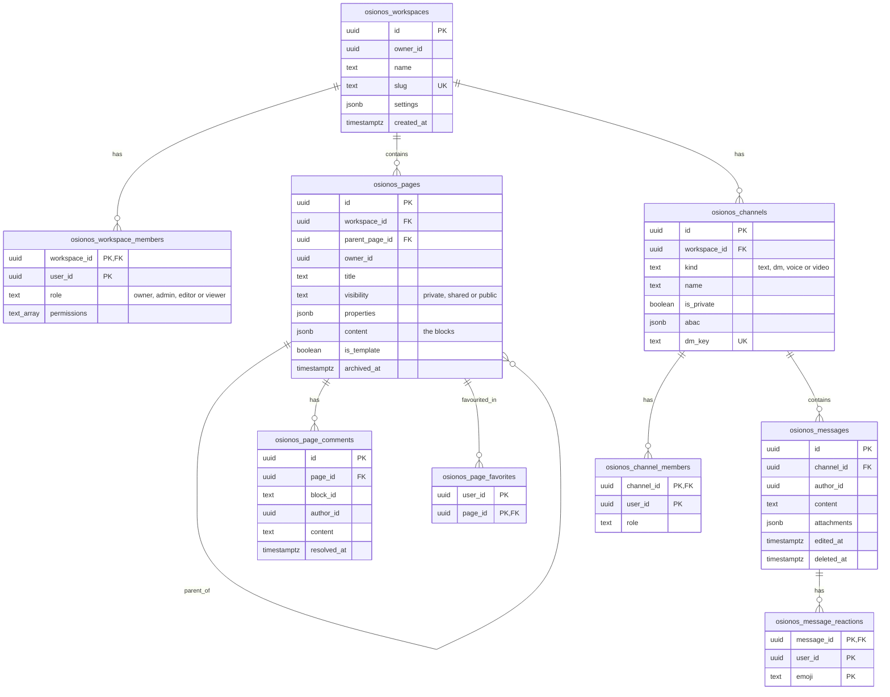

*This project has been created as part of the 42 curriculum by dlesieur, serjimen, danfern3, vjan-nie, shashemi.*

# Osionos

**A workspace where your data stays yours.** Pages, databases, chat and an AI
assistant, running on grobase, the Backend-as-a-Service we built ourselves.

| 16 points | 5 members | Our own backend | 1 command |
|---|---|---|---|
| 10 modules (6 Majors, 4 Minors), 14 required | Over 8,400 commits | Go, Rust, NestJS and Kong | `make all` runs everything |

> Naming: *Osionos* is the project and its editor. *prismatica* is the public
> landing (`apps/opposite-osiris`, repository
> [`Univers42/prismatica`](https://github.com/Univers42/prismatica)), the
> "Public site" below. Infrastructure identifiers keep the old codename
> `track-binocle` (the compose project, image names, `TRACK_BINOCLE_*`
> variables, `*.track-binocle.test` hosts, the local CA file): renaming them
> would break scripts and issued certificates.

---

## Table of contents

1. [Description](#-description)
2. [Instructions](#-instructions)
3. [Team members and roles](#-team-members-and-roles)
4. [Project management](#-project-management)
5. [Technologies](#-technologies)
6. [Database schema](#-database-schema)
7. [Features and who built them](#-features-and-who-built-them)
8. [Modules and points](#-modules-and-points)
9. [Individual contributions](#-individual-contributions)
10. [Resources](#-resources)
11. [Known limitations](#️-known-limitations)
12. [License](#license)
13. [Further documentation](#further-documentation)

---

## 📖 Description

### osionos

The editor: pages built from blocks, database blocks, chat, live collaboration
and an AI assistant.

Built with *React 19, Vite, TypeScript*.

### grobase

Our backend: sign-in, data, real-time and storage, with no osionos-specific
code inside.

Built with *Go, Rust, NestJS, Kong*.

### Public site

Where users start: the landing page in three languages, sign-up and the legal
pages.

Built with *Astro, Sass*.

### Why we built it

Most web projects rebuild the same backend before they reach the product. We
built that backend once as grobase, then built a real product on it: a
workspace whose data lives in a backend the team hosts, not in a third-party
service.

### Key features

- **Block editor**: nested pages, templates, comments, sharing and publishing
- **Database blocks**: table, board and calendar views, with search, filters,
  sort and paging
- **Live collaboration**: several people on one page, with presence
- **Chat and people**: channels, direct messages, profiles and contacts
- **AI assistant**: streamed answers from a language model
- **Design system**: `@osionos/ui`, 20+ components and generated palettes

### All the applications

| Application | Built with | Role |
| --- | --- | --- |
| osionos | React, Vite | The editor, the subject of this page |
| opposite-osiris | Astro, Sass | Public site, sign-up, legal pages |
| osionos bridge | Node | Trust boundary: holds the service key, calls the backend |
| auth-gateway | Node | Sessions and OAuth, hands the user to osionos |
| grobase | Go, Rust, NestJS, Kong | The backend |
| mail, calendar | React, Vite | Opt-in Gmail and Google Calendar apps |
| hydrawn | Own engine | The whiteboard |

---

## 🚀 Instructions

```bash
git clone --recursive git@github.com:Univers42/groot.git
cd groot
git checkout "$(git describe --tags --abbrev=0 origin/main)"
git submodule update --init --recursive
make all SKIP_SYNC=1
```

Then open `https://localhost:4322` and create an account. It takes 9 to 17
minutes on a cold machine, and `make showcase` lists what is running.

> [!WARNING]
> **Some modules need a switch.** On a plain `make all`, live editing (W9),
> the AI service (I3, I2, I5), OAuth (U3) and the app factory are off. The
> demo column in [Modules and points](#-modules-and-points) says what to turn
> on, or demonstrate them on the deployed stack.

### Prerequisites

| You need | Why |
| --- | --- |
| Docker 25+ with Compose v2 | Everything builds and runs in containers |
| GNU Make, git, curl, openssl | They drive the build and generate local secrets |
| 8 GB RAM, 30 GB of disk | Measured peak about 6.5 GB; images and cache take 23 GB |
| A GitHub SSH key | The recursive clone uses `git@github.com` URLs |
| Chrome, current stable | The browser the project is evaluated on |

Nothing else goes on the host, and no `.env` is written by hand: secrets are
generated on first run.

### Where to open each service

| Service | Address |
| --- | --- |
| Public site, start here | <https://localhost:4322> |
| osionos editor | <https://localhost:3001> |
| Whiteboard | <https://localhost:3007> |
| Bridge | <https://localhost:4000> |
| grobase API | <https://localhost:8444> |

### More on running it

The measured runs, the VM case, the verify script
(`scripts/verify/fresh-bringup.sh`) and troubleshooting are in
[`wiki/runbooks/fresh-machine.md`](wiki/runbooks/fresh-machine.md). `make help`
lists every root target; `make help-<target>` explains one.

**Local certificate authority.** Every frontend is served with a certificate
from the local CA `apps/grobase/certs/track-binocle-local-ca.pem`. `make all`
never asks for a `sudo` password on the host: it trusts the CA in this user's
Chrome, Chromium and Firefox stores without sudo (`scripts/certs-trust-user.sh`),
and in the system store too when `sudo` needs no password (`certs-trust-local` in
`utils/mk/certs.mk`). `CERT_TRUST_MODE=system` asks once for the system store,
`skip` trusts nothing. `make certs-trust-check` prints one line per
store; `make certs-trust-user` fixes them. A browser reads its store at launch
only, so relaunch it afterwards. While the CA is untrusted, the Whiteboard tab
in osionos stays blank: the browser refuses the embedded `:3007` frame
silently.

**Checks.**

| Command | What it proves |
| --- | --- |
| `make healthcheck` | grobase auth, bridge, osionos, website (and HTTP→HTTPS redirect), auth gateway, hydrawn board list (`utils/mk/app.mk`) |
| `make e2e` | Playwright smoke in a pinned container against the running stack (`tests/e2e/README.md`) |
| `make mail-up calendar-up` | Start the opt-in Mail (`https://localhost:3002`) and Calendar (`https://localhost:3003`) apps. Without them the Mail/Calendar smoke **skips** and prints the reason |

**Demo account.** `make demo-login` prints the seeded demo account's email and
password. The password is generated per machine and kept only in the
git-ignored `./.env.local`; it applies to the local stack only.

**Optional integrations.** Real credentials live only in git-ignored `.env*`
files; [`.env.example`](.env.example) documents every key as required,
recommended or optional. Left blank, `LIVEKIT_API_KEY` / `LIVEKIT_API_SECRET`
default to a local value, and without `GOOGLE_CLIENT_ID` /
`GOOGLE_CLIENT_SECRET` in `apps/mail/.env.local` and `apps/calendar/.env.local`
the mail and calendar OAuth flows are off.

**Development bring-up.** On `develop`, `make all` without `SKIP_SYNC=1` first
fast-forwards every submodule to the tip of its tracked branch
(`sync-submodules-soft` in `utils/mk/pipeline.mk`), so it builds the newest
code rather than the pinned commits.

---

## 👥 Team members and roles

| role \ name | dylan lesieur | vadim | daniel | sergio | mostafa |
| --- | --- | --- | --- | --- | --- |
| project manager | ❌ | ✅ | ❌ | ❌ | ❌ |
| Product Owner | ✅ | ❌ | ❌ | ❌ | ❌ |
| tech lead | ❌ | ❌ | ✅ | ❌ | ❌ |
| developer | ✅ | ✅ | ✅ | ✅ | ✅ |

**One owner per role**, as the team confirmed on 2026-11-04.

### Logins and areas

The last column is what each member's commits touch ([Individual
contributions](#-individual-contributions) has the numbers).

| Member | Login | GitHub | Areas in the history |
|---|---|---|---|
| Dylan Lesieur | `dlesieur` | [@LESdylan](https://github.com/LESdylan) | grobase, osionos, mail, calendar, root infrastructure and CI |
| Vadim Jan Nieto | `vjan-nie` | [@vjan-nie](https://github.com/vjan-nie) | osionos editable block logic (`src/features/block-editor`), QA tooling, end-to-end tests, documentation |
| Daniel Fernández | `danfern3` | [@danielfdez17](https://github.com/danielfdez17) | monkey-bot (security test bot), grobase Docker and Kubernetes deployment, osionos editor fixes |
| Sergio Jiménez de la Cruz | `serjimen` | [@DjSurgeon](https://github.com/DjSurgeon) | the public site (opposite-osiris), osionos accessibility and editor features |
| Seyed Mostafa Hashemian | `shashemi` | [@SMOSTAFAH1](https://github.com/SMOSTAFAH1) | security fixes and SAST, the site's legal pages, TLS edge |

**Former members.** The team changed along the way: `rstancu` (Roxana Stancu,
[@esettes](https://github.com/esettes)) and Alex Caceres were temporary members
who left. Special thanks to `rstancu`, who contributed significantly to the
osionos frontend and the QA workflow during the first, toughest months. The
defense covers the current five.

---

## 🗂 Project management

The team talks on Discord and meets weekly. Work lands through pull requests
into `develop`, then `main`, and a change is done when its verification gate
passes.

### Agile

| Scrum | Lean production | Kanban |
| --- | --- | --- |
| The Project Manager acts as Scrum Master. | Numbered verification gates define done. | GitHub Issues and labels track the work. |

### How the work flows

- **Branches**: short-lived `feat/`, `fix/` and `docs/`, one change each
- **Repositories**: a change lands in its submodule first, then the root
  records it
- **CI**: GitHub Actions on every pull request, with Dependabot for updates
- **Merged pull requests**: LESdylan 260, vjan-nie 72, SMOSTAFAH1 57,
  DjSurgeon 8, danielfdez17 4

### What the repositories record

| Practice | Evidence (2026-11-04) |
|---|---|
| Issues | 129 on osionos, 38 on groot, 20 on prismatica, 16 on grobase (`gh issue list --state all`) |
| Peer review | Since 2026-09-21 (grobase, hydrawn) and up to 2026-11-04 (groot `develop`), a GitHub ruleset on each main repository requires one approving review and forbids force-pushes and branch deletion (`gh api repos/<repo>/rulesets`). CodeRabbit reviews every pull request since 2026-10-23 |
| Commit subjects | groot rejects one-word commit subjects (`.github/workflows/commit-subjects.yml`) |

---

## 🧰 Technologies

| Layer | Choice | Why |
| --- | --- | --- |
| Editor | React 19, Vite, TypeScript | Block editing is highly interactive, and Vite builds fast |
| Public site | Astro, Sass | Static pages with almost no JavaScript |
| Design | @osionos/ui, Tailwind 4, Radix | Our own components, accessible primitives |
| Bridge | Node | Keeps the service key away from the browser |
| Gateway | Kong | One entry for key checks and rate limits |
| Services | NestJS | Storage, live queries and permissions |
| Control plane | Go | Concurrent and readable provisioning |
| Data, real-time | Rust, axum | Low latency, memory safety between tenants |
| Sign-in | GoTrue | A proven auth server, not a hand-written one |
| Storage | PostgreSQL, Redis, MinIO | Row-level security, fast state, files |
| Delivery | Docker, nginx | One command, HTTPS everywhere |

### Why we made the big choices

- **A BaaS, not a single backend**: what varies between projects moved from
  code into data, so an app is a contract, not a server
- **Three backend languages**: Go for orchestration, Rust where isolation
  matters, TypeScript where services already existed
- **A separate bridge**: the one place that holds the service key and checks
  every caller
- **PostgreSQL**: one engine for tables, JSONB blocks and row-level security

---

## 🗄 Database schema

- **Workspace**: has members, pages and channels
- **Page**: nests under a parent, keeps its blocks as JSONB
- **Channel**: has members and messages, with reactions

### Full diagram of the core tables



### All the table groups

| Area | Tables |
| --- | --- |
| Accounts | users, sessions, user_activities, user_tokens |
| Security, GDPR | auth_audit_events, gdpr_requests, user_consents |
| Site to editor | osionos_bridge_identities, osionos_bridge_audit_events |
| Social | osionos_communities, osionos_connections, osionos_user_blocks, osionos_feed_* |
| Databases as blocks | osionos_object_databases, osionos_workspace_databases |
| Publishing | osionos_published_pages, osionos_share_rules, osionos_page_links |
| Tasks, notifications | osionos_tasks, osionos_notifications, osionos_push_subscriptions |
| Mail, calendar | mail_accounts, mail_messages, calendar_accounts, calendar_event_cache |

Access rules are data too: `roles`, `user_roles` and `resource_policies`. The
schema is in the SQL migrations under `models/`. There are two users tables:
`users` with integer ids belongs to the auth gateway, while osionos refers to
users by UUID.

`make all` applies the idempotent `models/*-migration.sql` files to grobase's
PostgreSQL through
[`scripts/apply-models-migrations.sh`](scripts/apply-models-migrations.sh).
That runner skips seven files that target the integer-id `users` database or
that later files supersede; its header names them. The access rules are
evaluated by the SQL function `public.has_permission(...)` and mirrored by the
Rust data plane's own ABAC evaluator.

---

## ✨ Features and who built them

Who comes from the commits that touch each feature's code.

"Who" counts the non-merge commits that touch the feature's paths (last column),
reachable from the commit groot `main` pins for that repository, read through
the root [`.mailmap`](.mailmap), with bots and AI-agent identities left out;
largest share first. How the identities are joined:
[`wiki/project/contributions-method.md`](wiki/project/contributions-method.md).
A commit count is not effort, and pairing or review does not show in it.

| Feature | Description | Who (commits) | Paths counted |
|---|---|---|---|
| Sign-up / sign-in | Email and password on the public site, stored hashed by GoTrue; an email-OTP second step is off by default (`AUTH_LOGIN_EMAIL_OTP`) | dlesieur 9, serjimen 1 | opposite-osiris `src/pages/auth`, `src/pages/api/auth` |
| Site → editor handoff | After login, a one-time bridge session hands the user to osionos (`/api/auth/bridge/consume`) — the one-time token travels in the URL fragment and is redeemed once by `POST`, never in a query string | dlesieur 4 | osionos `scripts/bridge-auth*` |
| Legal pages | Privacy Policy, Terms of Service, Cookie Policy, Data Rights, linked from the site | shashemi 5, vjan-nie 3, serjimen 2, dlesieur 2 | opposite-osiris `src/pages/legal` |
| Block editor | Pages built from blocks, nested pages, templates, covers, favourites, search | dlesieur 164, vjan-nie 42, danfern3 29, rstancu 9, serjimen 8, shashemi 2 | osionos `src/features/block-editor` |
| Database block | A block that is a database, with table, board and calendar views over any mounted data source (the views live in the `notion-database-sys` submodule, `src/components/views/`) | dlesieur 125, vjan-nie 2, rstancu 2, shashemi 1, serjimen 1 | osionos `src/widgets/database*`, `src/features/*database*`, `src/shared/database*` |
| Real-time collaboration | Several users editing the same space live, over the protected `collab:<spaceId>` channel. Off in the default local build; `VITE_OSIO_COLLAB_SHARED=1` turns it on (osionos `src/shared/config/featureFlags.ts:73`) | dlesieur 45, shashemi 2 | osionos `src/features/collab`, `scripts/bridge-*collab*` |
| Chat | Workspace channels and direct messages, reactions, mentions, attachments, unread markers; new messages arrive over grobase's realtime WebSocket | dlesieur 72, vjan-nie 1 | osionos `src/features/chat`, `src/features/group-chat`, `scripts/bridge-*chat*` |
| Video rooms | LiveKit-based video channels inside workspaces | dlesieur 11, shashemi 1 | osionos `src/widgets/video-room`, `scripts/bridge-rtc*` |
| Comments, sharing, publishing | Page comments, share rules, public page publishing | dlesieur 45 | osionos `src/features/comments`, `src/features/share`, `scripts/bridge-*publish*`, `scripts/bridge-*share*` |
| Communities & social feed | Communities, connections, feed with likes, comments and shares; blocking and reporting | dlesieur 37, serjimen 2, shashemi 1 | osionos `src/features/communities`, `src/features/connections`, `scripts/bridge-*social*`, `scripts/bridge-*feed*` |
| Two-factor authentication and passkeys | TOTP codes and passkeys on the account | dlesieur 15 | osionos `scripts/bridge-account-mfa*`, `scripts/bridge-account-passkeys*`, `src/features/settings/profile/TwoFactorModal.tsx` |
| AI assistant | Streaming answers, retrieval over the workspace with citations, moderation, dictation and read-aloud; started with `--profile ai` | dlesieur 317, vjan-nie 9, shashemi 1 | osionos `services/osionos-ai`, `src/features/ai` |
| Whiteboard | Shared boards in osionos's Whiteboard tab; strokes reach every open copy of the board live | dlesieur 569, danfern3 20, shashemi 6, vjan-nie 4 | hydrawn, whole repository |
| Mail | Read Gmail inside the workspace via Google OAuth (mail `bridge/server.mjs`). Opt-in: `make mail-up` and Google OAuth credentials | dlesieur 39 | `apps/mail`, whole repository |
| Calendar | Google Calendar events via Google OAuth (calendar `bridge/server.mjs`). Opt-in: `make calendar-up` and Google OAuth credentials | dlesieur 22 | `apps/calendar`, whole repository |
| Contract-driven provisioning | One JSON contract → isolated database, roles, keys and frontend `.env` | dlesieur 9 | grobase `scripts/provision-contract.sh`, `infra/config/contracts` |
| Self-serve applications | `POST /v1/tenants/me/apps` creates a new isolated app with its own database and key, behind `APPS_SELFSERVE_ENABLED` (off unless set) | dlesieur 32 | grobase `src/control-plane/internal/tenants` |
| Multi-engine data API | One API and one key over PostgreSQL, MySQL, MongoDB, Redis (default edition), SQLite, SQL Server (`engines` plane), HTTP and DynamoDB (opt-in build) | dlesieur 95, vjan-nie 3 | grobase `src/data-plane-router` |
| Public API | Key-authenticated, rate-limited API behind Kong (not claimed as a module: see [Modules and points](#-modules-and-points)) | dlesieur 64, vjan-nie 5, shashemi 1 | grobase `infra/docker/services/kong`, `infra/config/openapi`; groot `infrastructure/tls/nginx.conf` |

---

## 🎯 Modules and points

**16 modules, 26 points claimed**: 10 Majors and 6 Minors. The subject
asks for 14, and bonus points stop at 19. A module that fails live scores zero,
which is why we claim with margin.

### Why we chose each module

| Module | Points | Why |
| --- | --- | --- |
| W1 Frameworks | 2 | React for the editor, axum and NestJS for the services |
| W4 Real-time | 2 | Chat, presence and live editing need a push channel |
| W5 User interaction | 2 | Chat, profiles and contacts are the product |
| W9 Collaboration | 1 | Live editing is the point of a shared workspace |
| W12 Design system | 1 | One token system keeps every app consistent |
| W13 Advanced search | 1 | Databases are the core object, so finding rows matters |
| U1 User management | 2 | Everything hangs off a user with a profile |
| U3 OAuth 2.0 | 1 | Sign in with Google or GitHub, no new password |
| D3 Microservices | 2 | Each grobase plane scales and is replaced on its own |
| I3 LLM interface | 2 | The assistant is the workspace's main AI feature |
| U5 Organisation system | 2 | Teams share the product through workspaces and teamspaces |
| U4 Advanced permissions | 2 | A shared workspace needs roles and per-page access |
| I2 RAG | 2 | The assistant answers from the workspace and cites it |
| I5 Content moderation | 1 | Communities and comments are read by other users |
| Module of choice: app factory | 2 | [Justification](#module-of-choice-major-contract-driven-app-factory) |
| Module of choice: SSRF guard | 1 | [Justification](#module-of-choice-minor-ssrf-guard-on-the-http-engine) |

### What we claim, how we demo it, and the risk

Paths are prefixed by repository: `G` groot, `GB` grobase (`apps/grobase`,
`21c132b6`), `OS` osionos (`apps/osionos/app`, `735c40fd`), `OO`
opposite-osiris (`apps/opposite-osiris`, `34237735`): the commits pinned by
groot's `main` branch on 2026-11-05. CI names a workflow job: `GB-CI` is
grobase `ci.yml`, `OS-CI` is osionos `ci.yml`, `OO-CI` is prismatica `ci.yml`.
The "local main stack" is `make all SKIP_SYNC=1` on groot `main`.

Risk is how likely the module is to fail in front of an evaluator:

- **low**: on in the local main stack with nothing to switch on, and a CI job
  tests it
- **medium**: needs a switch, a profile or the deployed stack, or no test
  covers part of what the subject asks
- **high**: no evidence cited yet, or the claim leans on a measurement the live
  stack does not reproduce

| Code | Module | Type | Points | How we demo it | Main files | Tests → CI job | Risk |
| --- | --- | --- | --: | --- | --- | --- | --- |
| W1 | Frameworks, front and back | Major | 2 | Local main stack, nothing to switch on: open the editor (React); `docker compose ps` lists the NestJS query-router | Frontend: React 19 (`OS package.json:105-106`). Backend: NestJS 11, grobase's application plane (`GB src/package.json:52`; `GB src/apps/query-router/src/main.ts:30`, `NestFactory`); axum 0.7 is a supporting example (`GB src/data-plane-router/Cargo.toml:59`); docs: [`wiki/platform/02-planes.md`](wiki/platform/02-planes.md) | React: OS-CI "Browser tests", Playwright against the served app in 6 shards (`ci.yml:338-339`). NestJS: GB-CI "Integration Tests" builds query-router from the pin and starts it (`ci.yml:900-904`), then m213 sends `/query/v1/execute` through Kong to it (`ci.yml:917`); the `nestjs` unit suite (`ci.yml:1436`) | low |
| W4 | Real-time (WebSockets) | Major | 2 | Local main stack, nothing to switch on: two browsers in one chat channel; a message sent in one appears in the other | `GB infra/docker/services/realtime/realtime-agnostic/crates/realtime-server/src/server.rs:243` (`/ws`); `GB kong.yml:314-315` (`/realtime/v1/ws`); `OS scripts/bridge-social-core.mjs:192-201` (the bridge publishes); `OS src/services/realtime-messages/wsTransport.ts:81` (chat over the socket, on whenever a session exists); docs: [`wiki/platform/05-realtime.md`](wiki/platform/05-realtime.md) | `GB scripts/verify/m201-realtime-issuer.sh` → GB-CI "Integration Tests" (`ci.yml:855`): it checks the `/ws` handshake (`AUTH_OK`) on the running realtime, not delivery between two users; m189 (`ci.yml:735`); `rust-realtime` suite and m184 (`ci.yml:1436,1479`). osionos's chat browser test runs against a stub bridge (OS-CI "Browser tests (stub bridge URL)", `ci.yml:432-433`) | low |
| W5 | User interaction | Major | 2 | Local main stack, nothing to switch on: edit a profile, add a contact, send a direct message | `OS scripts/bridge-chat.mjs`; `OS scripts/bridge-account-profile.mjs`; `OS scripts/bridge-social.mjs`; `OS src/features/chat`; `OS src/features/connections`; docs: [`wiki/product/02-osionos.md`](wiki/product/02-osionos.md) | `OS tests/canvas/chat-catch-up.test.ts` → OS-CI "quality (root)" Canvas unit tests (`ci.yml:285`); `OS tests/bridge/bridge-chat-reply-notify`, `bridge-account-profile`, `bridge-social-connections`, `bridge-connection-transitions` → Bridge tests (`ci.yml:291`). Unit tests with fakes: no CI job drives two users against a running stack | low |
| W9 | Real-time collaboration | Minor | 1 | Deployed stack; locally, rebuild osionos with `VITE_OSIO_COLLAB_SHARED=1`: two browsers on one page, edit, watch the remote cursor | `OS src/features/collab/model/{remoteCursors,collabPresence,blockSync}.ts`; `OS scripts/bridge-collab.mjs:626`; `GB …/realtime-auth/src/jwt/mod.rs:90-94` (`collab:` closed to wildcard tokens); docs: [`wiki/product/02-osionos.md`](wiki/product/02-osionos.md) | `OS tests/bridge/bridge-collab-*` (9) → OS-CI Bridge tests (`ci.yml:291`) | medium |
| W12 | Design system | Minor | 1 | Local main stack, nothing to switch on: open `packages/osionos-ui/src` (36 components) and `tokens.css`, then show the same buttons, menus and modals across the editor | `@osionos/ui`, the `OS packages/osionos-ui` submodule (`99fa5430`), imported by 128 osionos files (`OS tsconfig.json:49-50`): `src/{atoms,molecules,primitives}` (36 `.tsx` components), `tokens.css` (94 `--osio-*` tokens: colours, radii, font sizes), `scripts/check-token-contract.mjs`; icons are Lucide glyphs behind `src/atoms/IconValueView/LucideGlyph.tsx` | `tests/{buttonTones,dropdownLayout,primitives,pure,lockedMermaid}.test.ts` → osionos-ui CI `make check` (typecheck, test, tokens), green at the pin ([run 41792181656](https://github.com/Univers42/osionos-ui/actions/runs/41792181656)); osionos's own CI does not run them. The icons come from a library and no token sets a font family | medium |
| W13 | Advanced search | Minor | 1 | Local main stack, nothing to switch on: in a database view, search, add a filter rule, sort by a property, page through the rows | The database views, in the `OS src/shared/notion-database-sys` submodule (`6596ea92`): `src/components/topBar/SearchBar.tsx`, `src/components/filters/AdvancedFilterGrid.tsx`, `src/lib/filter/evaluateFilter.ts`, `src/components/sort/SortPanel.tsx`, `src/components/views/shared/ViewPaginationBar.tsx`; page search `OS scripts/bridge-api.mjs` (`pageTitleScore`) | `OS tests/canvas/{db-filter-matrix,filter-summary,select-filter-options,top-bar-search-archived}.test.ts` → OS-CI Canvas unit tests (`ci.yml:285`); `OS tests/bridge/bridge-{search,paging}.test.mjs` → Bridge tests (`ci.yml:291`); `OS tests/e2e/functional/database{SortFilter,FilterSortUx}.spec.mjs` → Browser tests (`ci.yml:339`). OS-CI green at the pin ([run 41935908342](https://github.com/Univers42/osionos/actions/runs/41935908342)) | low |
| U1 | User management | Major | 2 | Local main stack, nothing to switch on: sign up, edit the profile, upload an avatar, see online status | `OS scripts/bridge-account-profile.mjs`; `OS scripts/bridge-avatar.mjs`; `OS scripts/bridge-presence.mjs`; `OS src/features/collab/model/collabPresence.ts:63` (initials when there is no avatar); docs: [`wiki/product/02-osionos.md`](wiki/product/02-osionos.md) | `OS tests/bridge/bridge-avatar` (upload, type and size refusal), `bridge-presence` (online status), `bridge-account-profile` → OS-CI Bridge tests (`ci.yml:291`). Unit tests with fakes | low |
| U3 | OAuth 2.0 | Minor | 1 | Deployed stack (needs Google or GitHub credentials): sign in with Google | `OO scripts/auth/oauth-providers.mjs`; `OO scripts/auth/oauth-link.mjs`; `OO src/scripts/portal-oauth.ts`; `GB orchestrators/compose/base/auth-api.yml:64-67` (GoTrue's Google provider); docs: `OO docs/adr/0002-oauth-link-existing-account.md` | `OO tests/unit/auth/oauth-providers`, `oauth-link`, `gateway-oauth-{start,link,collision}` (5) → OO-CI "Quality Gate" `pnpm test` (`ci.yml:31-32`) | medium |
| D3 | Microservices | Major | 2 | Local main stack, nothing to switch on: `docker compose ps` lists each plane as its own container | `GB orchestrators/compose/base/*.yml` (16 files); `GB orchestrators/makes/30-planes.mk:33`; `GB src/control-plane`; `GB src/data-plane-router`; docs: [`wiki/platform/02-planes.md`](wiki/platform/02-planes.md) | GB-CI unit suites (`ci.yml:1436`) + "Engine conformance" legs (`ci.yml:1532`) | low |
| I3 | LLM interface | Major | 2 | Deployed stack, or locally `docker compose --profile ai up -d --build`: ask a question and watch it stream, reload mid-answer (it resumes), or stop it | osionos `services/osionos-ai/src/routes/runs.ts:178-324`, `src/runs/{runner,upstream,upstreamError,streamPump}.ts`, `src/rateLimit.ts:84`, `src/http.ts:108-129`; client `src/features/ai/model/runStream.ts`. All 12 hops: [`wiki/project/ai-llm-interface.md`](wiki/project/ai-llm-interface.md); docs: [`wiki/project/ai-llm-interface.md`](wiki/project/ai-llm-interface.md), [`wiki/runbooks/osionos-ai.md`](wiki/runbooks/osionos-ai.md), [M1 sheet](https://github.com/Univers42/osionos/blob/develop/docs/ai/modules/m1-images.md) | `services/osionos-ai/tests/{runs,complete,upstreamError*,runRateLimit,failover,quotaFailover}.test.ts` → OS-CI "AI service (tsc + suite)" (`ci.yml:314`); `tests/canvas/ai-{chat-store,run-dispatch,run-stream}.test.ts` → "quality (root)" Canvas unit tests (`ci.yml:285`) | medium |
| U5 | Organisation system | Major | 2 | Local main stack, nothing to switch on (the routes mount unconditionally, `OS scripts/bridge-account-mounts.mjs:72`): create a workspace, then a teamspace, invite a second user, who accepts | `OS scripts/bridge-workspace-teams.mjs:229`; `OS scripts/bridge-workspace-invites.mjs:134`; `OS src/features/settings/teamspaces/TeamspacesPanel.tsx`; docs: [`wiki/platform/06-contracts.md`](wiki/platform/06-contracts.md) | `OS tests/bridge/bridge-workspace-*` (7) → OS-CI "quality (root)" Bridge tests (`ci.yml:291`). Unit tests with fakes | low |
| U4 | Advanced permissions | Major | 2 | Local main stack, nothing to switch on (`OS scripts/bridge-account-mounts.mjs:75`): as admin, change a member's role or a page's share level; that member loses access | `OS scripts/bridge-roles.mjs:28-29` (admin, moderator, user, guest); `OS scripts/bridge-share-rules.mjs:38`; `OS scripts/bridge-page-access.mjs:217`; `OS src/features/admin-users/api.ts`; docs: [`wiki/platform/07-isolation.md`](wiki/platform/07-isolation.md) | `OS tests/bridge/bridge-page-access*` (7), `bridge-share-rules-*` (2), `bridge-mount-roles` → OS-CI Bridge tests (`ci.yml:291`). No test drives the per-role views the subject asks for | medium |
| I2 | RAG | Major | 2 | Same switch as I3: ask a workspace question, click a citation. The large-dataset part is a recorded measurement (110 363 chunks, run on a separate eval stack, reranker off by default), not live | `OS services/osionos-ai/src/retrieval/search.ts:277,469,564`; `OS services/osionos-ai/src/retrieval/rerank.ts:16`; `G models/osionos-ai-rag-migration.sql:60,91`; docs: [M2 sheet](https://github.com/Univers42/osionos/blob/develop/docs/ai/modules/m2-rag.md), `OS services/osionos-ai/eval/wiki/RESULTS-rag.md` | `OS services/osionos-ai/tests/{retrieval,aclAgreement,rerank}.test.ts` → OS-CI "AI service (tsc + suite)" (`ci.yml:314`) | high |
| I5 | Content moderation | Minor | 1 | Same switch as I3, plus `OSIONOS_MODERATION_ACTIONS=hold` and, once its migration is applied, `OSIONOS_MODERATION_STATE=1` (`OS scripts/bridge-moderation-gate.mjs:46`): post a toxic comment; it waits in the admin console (no auto-removal, by design) | `OS scripts/bridge-moderation-gate.mjs:70`; `OS services/osionos-ai/src/moderation/l1.ts:99`; docs: [M4 sheet](https://github.com/Univers42/osionos/blob/develop/docs/ai/modules/m4-moderation.md) | `OS services/osionos-ai/tests/moderation*.test.ts` (4) → OS-CI AI service (`ci.yml:314`); `OS tests/bridge/bridge-moderation*` (5) → Bridge tests (`ci.yml:291`) | medium |
| Choice | Contract-driven app factory | Major | 2 | Local main stack, set `APPS_SELFSERVE_ENABLED` (empty by default, `GB orchestrators/compose/base/control-plane.yml:140`): sign in, `POST /v1/tenants/me/apps` twice; one app's key on the other app's database answers 4xx. Steps: [`wiki/DEFENSE.md`](wiki/DEFENSE.md) | `GB src/control-plane/internal/tenants/selfserve_apps.go:55-58`; `GB src/control-plane/cmd/tenant-control/mount_appsselfserve.go:26`; `GB scripts/verify/m177-selfserve-apps.sh`; docs: [`wiki/platform/06-contracts.md`](wiki/platform/06-contracts.md) | m176 static leg → GB-CI Shellcheck job (`ci.yml:192-193`); m176 and m177 → groot `modules-of-choice.yml:39-40`, static mode only. Their live half (`BAAS_VERIFY_LIVE=1`) is on grobase branch `ci/live-proof-gates-m175-m177`, not pinned yet ([#177](https://github.com/Univers42/groot/issues/177)) | medium |
| Choice | SSRF guard on the HTTP engine | Minor | 1 | No stack needed, but a Rust toolchain: from `apps/grobase/src/data-plane-router`, `cargo test -p data-plane-pool ssrf_blocks_internal_and_metadata_ips -- --nocapture`; it passes while listing `169.254.169.254` as blocked. Steps: [`wiki/DEFENSE.md`](wiki/DEFENSE.md). Live alternative: mount an `http` source at `169.254.169.254`; whether the default edition mounts the `http` engine is unverified (guess: it does not) | `GB src/data-plane-router/crates/data-plane-pool/src/dial_guard/classify.rs:90-155`; `GB …/data-plane-pool/src/http/validate.rs:83-153`; `GB …/data-plane-pool/src/http/adapter.rs:57-61` (pins the checked IP); docs: [`wiki/security/04-network.md`](wiki/security/04-network.md) | `GB …/data-plane-pool/src/http/mod.rs:90` (`ssrf_blocks_internal_and_metadata_ips`, one of 30 tests in that file) and `GB …/dial_guard/classify_tests.rs` → GB-CI unit tests `rust-data-plane` (`ci.yml:1436`); "Engine conformance (http)" (`ci.yml:1531`) | medium |

The codes W6, U4, U5, I2, I5 and D4 follow the subject's order within each
category, as LESdylan's codes do. The subject is not in this repository, so
check them against the team's copy.

### Totals

| | Points |
| --- | --: |
| Claimed | 26 |
| Claimed at low risk (W1, W4, W5, W13, U1, D3, U5) | 13 |
| Claimed at medium risk | 11 |
| Claimed at high risk (I2) | 2 |
| Modules of choice (cap 3) | 3 |
| Above 19 if every high-risk module fails | +5 |
| Above 19 if every medium- and high-risk module fails | -6 |

If every medium- and high-risk module fails, the 13 low-risk points are also
1 short of the 14 required. One switch, `--profile ai`, carries I3, I2 and
I5 (5 points), and they fail together.

### Overlaps we checked

- **W1 replaces W2 and W3**: neither Minor is claimed.
- **Modules of choice**: one Major and one Minor, 3 points, the cap. Neither is
  a catalogue module; the SSRF guard is not the cybersecurity WAF or Vault
  module. An evaluator may still count the SSRF guard as part of the data
  plane rather than its own Minor: say why it is separate, with the unit-test
  demo ready.
- **D3 and the app factory** both live in grobase's control plane: D3 is
  claimed for splitting the backend into planes, the factory for what one
  plane does (create an isolated app on its own database). Different evidence.
- **U5 and U4** both act on workspace members: U5 is claimed for workspaces,
  teamspaces and invites (`bridge-workspace-*`), U4 for roles and page access
  (`bridge-roles`, `bridge-page-access`, `bridge-share-rules`).
- **I2 and I5 run on I3's service**: separate subject modules, one shared
  switch.
- **W5 and U1 both cite `bridge-account-profile.mjs`**: the subject asks for
  profiles in both. Kept as LESdylan claimed them.
- **W6 Public API** would sit on the same API as the factory's endpoint; it is
  a stretch goal and not counted, so nothing counts twice.

No module was dropped for double-counting.

### Stretch: not counted

| Code | Module | Type | Points | What exists | What is missing |
| --- | --- | --- | --: | --- | --- |
| W6 | Public API | Major | 2 | Key-auth and rate limiting on `/rest/v1` (`GB infra/docker/services/kong/conf/kong.yml:221-245`); `GB infra/config/openapi/grobase-public.json`; `GB scripts/verify/m102-gateway-query-path.sh` → GB-CI "Integration Tests" (`ci.yml:934`) | PUT and DELETE on personal tokens; served docs |
| D4 | Health/status page and backups | Minor | 1 | `GB infra/docker/services/status-page/{server,availability}.py`; `GB scripts/verify/m241-status-backup-recovery.sh` → GB `operational-reliability.yml:27` | The `ops` plane is not in the default edition; m192 (GB-CI `ci.yml:582`) was red on grobase `develop` in [run 41870904860](https://github.com/Univers42/grobase/actions/runs/41870904860) |

### What we did not claim

A module with one failing sub-task is not claimed, and the game and blockchain
modules are out because the project has no game. Two-factor authentication and
GDPR are not claimed: both have runtime bugs (see
[Known limitations](#️-known-limitations)).

### The cheapest next points

1. **Public API**: add PUT and DELETE to personal tokens, serve the docs (+2)
1. **Export and import**: CSV import with stricter validation (+1)
1. **PWA**: PNG icons, fix the offline message (+1)
1. **2FA**: the sign-in code prompt, which also fixes the lockout (+1)
1. **GDPR**: run the deletion, send the emails (+1)

### Module of choice (Major): contract-driven app factory

- **Why this module.** It is the central idea of grobase: a backend with no
  application-specific code, where an application is a declarative contract.
- **Technical challenge.** From one contract, a generic provisioner creates an
  isolated database, applies its schema, creates roles and policies, mints
  scoped API keys and emits the frontend's configuration. The self-serve
  endpoint `POST /v1/tenants/me/apps` does it on demand, with a fresh
  `CREATE DATABASE` per application.
- **Value.** A new application costs a contract instead of a new server. The
  public site and vault42 are both provisioned from contracts (m176 checks
  both are present).
- **Why it deserves a Major.** It spans the Go control plane, the Rust data
  plane and the database, and it comes with isolation gates: m177 creates two
  apps and checks one app's key cannot read the other, and m176 checks a
  foreign key resolves zero rows on another app's mount (a 404, never a cross
  read). Both run in their static mode in CI; their live half is on grobase
  `ci/live-proof-gates-m175-m177` ([#177](https://github.com/Univers42/groot/issues/177)).
  Demo steps: [`wiki/DEFENSE.md`](wiki/DEFENSE.md).
- **Who.** dlesieur (LESdylan), the only author of the provisioner and the
  self-serve endpoint at the pinned commit.

### Module of choice (Minor): SSRF guard on the HTTP engine

- **Why this module.** The data plane can mount a remote HTTP API as if it
  were a database, which also means "let a user make our server fetch any
  URL", the classic SSRF hole.
- **Technical challenge.** The guard refuses loopback, private (RFC 1918),
  link-local (the cloud metadata address `169.254.169.254` included), CGNAT,
  IPv6 ULA and IPv4-mapped addresses, then pins the client to the checked
  public IP so a later DNS rebind cannot redirect it inward.
- **Value and weight.** Small, self-contained and demonstrable in seconds, and
  it shows security judgement on a feature we chose to build. It is kept as its
  own Minor, separate from the factory: it guards the HTTP mount engine, not
  app creation. Demo steps: [`wiki/DEFENSE.md`](wiki/DEFENSE.md).
- **Who.** dlesieur (LESdylan), the only author of the guard and its tests at
  the pinned commit.

---

## 🙌 Individual contributions

> [!NOTE]
> A commit count is not effort: pairing, review and design do not show in it.
> Commits concentrate on dlesieur: 86%, 5,895 of the 6,876 non-merge member
> commits at the commits groot `main` (`948487ee`) pins, counted on 2026-11-05
> with the [contributions method](wiki/project/contributions-method.md). Be
> ready to explain the split.

### Per member

- **`dlesieur`**, Product Owner and developer: grobase (control plane, data
  plane, realtime, gateway, contracts), osionos (editor, chat, collaboration,
  the bridge, the AI service), mail, calendar, the root's infrastructure and CI.
- **`vjan-nie`**, Project Manager and developer: the editable block logic of
  osionos (`src/features/block-editor`: the block editor surface, its state
  hook, the context menu, drag handles, code and Mermaid blocks, block
  history). 42 of the 254 non-merge commits on that folder at the osionos
  commit `main` pins (`735c40fd`), second to dlesieur's 164. Also QA tooling,
  end-to-end tests, the wiki and README, and submodule pins.
- **`danfern3`**, tech lead and developer: grobase Docker images and Kubernetes
  deployment, monkey-bot, osionos editor features.
- **`serjimen`**, developer: the public site (opposite-osiris), osionos
  accessibility and editor features.
- **`shashemi`**, developer: security fixes and SAST, the site's legal pages,
  the TLS edge, end-to-end fixes.

### Who committed where

Non-merge commits per member reachable from the commit groot `main` pins for
each repository, read through the root [`.mailmap`](.mailmap), bots and AI-agent
identities left out (counted on 2026-11-05 at `main` = `0bef3cb3`). The command,
the identity joins and what is left out:
[`wiki/project/contributions-method.md`](wiki/project/contributions-method.md).

Several members work almost only in submodules, so the root alone understates them.

| Member | GitHub | root | osionos | grobase | opposite-osiris | hydrawn | mail | calendar | QA | monkey-bot | First → last commit |
|---|---|--:|--:|--:|--:|--:|--:|--:|--:|--:|---|
| `dlesieur` | @LESdylan | 1394 | 2469 | 1279 | 103 | 569 | 39 | 22 | 1 | 2 | 2026-04-05 → 2026-11-05 |
| `vjan-nie` | @vjan-nie | 136 | 119 | 29 | 12 | 4 | | | 38 | | 2026-03-19 → 2026-11-04 |
| `serjimen` | @DjSurgeon | | 82 | | 134 | | | | | | 2026-04-09 → 2026-11-03 |
| `danfern3` | @danielfdez17 | | 84 | 73 | 4 | 20 | | | 1 | 10 | 2026-03-18 → 2026-10-02 |
| `shashemi` | @SMOSTAFAH1 | 42 | 17 | 15 | 39 | 8 | | | | | 2026-09-20 → 2026-11-04 |
| `rstancu` (former member) | @esettes | | 90 | | | | | | 2 | | 2026-03-18 → 2026-05-02 |

Dates are author dates in these nine repositories only. Work that is not on a
pinned commit (open branches and pull requests) does not show above. A commit
count is not effort: one large commit and one typo fix weigh the same, and
pairing and review do not show in it.

### Challenges the team faced

- Moving the data plane from TypeScript to Rust with no downtime, using a
  per-request switch and a shadow mode
- Keeping eight database adapters at parity with a conformance battery against
  real engines
- Auditing our own authorisation path and shipping a reversible fix

---

## 📚 Resources

### How AI was used

- **Code**: AI assistants wrote and refactored code across the stack
- **Tests**: verification gates and test scripts, run against the live stack
- **Review**: AI-assisted pull request review and a security review
- **Documentation**: drafted from the code, then checked against the repository
- **Agents in the history**: `opencode` (6 commits) and Space Bunny on hydrawn
  (111 commits)
- **Control**: a human merges every change, and each member must be able to
  explain the code in their area
- **Tools the repositories record**: Claude Code with the team's kit in groot's
  [`.claude`](.claude) submodule; Gemini (`.gemini/`) and the opencode agent in
  osionos; an OpenCode agent team on hydrawn (`BUNNY.md`); GitHub Copilot and
  CodeRabbit on pull requests
- **Commit trailers**: on 2026-11-04 the history of groot, osionos and grobase
  was rewritten to remove `Co-authored-by` trailers. Since then no commit
  carries a co-author line, so the history does not show which commits were
  written with an AI tool, and must not be read as AI-free
  ([`wiki/project/contributions-method.md`](wiki/project/contributions-method.md))

### References

- [Docker Compose](https://docs.docker.com/compose/), [PostgreSQL row-level security](https://www.postgresql.org/docs/current/ddl-rowsecurity.html), [Kong Gateway](https://docs.konghq.com/gateway/latest/)
- [React](https://react.dev/), [Vite](https://vite.dev/), [Tailwind CSS](https://tailwindcss.com/docs), [Astro](https://docs.astro.build/), [NestJS](https://docs.nestjs.com/)
- [The Go documentation](https://go.dev/doc/), [The Rust Programming Language](https://doc.rust-lang.org/book/), [LiveKit](https://docs.livekit.io/)
- [OWASP Top 10](https://owasp.org/www-project-top-ten/), [NIST guide to ABAC](https://csrc.nist.gov/pubs/sp/800/162/final), [GDPR full text](https://gdpr-info.eu/)
- L. Lamport, "Time, Clocks, and the Ordering of Events in a Distributed System", 1978
- [Supabase Auth (GoTrue)](https://github.com/supabase/auth)

---

## ⚠️ Known limitations

> [!CAUTION]
> **Do not enrol two-step verification on a real account.** The app has no
> sign-in prompt for the code, so the account locks itself out.

### What does not work yet

- **No game**, so every game module is out
- **Only the landing page is translated**: the app is English only
- **Collaboration is per block**: last write wins, not CRDT
- **The whiteboard** has no per-user authorization; its editing is
  loopback-only for that reason (hydrawn is bound to `127.0.0.1:3007`)
- **Expressiveness is narrow by design**: grobase has no per-application
  server code; business rules are policies, schema constraints, database
  triggers, or functions in the flag-gated functions plane
- **Documented security weaknesses**: declared in
  [`wiki/security/03-known-weaknesses.md`](wiki/security/03-known-weaknesses.md)

### Bugs to fix

- Blocked users can keep writing in an open direct message
- Port 8880 serves the API over plain HTTP where the stack runs
- The Privacy Policy promises a deletion the code never performs
- Demo passwords in `src/data/seedUsers.json` ship in the client bundle
- Page saves fail past about 330 blocks, because of a WAF limit
- 148 root commits have a one-word subject

---

## License

Osionos Project License: copyright (c) 2026 Osionos contributors, all rights
reserved. It applies to this repository's own files; each git submodule (listed
in `.gitmodules`) keeps its own licence. Contributors and persons the copyright
holders explicitly authorize may access, inspect, run and contribute to the
software to evaluate, develop, maintain and improve the project; no other use is
granted. The full text is in [`LICENSE`](LICENSE).

grobase (`apps/grobase`, a submodule) carries its own licence: open-core under
the GNU AGPL v3 (`apps/grobase/LICENSE`), with `apps/grobase/LICENSING.md`
mapping which parts carry which licence. monkey-bot (`vendor/monkey-bot`) is
under the MIT License. osionos, opposite-osiris, hydrawn, mail and calendar
have no licence file of their own.

---

## Further documentation

- [`wiki/README.md`](wiki/README.md) — the documentation catalogue
- [`wiki/ONBOARDING.md`](wiki/ONBOARDING.md) — seven pages to understand the project, in order
- [`wiki/DEFENSE.md`](wiki/DEFENSE.md) — evaluation questions mapped to answers
- [`wiki/platform/`](wiki/platform/) — grobase: planes, data plane, contracts, isolation, engines
- [`wiki/security/`](wiki/security/) — security model, proofs, known weaknesses, network
- [`DATA-MIGRATION.md`](DATA-MIGRATION.md) — fresh-machine and migration runbook
- `apps/grobase/CLAUDE.md` — grobase's own authoritative technical document (inside the submodule)
- [prismatica docs](https://prismatica-beta.vercel.app/docs/) — the public
  landing's documentation site
