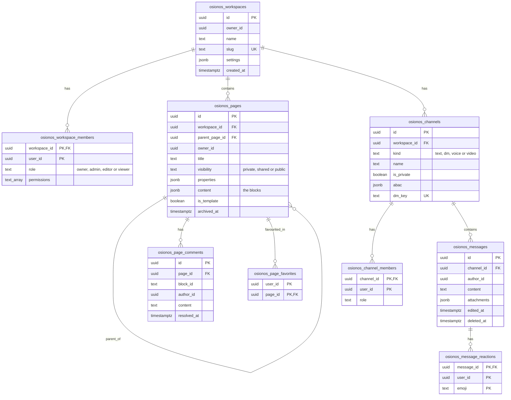

*This project has been created as part of the 42 curriculum by dlesieur, serjimen, danfern3, vjan-nie, shashemi.*

# Osionos

**A workspace where your data stays yours.** Pages, databases, chat and an AI
assistant, running on grobase, the Backend-as-a-Service we built ourselves.

| 52 points | 5 members | Our own backend | 1 command |
|---|---|---|---|
| 10 modules claimed, 14 required | Over 8,400 commits | Go, Rust, NestJS and Kong | `make all` runs everything |

> Naming: *Osionos* is the project and its editor. *prismatica* is the public
> landing (`apps/opposite-osiris`, repository
> [`Univers42/prismatica`](https://github.com/Univers42/prismatica)), the
> "Public site" below. Infrastructure identifiers keep the old codename
> `track-binocle` (the compose project, image names, `TRACK_BINOCLE_*`
> variables, `*.track-binocle.test` hosts, the local CA file): renaming them
> would break scripts and issued certificates.

---

## Table of contents

1. [Description](#description)
2. [Instructions](#instructions)
3. [Team Information](#team-information)
4. [Project Management](#project-management)
5. [Technical Stack](#technical-stack)
6. [Database Schema](#database-schema)
7. [Features List](#features-list)
8. [Modules](#modules)
9. [Individual Contributions](#individual-contributions)
10. [Resources](#resources)
11. [Known limitations](#known-limitations)
12. [Further documentation](#further-documentation)

---

## 📖 Description

### osionos

The editor: pages built from blocks, database blocks, chat, live collaboration
and an AI assistant.

*React 19, Vite, TypeScript*

### grobase

Our backend: sign-in, data, real-time and storage, with no osionos-specific
code inside.

*Go, Rust, NestJS, Kong*

### Public site

Where users start: the landing page in three languages, sign-up and the legal
pages.

*Astro, Sass*

### Why we built it

Most web projects rebuild the same backend before they reach the product. We
built that backend once as grobase, then built a real product on it: a
workspace whose data lives in a backend the team hosts, not in a third-party
service.

### Key features

- **Block editor**: nested pages, templates, comments, sharing and publishing
- **Database blocks**: table, board and calendar views, with search, filters,
  sort and paging
- **Live collaboration**: several people on one page, with presence
- **Chat and people**: channels, direct messages, profiles and contacts
- **AI assistant**: streamed answers from a language model
- **Design system**: `@osionos/ui`, 20+ components and generated palettes

### All the applications

| Application | Built with | Role |
| --- | --- | --- |
| osionos | React, Vite | The editor, the subject of this page |
| opposite-osiris | Astro, Sass | Public site, sign-up, legal pages |
| osionos bridge | Node | Trust boundary: holds the service key, calls the backend |
| auth-gateway | Node | Sessions and OAuth, hands the user to osionos |
| grobase | Go, Rust, NestJS, Kong | The backend |
| mail, calendar | React, Vite | Opt-in Gmail and Google Calendar apps |
| hydrawn | Own engine | The whiteboard |

---

## 🚀 Instructions

```bash
git clone --recursive git@github.com:Univers42/groot.git
cd groot
git checkout "$(git describe --tags --abbrev=0 origin/main)"
git submodule update --init --recursive
make all SKIP_SYNC=1
```

Then open `https://localhost:4322` and create an account. It takes 9 to 17
minutes on a cold machine, and `make showcase` lists what is running.

> [!WARNING]
> **Three modules need the deployed stack.** On a plain `make all`, live
> editing (W9), the AI assistant (I3) and OAuth (U3) are off. That is 4 points,
> so demonstrate them on the deployed stack.

### Prerequisites

| You need | Why |
| --- | --- |
| Docker 25+ with Compose v2 | Everything builds and runs in containers |
| GNU Make, git, curl, openssl | They drive the build and generate local secrets |
| 8 GB RAM, 30 GB of disk | Measured peak about 6.5 GB; images and cache take 23 GB |
| A GitHub SSH key | The recursive clone uses git@github.com URLs |
| Chrome, current stable | The browser the project is evaluated on |

Nothing else goes on the host, and no `.env` is written by hand: secrets are
generated on first run.

### Where to open each service

| Service | Address |
| --- | --- |
| Public site, start here | <https://localhost:4322> |
| osionos editor | <https://localhost:3001> |
| Whiteboard | <https://localhost:3007> |
| Bridge | <https://localhost:4000> |
| grobase API | <https://localhost:8444> |

### More on running it

The measured runs, the VM case, the verify script
(`scripts/verify/fresh-bringup.sh`) and troubleshooting are in
[`wiki/runbooks/fresh-machine.md`](wiki/runbooks/fresh-machine.md). `make help`
lists every root target; `make help-<target>` explains one.

**Local certificate authority.** Every frontend is served with a certificate
from the local CA `apps/grobase/certs/track-binocle-local-ca.pem`. `make all`
asks for one `sudo` password the first time, to copy that CA into the system
trust store (`certs-trust-local` in `utils/mk/certs.mk`), and trusts it in this
user's Chrome, Chromium and Firefox stores without sudo
(`scripts/certs-trust-user.sh`). `CERT_TRUST_MODE=user` trusts the browsers
only, `skip` trusts nothing. `make certs-trust-check` prints one line per
store; `make certs-trust-user` fixes them. A browser reads its store at launch
only, so relaunch it afterwards. While the CA is untrusted, the Whiteboard tab
in osionos stays blank: the browser refuses the embedded `:3007` frame
silently.

**Checks.**

| Command | What it proves |
| --- | --- |
| `make healthcheck` | grobase auth, bridge, osionos, website (and HTTP→HTTPS redirect), auth gateway, hydrawn board list (`utils/mk/app.mk`) |
| `make e2e` | Playwright smoke in a pinned container against the running stack (`tests/e2e/README.md`) |
| `make mail-up calendar-up` | Start the opt-in Mail (`https://localhost:3002`) and Calendar (`https://localhost:3003`) apps. Without them the Mail/Calendar smoke **skips** and prints the reason |

**Demo account.** `make demo-login` prints the seeded demo account's email and
password. The password is generated per machine and kept only in the
git-ignored `./.env.local`; it applies to the local stack only.

**Optional integrations.** Real credentials live only in git-ignored `.env*`
files; [`.env.example`](.env.example) documents every key as required,
recommended or optional. Left blank, `LIVEKIT_API_KEY` / `LIVEKIT_API_SECRET`
default to a local value, and without `GOOGLE_CLIENT_ID` /
`GOOGLE_CLIENT_SECRET` in `apps/mail/.env.local` and `apps/calendar/.env.local`
the mail and calendar OAuth flows are off.

**Development bring-up.** On `develop`, `make all` without `SKIP_SYNC=1` first
fast-forwards every submodule to the tip of its tracked branch
(`sync-submodules-soft` in `utils/mk/pipeline.mk`), so it builds the newest
code rather than the pinned commits.

---

## 👥 Team members and roles

| role \ name | dylan lesieur | vadim | daniel | sergio | mostafa |
| --- | --- | --- | --- | --- | --- |
| project manager | ❌ | ✅ | ❌ | ❌ | ❌ |
| Product Owner | ✅ | ❌ | ❌ | ❌ | ❌ |
| tech lead | ❌ | ❌ | ✅ | ❌ | ❌ |
| developer | ✅ | ✅ | ✅ | ✅ | ✅ |

**One owner per role**, as the team confirmed on 2026-11-04.

### Logins and areas

The last column is what each member's commits touch ([Individual
contributions](#-individual-contributions) has the numbers).

| Member | Login | GitHub | Areas in the history |
|---|---|---|---|
| Dylan Lesieur | `dlesieur` | [@LESdylan](https://github.com/LESdylan) | grobase, osionos, mail, calendar, root infrastructure and CI |
| Vadim Jan Nieto | `vjan-nie` | [@vjan-nie](https://github.com/vjan-nie) | osionos editable block logic (`src/features/block-editor`), QA tooling, end-to-end tests, documentation |
| Daniel Fernández | `danfern3` | [@danielfdez17](https://github.com/danielfdez17) | monkey-bot (security test bot), grobase Docker and Kubernetes deployment, osionos editor fixes |
| Sergio Jiménez de la Cruz | `serjimen` | [@DjSurgeon](https://github.com/DjSurgeon) | the public site (opposite-osiris), osionos accessibility and editor features |
| Seyed Mostafa Hashemian | `shashemi` | [@SMOSTAFAH1](https://github.com/SMOSTAFAH1) | security fixes and SAST, the site's legal pages, TLS edge |

**Former members.** The team changed along the way: `rstancu` (Roxana Stancu,
[@esettes](https://github.com/esettes)) and Alex Caceres were temporary members
who left. Special thanks to `rstancu`, who contributed significantly to the
osionos frontend and the QA workflow during the first, toughest months. The
defense covers the current five.

---

## 🗂 Project management

The team talks on Discord and meets weekly. Work lands through pull requests
into `develop`, then `main`, and a change is done when its verification gate
passes.

### Agile

| Scrum | Lean production | Kanban |
| --- | --- | --- |
| The Project Manager acts as Scrum Master. | Numbered verification gates define done. | GitHub Issues and milestones track the work. |

### How the work flows

- **Branches**: short-lived `feat/`, `fix/` and `docs/`, one change each
- **Repositories**: a change lands in its submodule first, then the root
  records it
- **CI**: GitHub Actions on every pull request, with Dependabot for updates
- **Merged pull requests**: LESdylan 260, vjan-nie 72, SMOSTAFAH1 57,
  DjSurgeon 8, danielfdez17 4

### What the repositories record

| Practice | Evidence (2026-11-04) |
|---|---|
| Issues | 129 on osionos, 38 on groot, 20 on prismatica, 16 on grobase (`gh issue list --state all`) |
| Peer review | Since 2026-09-21 (grobase, hydrawn) and up to 2026-11-04 (groot `develop`), a GitHub ruleset on each main repository requires one approving review and forbids force-pushes and branch deletion (`gh api repos/<repo>/rulesets`). CodeRabbit reviews every pull request since 2026-10-23 |
| Commit subjects | groot rejects one-word commit subjects (`.github/workflows/commit-subjects.yml`) |

---

## 🧰 Technologies

| Layer | Choice | Why |
| --- | --- | --- |
| Editor | React 19, Vite, TypeScript | Block editing is highly interactive, and Vite builds fast |
| Public site | Astro, Sass | Static pages with almost no JavaScript |
| Design | @osionos/ui, Tailwind 4, Radix | Our own components, accessible primitives |
| Bridge | Node | Keeps the service key away from the browser |
| Gateway | Kong | One entry for key checks and rate limits |
| Services | NestJS | Storage, live queries and permissions |
| Control plane | Go | Concurrent and readable provisioning |
| Data, real-time | Rust, axum | Low latency, memory safety between tenants |
| Sign-in | GoTrue | A proven auth server, not a hand-written one |
| Storage | PostgreSQL, Redis, MinIO | Row-level security, fast state, files |
| Delivery | Docker, nginx | One command, HTTPS everywhere |

### Why we made the big choices

- **A BaaS, not a single backend**: what varies between projects moved from
  code into data, so an app is a contract, not a server
- **Three backend languages**: Go for orchestration, Rust where isolation
  matters, TypeScript where services already existed
- **A separate bridge**: the one place that holds the service key and checks
  every caller
- **PostgreSQL**: one engine for tables, JSONB blocks and row-level security

---

## 🗄 Database schema

- **Workspace**: has members, pages and channels
- **Page**: nests under a parent, keeps its blocks as JSONB
- **Channel**: has members and messages, with reactions

### Full diagram of the core tables



### All the table groups

| Area | Tables |
| --- | --- |
| Accounts | users, sessions, user_activities, user_tokens |
| Security, GDPR | auth_audit_events, gdpr_requests, user_consents |
| Site to editor | osionos_bridge_identities, osionos_bridge_audit_events |
| Social | osionos_communities, osionos_connections, osionos_user_blocks, osionos_feed_* |
| Databases as blocks | osionos_object_databases, osionos_workspace_databases |
| Publishing | osionos_published_pages, osionos_share_rules, osionos_page_links |
| Tasks, notifications | osionos_tasks, osionos_notifications, osionos_push_subscriptions |
| Mail, calendar | mail_accounts, mail_messages, calendar_accounts, calendar_event_cache |

Access rules are data too: `roles`, `user_roles` and `resource_policies`. The
schema is in the SQL migrations under `models/`. There are two users tables:
`users` with integer ids belongs to the auth gateway, while osionos refers to
users by UUID.

`make all` applies the idempotent `models/*-migration.sql` files to grobase's
PostgreSQL through
[`scripts/apply-models-migrations.sh`](scripts/apply-models-migrations.sh).
That runner skips seven files that target the integer-id `users` database or
that later files supersede; its header names them. The access rules are
evaluated by the SQL function `public.has_permission(...)` and mirrored by the
Rust data plane's own ABAC evaluator.

---

## ✨ Features and who built them

Who comes from the commits that touch each feature's code.

"Who" counts the non-merge commits that touch the feature's paths (last column),
reachable from the commit groot `main` pins for that repository, read through
the root [`.mailmap`](.mailmap), with bots and AI-agent identities left out;
largest share first. How the identities are joined:
[`wiki/project/contributions-method.md`](wiki/project/contributions-method.md).
A commit count is not effort, and pairing or review does not show in it.

| Feature | Description | Who (commits) | Paths counted |
|---|---|---|---|
| Sign-up / sign-in | Email and password on the public site, stored hashed by GoTrue; an email-OTP second step is off by default (`AUTH_LOGIN_EMAIL_OTP`) | dlesieur 9, serjimen 1 | opposite-osiris `src/pages/auth`, `src/pages/api/auth` |
| Site → editor handoff | After login, a one-time bridge session hands the user to osionos (`/api/auth/bridge/consume`) — the one-time token travels in the URL fragment and is redeemed once by `POST`, never in a query string | dlesieur 4 | osionos `scripts/bridge-auth*` |
| Legal pages | Privacy Policy, Terms of Service, Cookie Policy, Data Rights, linked from the site | shashemi 5, vjan-nie 3, serjimen 2, dlesieur 2 | opposite-osiris `src/pages/legal` |
| Block editor | Pages built from blocks, nested pages, templates, covers, favourites, search | dlesieur 164, vjan-nie 42, danfern3 29, rstancu 9, serjimen 8, shashemi 2 | osionos `src/features/block-editor` |
| Database block | A block that is a database, with table, board and calendar views over any mounted data source (the views live in the `notion-database-sys` submodule, `src/components/views/`) | dlesieur 125, vjan-nie 2, rstancu 2, shashemi 1, serjimen 1 | osionos `src/widgets/database*`, `src/features/*database*`, `src/shared/database*` |
| Real-time collaboration | Several users editing the same space live, over the protected `collab:<spaceId>` channel. Off in the default local build; `VITE_OSIO_COLLAB_SHARED=1` turns it on (osionos `src/shared/config/featureFlags.ts:73`) | dlesieur 45, shashemi 2 | osionos `src/features/collab`, `scripts/bridge-*collab*` |
| Chat | Workspace channels and direct messages, reactions, mentions, attachments, unread markers; new messages arrive over grobase's realtime WebSocket | dlesieur 72, vjan-nie 1 | osionos `src/features/chat`, `src/features/group-chat`, `scripts/bridge-*chat*` |
| Video rooms | LiveKit-based video channels inside workspaces | dlesieur 11, shashemi 1 | osionos `src/widgets/video-room`, `scripts/bridge-rtc*` |
| Comments, sharing, publishing | Page comments, share rules, public page publishing | dlesieur 45 | osionos `src/features/comments`, `src/features/share`, `scripts/bridge-*publish*`, `scripts/bridge-*share*` |
| Communities & social feed | Communities, connections, feed with likes, comments and shares; blocking and reporting | dlesieur 37, serjimen 2, shashemi 1 | osionos `src/features/communities`, `src/features/connections`, `scripts/bridge-*social*`, `scripts/bridge-*feed*` |
| Two-factor authentication and passkeys | TOTP codes and passkeys on the account | dlesieur 15 | osionos `scripts/bridge-account-mfa*`, `scripts/bridge-account-passkeys*`, `src/features/settings/profile/TwoFactorModal.tsx` |
| AI assistant | Streaming answers, retrieval over the workspace with citations, moderation, dictation and read-aloud; started with `--profile ai` | dlesieur 317, vjan-nie 9, shashemi 1 | osionos `services/osionos-ai`, `src/features/ai` |
| Whiteboard | Shared boards in osionos's Whiteboard tab; strokes reach every open copy of the board live | dlesieur 569, danfern3 20, shashemi 6, vjan-nie 4 | hydrawn, whole repository |
| Mail | Read Gmail inside the workspace via Google OAuth (mail `bridge/server.mjs`). Opt-in: `make mail-up` and Google OAuth credentials | dlesieur 39 | `apps/mail`, whole repository |
| Calendar | Google Calendar events via Google OAuth (calendar `bridge/server.mjs`). Opt-in: `make calendar-up` and Google OAuth credentials | dlesieur 22 | `apps/calendar`, whole repository |
| Contract-driven provisioning | One JSON contract → isolated database, roles, keys and frontend `.env` | dlesieur 9 | grobase `scripts/provision-contract.sh`, `infra/config/contracts` |
| Self-serve applications | `POST /v1/tenants/me/apps` creates a new isolated app with its own database and key, behind `APPS_SELFSERVE_ENABLED` (off unless set) | dlesieur 32 | grobase `src/control-plane/internal/tenants` |
| Multi-engine data API | One API and one key over PostgreSQL, MySQL, MongoDB, Redis (default edition), SQLite, SQL Server (`engines` plane), HTTP and DynamoDB (opt-in build) | dlesieur 95, vjan-nie 3 | grobase `src/data-plane-router` |
| Public API | Key-authenticated, rate-limited API behind Kong (not claimed as a module: see [Modules and points](#-modules-and-points)) | dlesieur 64, vjan-nie 5, shashemi 1 | grobase `infra/docker/services/kong`, `infra/config/openapi`; groot `infrastructure/tls/nginx.conf` |

---

## Modules

The subject requires **14 points** (Major = 2, Minor = 1). A module that cannot
be demonstrated live scores zero. Every row is graded against **the local stack
built from `main`** (`git checkout main`, `make all SKIP_SYNC=1`, which starts
grobase's `devlean` edition; see [Defense bring-up](#defense-bring-up-pinned))
by **one rule**, groot's own. It keeps the clause of osionos
[`docs/ai/README.md`](https://github.com/Univers42/osionos/blob/1c1d5d849c1dc43460a194f7ee3d97e17505205c/docs/ai/README.md)
lines 7–8 (a row is never A when its demonstration needs something switched off
or unmeasured), but it is stricter than that file's legend, which grades a
documented profile A:

- **A**: the demo works on that stack with nothing switched on, and a green CI
  job drives that path against a running service.
- **B**: it works, but the demo needs something switched on (a flag, a profile,
  an edition, a provider credential), or its only evidence is unit tests with
  fakes or a run that was never repeated.
- **C**: partial. **Not claimed.** These rows are listed under [Not claimed
  yet](#not-claimed-yet).

**Claimed = A and B only: 30 points against the 14 required. 6 of them are A.**
Paths are prefixed by repository: `G` groot, `GB` grobase (`apps/grobase`), `OS`
osionos (`apps/osionos/app`), `OO` opposite-osiris (`apps/opposite-osiris`).
They point at the commits pinned by groot's `main` branch. CI names a workflow
job: `GB-CI` is grobase `ci.yml`, `OS-CI` is osionos `ci.yml`, `OO-CI` is
prismatica `ci.yml`.

| # | Module | Category | Type | Pts | Grade | Core files | Tests → CI job | Docs | Demo (3 steps) |
|---|---|---|---|--:|:--:|---|---|---|---|
| 1 | Public API (key, rate limit, docs, ≥5 endpoints) | Web | Major | 2 | **A** | `GB infra/docker/services/kong/conf/kong.yml:221-245` (`/rest/v1`: key-auth + rate-limiting); `GB infra/config/openapi/grobase-public.json` | `GB scripts/verify/m102-gateway-query-path.sh` → GB-CI "Integration Tests" (`ci.yml:927`) | `GB infra/config/openapi/README.md` | `make all SKIP_SYNC=1` → `/rest/v1` without `apikey` answers 401, with it 200 → repeat until 429 |
| 2 | Backend as microservices | DevOps | Major | 2 | **A** | `GB orchestrators/compose/base/*.yml` (16 files); `GB orchestrators/makes/30-planes.mk:33`; `GB src/control-plane`; `GB src/data-plane-router` | GB-CI unit suites (`ci.yml:1436`) + "Engine conformance" legs (`ci.yml:1532`) | [`wiki/platform/02-planes.md`](wiki/platform/02-planes.md) | `make -C apps/grobase planes` → `docker compose ps` → `make healthcheck` |
| 3 | Real-time features via WebSockets | Web | Major | 2 | **B** | `GB infra/docker/services/realtime/realtime-agnostic/crates/realtime-server/src/server.rs:243` (`/ws`); `GB kong.yml:314-315` (`/realtime/v1/ws`); `OS scripts/bridge-social-core.mjs:192-201` (the bridge publishes); `OS src/services/realtime-messages/wsTransport.ts:81` (chat over the socket, on whenever a session exists) | `GB scripts/verify/m201-realtime-issuer.sh` → GB-CI "Integration Tests" (`ci.yml:855`): it checks the `/ws` handshake (`AUTH_OK`) on the running realtime, not delivery between two users; m189 (`ci.yml:735`); `rust-realtime` suite and m184 (`ci.yml:1436,1479`). osionos's chat browser test runs against a stub bridge (OS-CI "Browser tests (stub bridge URL)", `ci.yml:432-433`) | [`wiki/platform/05-realtime.md`](wiki/platform/05-realtime.md) | sign in as two users in two browsers → open the same direct message in both → a message sent in one appears in the other without a reload. A second default demo: two windows on one Whiteboard board, where each stroke appears in the other (`G tests/e2e/specs/dw8-realtime.spec.ts`, `make e2e`, run by hand) |
| 4 | Use a framework for both the frontend and backend | Web | Major | 2 | **A** | Frontend: React 19 (`OS package.json:105-106`). Backend: NestJS 11, grobase's application plane (`GB src/package.json:52`; `GB src/apps/query-router/src/main.ts:30`, `NestFactory`); axum 0.7 is a supporting example (`GB src/data-plane-router/Cargo.toml:59`) | React: OS-CI "Browser tests", Playwright against the served app in 6 shards (`ci.yml:338-339`). NestJS: GB-CI "Integration Tests" builds query-router from the pin and starts it (`ci.yml:900-904`), then m213 sends `/query/v1/execute` through Kong to it (`ci.yml:917`); the `nestjs` unit suite (`ci.yml:1436`) | [`wiki/platform/02-planes.md`](wiki/platform/02-planes.md) | `make all SKIP_SYNC=1` → `docker compose ps` lists `mini-baas-query-router` (`GB orchestrators/compose/base/app-services.yml:12`, in the `devlean` edition) → open osionos at `https://localhost:3001` |
| 5 | Allow users to interact with other users (chat, profile, friends) | Web | Major | 2 | **B** | `OS scripts/bridge-chat.mjs`; `OS scripts/bridge-account-profile.mjs`; `OS scripts/bridge-social.mjs`; `OS src/features/chat`; `OS src/features/connections` | `OS tests/canvas/chat-catch-up.test.ts` → OS-CI "quality (root)" Canvas unit tests (`ci.yml:285`); `OS tests/bridge/bridge-chat-reply-notify`, `bridge-account-profile`, `bridge-social-connections`, `bridge-connection-transitions` → Bridge tests (`ci.yml:291`). Unit tests with fakes: no CI job drives two users against a running stack | [`wiki/product/02-osionos.md`](wiki/product/02-osionos.md) | as row 3 → user A sends a friend request, user B accepts → each opens the other's profile |
| 6 | Standard user management and authentication | User management | Major | 2 | **B** | `OS scripts/bridge-account-profile.mjs`; `OS scripts/bridge-avatar.mjs`; `OS scripts/bridge-presence.mjs`; `OS src/features/collab/model/collabPresence.ts:63` (initials when there is no avatar) | `OS tests/bridge/bridge-avatar` (upload, type and size refusal), `bridge-presence` (online status), `bridge-account-profile` → OS-CI Bridge tests (`ci.yml:291`). Unit tests with fakes | [`wiki/product/02-osionos.md`](wiki/product/02-osionos.md) | sign up on `https://localhost:4322` → upload an avatar and edit the profile → a friend sees you online |
| 7 | Real-time collaboration | Web | Minor | 1 | **B** | `OS src/features/collab/model/{remoteCursors,collabPresence,blockSync}.ts`; `OS scripts/bridge-collab.mjs:626`; `GB …/realtime-auth/src/jwt/mod.rs:90-94` (`collab:` closed to wildcard tokens) | `OS tests/bridge/bridge-collab-*` (9) → OS-CI Bridge tests (`ci.yml:291`) | [`wiki/product/02-osionos.md`](wiki/product/02-osionos.md) | rebuild osionos with `VITE_OSIO_COLLAB_SHARED=1` (off by default) → two browsers on one page → watch the remote cursor and edit the same block from both |
| 8 | Advanced permissions | User management | Major | 2 | **B** | `OS scripts/bridge-roles.mjs:28-29`; `OS scripts/bridge-share-rules.mjs:38`; `OS scripts/bridge-page-access.mjs:217`; `OS src/features/admin-users/api.ts` | `OS tests/bridge/bridge-page-access*` (7), `bridge-share-rules-*` (2) → OS-CI Bridge tests | [`wiki/platform/07-isolation.md`](wiki/platform/07-isolation.md) | sign in as admin → change a member's role → that member loses access |
| 9 | Organisation system | User management | Major | 2 | **B** | `OS scripts/bridge-workspace-teams.mjs:229`; `OS scripts/bridge-workspace-invites.mjs:134`; `OS src/features/settings/teamspaces/TeamspacesPanel.tsx` | `OS tests/bridge/bridge-workspace-*` (7) → OS-CI Bridge tests | [`wiki/platform/06-contracts.md`](wiki/platform/06-contracts.md) | create a workspace → create a teamspace → invite a user, who accepts |
| 10 | Remote authentication with OAuth 2.0 | User management | Minor | 1 | **B** | `OO scripts/auth/oauth-providers.mjs`; `OO scripts/auth/oauth-link.mjs`; `OO src/scripts/portal-oauth.ts`; `GB orchestrators/compose/base/auth-api.yml:64-67` (GoTrue's Google provider) | `OO tests/unit/auth/oauth-providers`, `oauth-link`, `gateway-oauth-{start,link,collision}` (5) → OO-CI "Quality Gate" `pnpm test` (`ci.yml:31-32`) | `OO docs/adr/0002-oauth-link-existing-account.md` | set `GOOGLE_OAUTH_ENABLED=true`, `GOOGLE_CLIENT_ID` and `GOOGLE_CLIENT_SECRET` for grobase (Google provider credentials, not shipped) → `make all SKIP_SYNC=1` → "Continue with Google" on `https://localhost:4322` |
| 11 | Health/status page, backups, disaster recovery | DevOps | Minor | 1 | **B** | `GB infra/docker/services/status-page/{server,availability}.py`; `GB orchestrators/compose/base/ops.yml`; `GB scripts/verify/m241-status-backup-recovery.sh` | m241 → GB `operational-reliability.yml:27`; m192 → GB-CI (`ci.yml:582`), **red on grobase `develop`** ([run 41870904860](https://github.com/Univers42/grobase/actions/runs/41870904860)) | [`wiki/operations/04-troubleshooting.md`](wiki/operations/04-troubleshooting.md) | bring up the `ops` plane (not in the default edition) → open the status page → stop a container, then `m241 --live` |
| 12 | GDPR compliance | Data | Minor | 1 | **B** | `OS scripts/bridge-account-export.mjs:143`; `OS scripts/bridge-account-erasure.mjs:79`; `OS src/features/settings/ui/AccountExportSection.tsx`; `OS src/features/settings/ui/danger/AccountDangerZone.tsx` | `OS tests/bridge/bridge-account-export*` (3), `bridge-account-erasure` (1) → OS-CI Bridge tests; `G .github/workflows/models-grants.yml` | [`wiki/security/01-model.md`](wiki/security/01-model.md) | Settings › export my data → open the archive → delete the account |
| 13 | Two-factor authentication | User management | Minor | 1 | **B** | `OS scripts/bridge-account-mfa-totp.mjs:68`; `OS scripts/bridge-account-mfa.mjs:187`; `OS scripts/bridge-account-passkeys.mjs:100`; `OS src/features/settings/profile/TwoFactorModal.tsx` | `OS tests/bridge/bridge-account-mfa-*` (5), `bridge-account-passkeys` (1) → OS-CI Bridge tests | osionos `docs/account-platform` | enable TOTP → sign out → sign in with the code |
| 14 | **Module of choice:** contract-driven application factory | Free choice | Major | 2 | **B** | `GB src/control-plane/internal/tenants/selfserve_apps.go:55-58`; `GB src/control-plane/cmd/tenant-control/mount_appsselfserve.go:26`; `GB scripts/verify/m177-selfserve-apps.sh` | m176 → GB-CI (`ci.yml:192`, static leg, in the Shellcheck job); m176 and m177 → groot `modules-of-choice.yml:39-40`, static mode only | [`wiki/platform/06-contracts.md`](wiki/platform/06-contracts.md), [justification](#justification--module-of-choice-major-contract-driven-application-factory) | set `APPS_SELFSERVE_ENABLED` (empty by default) → OTP login, `POST /v1/tenants/me/apps` twice → one app's key reads the other: 4xx |
| 15 | **Module of choice:** SSRF guard on the HTTP engine | Free choice | Minor | 1 | **B** | `GB src/data-plane-router/crates/data-plane-pool/src/dial_guard/classify.rs:90-155`; `GB src/data-plane-router/crates/data-plane-pool/src/http/validate.rs:83-153` | `GB …/dial_guard/classify_tests.rs` → GB-CI `rust-data-plane` + "Engine conformance (http)" | [`wiki/security/04-network.md`](wiki/security/04-network.md), [justification](#justification--module-of-choice-minor-ssrf-guard-on-the-http-engine) | mount an `http` source at `169.254.169.254` → query it → refused. Whether the default edition mounts the `http` engine is unverified (guess: it does not) |
| 16 | Complete LLM system interface: text, streaming, error handling, rate limiting. Images exist but are **off by default** and not part of this claim | Artificial Intelligence | Major | 2 | **B** | osionos `services/osionos-ai/src/routes/runs.ts:178-324`, `src/runs/{runner,upstream,upstreamError,streamPump}.ts`, `src/rateLimit.ts:84`, `src/http.ts:108-129`; client `src/features/ai/model/runStream.ts`. All 12 hops: [`wiki/project/ai-llm-interface.md`](wiki/project/ai-llm-interface.md) | `services/osionos-ai/tests/{runs,complete,upstreamError*,runRateLimit,failover,quotaFailover}.test.ts` → OS-CI "AI service (tsc + suite)" (`ci.yml:314`); `tests/canvas/ai-{chat-store,run-dispatch,run-stream}.test.ts` → "quality (root)" Canvas unit tests (`ci.yml:285`) | [`wiki/project/ai-llm-interface.md`](wiki/project/ai-llm-interface.md), [`wiki/runbooks/osionos-ai.md`](wiki/runbooks/osionos-ai.md), [M1 sheet](https://github.com/Univers42/osionos/blob/develop/docs/ai/modules/m1-images.md) | `docker compose --profile ai up -d --build` → ask a question and watch it stream → reload mid-answer (it resumes), or stop it |
| 17 | Complete RAG on a large dataset | Artificial Intelligence | Major | 2 | **B** | osionos `services/osionos-ai/src/retrieval/search.ts:277,469,564`, `src/retrieval/rerank.ts:16`; `G models/osionos-ai-rag-migration.sql:60,91` | `services/osionos-ai/tests/{retrieval,aclAgreement,rerank}.test.ts` → OS-CI AI service | [M2 sheet](https://github.com/Univers42/osionos/blob/develop/docs/ai/modules/m2-rag.md), osionos `services/osionos-ai/eval/wiki/RESULTS-rag.md` | `--profile ai` → ask a workspace question → click a citation, then show the 110 363-chunk measurement (run on a separate eval stack; the reranker is off by default) |
| 18 | Content moderation AI | Artificial Intelligence | Minor | 1 | **B** | osionos `scripts/bridge-moderation-gate.mjs:70`; `services/osionos-ai/src/moderation/l1.ts:99` | `services/osionos-ai/tests/moderation*.test.ts` (4) → OS-CI AI service; `tests/bridge/bridge-moderation*` (5) → Bridge tests | [M4 sheet](https://github.com/Univers42/osionos/blob/develop/docs/ai/modules/m4-moderation.md) | set `OSIONOS_MODERATION_ACTIONS=hold` and `OSIONOS_MODERATION_STATE=1` → post a toxic comment → it waits in the admin console (no auto-removal, by design) |
| 19 | Voice / speech | Artificial Intelligence | Minor | 1 | **B** | osionos `services/osionos-ai/src/routes/voice.ts:104`, `src/features/voice/ui/DictationButton.tsx`, `src/features/voice/model/readAloud.ts`; `G docker-compose.yml:788-790` | `services/osionos-ai/tests/voice.test.ts` → OS-CI AI service | [M5 sheet](https://github.com/Univers42/osionos/blob/develop/docs/ai/modules/m5-voice.md) | `--profile ai`, with the speech model fetched into its volume → dictate into a page → read it aloud (read-aloud voices not measured yet) |

No separate framework Minor is claimed beside row 4.

**Point calculation** (free choice is capped at 3,
[`wiki/project/01-subject.md`](wiki/project/01-subject.md#points))

| | Before (2026-10) | After |
|---|--:|--:|
| Catalogue modules claimed (rows 1–13) | 18 | 21: 6 A (rows 1, 2, 4) + 15 B (rows 3, 5–13) |
| Modules of choice (rows 14–15, cap 3) | 3 | 3, all B |
| Artificial Intelligence modules (rows 16–19) | 10 | 6, all B |
| **Total claimed** | **31 listed** | **30 (A + B)** |
| Of which A | 10 | **6** |
| Required | 14 | 14 |

What moved: under the old legend ("works as-is"), six rows were A. Under one
rule, the rows whose demonstration needs a switch or whose only evidence is
unit-level are B: WebSockets (CI checks the handshake, not delivery), real-time
collaboration (off by default), the contract factory and the SSRF guard. Row 4
is new at A. The rows below no longer count.

### Not claimed yet

| Module | Was | Why it is not claimed, in one line |
|---|---|---|
| Monitoring with Prometheus + Grafana, DevOps, Major | 2, C | The default edition ships no observability plane, and its gate m85 runs in no workflow |
| File upload and management, Web, Minor | 1, C | Avatars and page files upload (`OS scripts/bridge-media.mjs:160`), but no general file manager is verified, and gate m159 runs in no workflow |
| ML recommendation system, AI, Major | 2, B | Needs 20+ real users, the offline numbers are synthetic, and the `osionos-ml` Python tests run in no CI |
| Sentiment analysis, AI, Minor | 1, C | The model licence is undeclared |
| Image recognition and tagging, AI, Minor | 1, C | The browser flow is unverified. Locally the VLM starts with `--profile ai` (`G docker-compose.yml:1004-1006`); `--profile ai-vlm` exists only in `docker-compose.public.yml:211-212` |
| AI opponent, AI | — | osionos has no game |
| Multiple languages, Accessibility | — | `i18next` is a dependency (osionos `package.json:92`), but no source file imports it and no translation resource exists |

### Justification — Module of choice (Major): contract-driven application factory

- **Why this module.** It is the central idea of the project: a backend with zero
  application-specific code, where an application is a declarative contract.
- **Technical challenge.** From one JSON file, a generic provisioner must create an isolated
  database, apply its schema, create roles and policies, mint scoped API keys and emit the
  frontend's `PUBLIC_*` configuration — idempotently, on every boot. The self-serve endpoint
  `POST /v1/tenants/me/apps` does it on demand, with a fresh `CREATE DATABASE` per application.
- **Value.** A new application costs a contract instead of a new server.
- **Why it deserves a Major.** It spans the Go control plane, the Rust data plane and the
  database layer, and it comes with isolation proofs: gate `m177` proves self-serve creation, and
  gate `m176` proves one application cannot read another's data (a foreign mount resolves to zero
  rows — a 404, never a cross read).

### Justification — Module of choice (Minor): SSRF guard on the HTTP engine

- **Why this module.** The data plane can mount a remote HTTP API as if it were a database —
  which also means "let a user make our server fetch any URL", the classic SSRF hole.
- **Technical challenge.** The guard blocks loopback, private (RFC 1918), link-local — including
  the cloud metadata endpoint `169.254.169.254` — CGNAT, IPv6 ULA and link-local, IPv4-mapped
  addresses and internal hostnames, then **pins** the connection to the validated public IP so a
  later DNS rebind cannot redirect it inward.
- **Value and weight.** Small, self-contained and demonstrable in seconds (a
  mount pointing at `169.254.169.254` is refused), and it shows security
  judgement on a feature we chose to build.

---

## Individual Contributions

### Who committed where

Non-merge commits per member reachable from the commit groot `main` pins for
each repository, read through the root [`.mailmap`](.mailmap), bots and AI-agent
identities left out (counted on 2026-11-05 at `main` = `0bef3cb3`). The command,
the identity joins and what is left out:
[`wiki/project/contributions-method.md`](wiki/project/contributions-method.md).

Several members work almost only in submodules, so the root alone understates them.

| Member | GitHub | root | osionos | grobase | opposite-osiris | hydrawn | mail | calendar | QA | monkey-bot | First → last commit |
|---|---|--:|--:|--:|--:|--:|--:|--:|--:|--:|---|
| `dlesieur` | @LESdylan | 1394 | 2469 | 1279 | 103 | 569 | 39 | 22 | 1 | 2 | 2026-04-05 → 2026-11-05 |
| `vjan-nie` | @vjan-nie | 136 | 119 | 29 | 12 | 4 | | | 38 | | 2026-03-19 → 2026-11-04 |
| `serjimen` | @DjSurgeon | | 82 | | 134 | | | | | | 2026-04-09 → 2026-11-03 |
| `danfern3` | @danielfdez17 | | 84 | 73 | 4 | 20 | | | 1 | 10 | 2026-03-18 → 2026-10-02 |
| `shashemi` | @SMOSTAFAH1 | 42 | 17 | 15 | 39 | 8 | | | | | 2026-09-20 → 2026-11-04 |
| `rstancu` (former member) | @esettes | | 90 | | | | | | 2 | | 2026-03-18 → 2026-05-02 |

Dates are author dates in these nine repositories only. Work that is not on a
pinned commit (open branches and pull requests) does not show above. A commit
count is not effort: one large commit and one typo fix weigh the same, and
pairing and review do not show in it.

Merged pull requests per login in the project's repositories (groot, osionos, grobase,
prismatica = opposite-osiris, osionos-mail, osionos-calendar, hydrawn, QA, monkey-bot), from
`gh search prs --owner Univers42 --author <login> --merged` on 2026-11-04:

| GitHub | Merged PRs | Where |
|---|--:|---|
| @LESdylan | 260 | osionos 138, grobase 61, groot 56, prismatica 3, osionos-mail 1, osionos-calendar 1 |
| @vjan-nie | 72 | groot 45, osionos 17, prismatica 6, grobase 4 |
| @SMOSTAFAH1 | 57 | prismatica 20, groot 19, osionos 12, grobase 6 |
| @DjSurgeon | 8 | prismatica 7, osionos 1 |
| @danielfdez17 | 4 | prismatica 4 |

### Per member

- **`dlesieur`**, Product Owner: grobase (control plane, data plane, realtime,
  gateway, contracts), osionos (editor, chat, collaboration, the bridge, the AI
  service), mail, calendar, the root's infrastructure and CI.
- **`vjan-nie`**, Project Manager: QA tooling, end-to-end tests, the wiki and
  README, submodule pins, Docker infrastructure.
- **`serjimen`**, frontend tech lead: the public site (opposite-osiris),
  osionos accessibility and editor features.
- **`danfern3`**, backend tech lead: grobase Docker images and Kubernetes
  deployment, monkey-bot, osionos editor features.
- **`shashemi`**, QA / quality tech lead: security fixes and SAST, the site's
  legal pages, the TLS edge, end-to-end fixes.

### Challenges and lessons

The project met many productive problems and blockers: lack of autonomy,
communication problems, frustration. We addressed them with dedicated meetings
and by applying TDD and DevOps practices, toward a frictionless workflow. We
acknowledge our technical debt openly
([`wiki/security/03-known-weaknesses.md`](wiki/security/03-known-weaknesses.md)
is one record of it). Several technologies and architectures were rebuilt from
scratch when the first choice proved wrong late: the data plane moved from
TypeScript to Rust behind a per-request switch (`RUST_DATA_PLANE_FORWARD`, on
by default in grobase `orchestrators/compose/base/app-services.yml:96`);
grobase's Node session, email and GDPR services were retired and their work
moved to the Go orchestrator (`app-services.yml:133,190,448`); and osionos's
legacy second brain was replaced by graph_render (groot `fresh-machine.yml:363`
checks it on a live stack; the legacy one survives only behind a gate, osionos
`ci.yml:383-388`). The project's maturity comes from that intense team
experience, with its ups and downs.

---

## Resources

### References

- Docker Compose — <https://docs.docker.com/compose/>
- PostgreSQL row-level security — <https://www.postgresql.org/docs/current/ddl-rowsecurity.html>
- Kong Gateway — <https://docs.konghq.com/gateway/latest/>
- Supabase Auth (GoTrue) — <https://github.com/supabase/auth>
- The Go Programming Language documentation — <https://go.dev/doc/>
- The Rust Programming Language — <https://doc.rust-lang.org/book/>
- NestJS — <https://docs.nestjs.com/>
- Astro — <https://docs.astro.build/>
- React — <https://react.dev/> · Vite — <https://vite.dev/> · Tailwind CSS — <https://tailwindcss.com/docs>
- LiveKit — <https://docs.livekit.io/>
- NIST SP 800-162, *Guide to Attribute Based Access Control* — <https://csrc.nist.gov/pubs/sp/800/162/final>
- OWASP SSRF Prevention Cheat Sheet — <https://cheatsheetseries.owasp.org/cheatsheets/Server_Side_Request_Forgery_Prevention_Cheat_Sheet.html>
- OWASP Top 10 — <https://owasp.org/www-project-top-ten/>
- GDPR, full text — <https://gdpr-info.eu/>

### How AI was used

This project was built with **heavy AI assistance**, and we state it plainly.

- **Tools and tasks.** Every member used a variety of AI tools (chat
  assistants, coding agents, review bots) across code, tests, reviews and
  documentation.
- **What the repositories record.** Claude Code with the team's kit in groot's
  [`.claude`](.claude) submodule; Gemini (`.gemini/`) and the opencode agent in
  osionos; an OpenCode agent team on hydrawn (`BUNNY.md`); GitHub Copilot and
  CodeRabbit on pull requests.
- **Commit history.** On 2026-11-04 the history of groot, osionos and grobase
  was rewritten to remove `Co-authored-by` trailers. Since then no commit
  carries a co-author line, so the history does not show which commits were
  written with an AI tool, and must not be read as AI-free
  ([`wiki/project/contributions-method.md`](wiki/project/contributions-method.md)).
- **How we kept control.** A human merges every pull request; nothing reaches
  `develop` or `main` by an agent alone. Approval by a second member is required
  by the rulesets but thin in practice (see [Project
  Management](#project-management)). A change is accepted only when its
  verification gate passes. Every member must be able to explain the AI-assisted
  code in their area.

---

## Known limitations

- **No game.** All gaming-dependent modules are out of scope.
- **Expressiveness is narrow by design.** grobase has no per-application server
  code; business rules are expressed as policies, schema constraints, database
  triggers, or functions in the flag-gated functions plane.
- **Documented security weaknesses.** Known and declared in
  [`wiki/security/03-known-weaknesses.md`](wiki/security/03-known-weaknesses.md).
- **Several features are behind flags that are off by default** — see the Grade
  column in [Modules](#modules).
- **No interface translation in osionos.** `i18next` is declared but no
  translation resource is loaded (see [Modules](#modules)). The prismatica site
  itself ships English, Spanish and Arabic.
- **Whiteboard editing is loopback-only and has no per-user authorization yet** (see
  [Demo](#demo)).

---

## License

- There is no `LICENSE` file at the repository root.
- grobase is open-core under the GNU AGPL v3 (`apps/grobase/LICENSE`);
  `apps/grobase/LICENSING.md` maps which parts carry which licence.
- osionos, opposite-osiris (prismatica), hydrawn, mail and calendar carry no
  licence file.

---

## Further documentation

- [`wiki/README.md`](wiki/README.md) — the documentation catalogue
- [`wiki/ONBOARDING.md`](wiki/ONBOARDING.md) — seven pages to understand the project, in order
- [`wiki/DEFENSE.md`](wiki/DEFENSE.md) — evaluation questions mapped to answers
- [`wiki/platform/`](wiki/platform/) — grobase: planes, data plane, contracts, isolation, engines
- [`wiki/security/`](wiki/security/) — security model, proofs, known weaknesses, network
- [`DATA-MIGRATION.md`](DATA-MIGRATION.md) — fresh-machine and migration runbook
- `apps/grobase/CLAUDE.md` — grobase's own authoritative technical document (inside the submodule)
- [Prismatica docs](https://prismatica-beta.vercel.app/docs/) — the landing's
  documentation site
