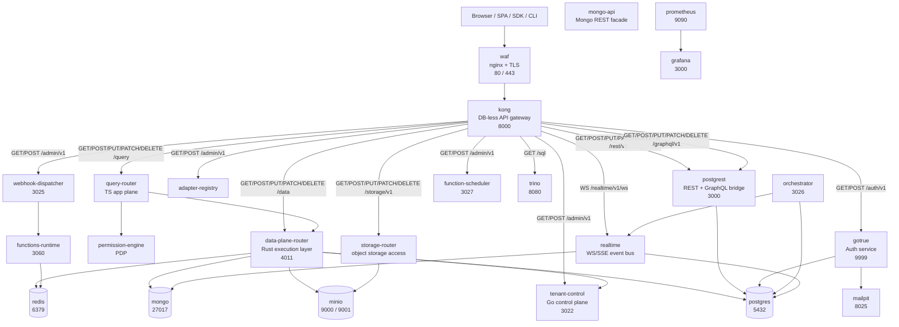
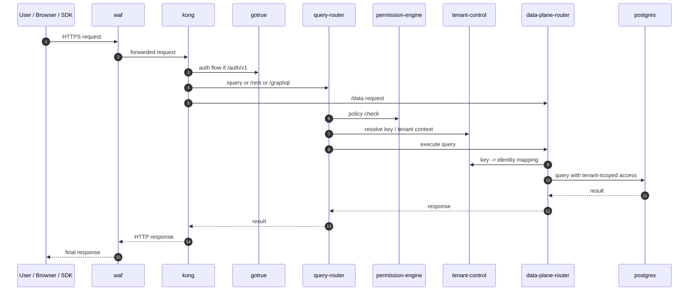
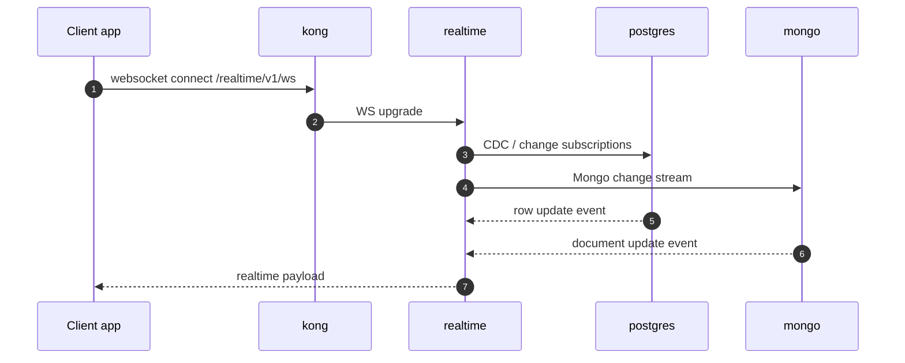
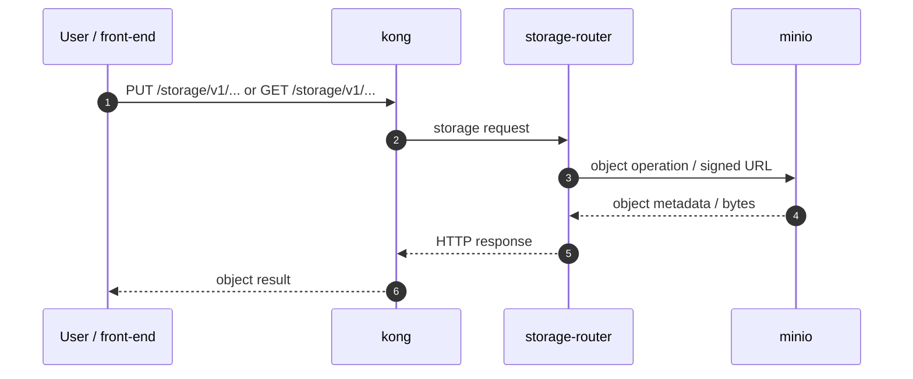

# Grobase runtime architecture

This is the actual runtime topology of the Grobase BaaS used by this monorepo, based on the real deployment configuration in:

- [apps/grobase/wiki/architecture_relation.md](../../apps/grobase/wiki/architecture_relation.md)
- [apps/grobase/deploy/helm/mini-baas/values.yaml](../../apps/grobase/deploy/helm/mini-baas/values.yaml)
- [apps/grobase/infra/docker/services/kong/conf/kong.yml](../../apps/grobase/infra/docker/services/kong/conf/kong.yml)

It represents the real service boundaries, ports, routes, and call patterns of the platform as it is actually assembled in Docker and Kong.

## 1) System view

Grobase is not a single server. It is a layered platform built around a public edge, auth, application plane, control plane, data plane, realtime, and engine/storage tier.

## 2) Service inventory and network ports

These are the principal services exposed by the Grobase stack and the ports they use inside the Docker network as defined in the actual Helm manifest.

| Service | Type | Internal port(s) | Role |
|---|---|---:|---|
| waf | edge proxy | 80, 443 | TLS and public edge front door |
| kong | gateway | 8000 | API routing, auth, rate limiting, CORS, service policies |
| gotrue | auth | 9999 | identity, JWT issuance, OAuth, email OTP |
| postgrest | direct REST / GraphQL | 3000 | exposes Postgres as REST and RPC |
| query-router | TS app plane | 4001 | request orchestration and API adaptation |
| permission-engine | policy engine | 3050 | authorization / policy decision point |
| storage-router | storage API | 3040 | forms signed URLs and storage calls |
| data-plane-router | Rust execution layer | 4011 | executes engine-agnostic queries |
| realtime | realtime bus | internal event service | websockets / SSE / event propagation |
| tenant-control | Go control plane | 3022 | tenant provisioning, key resolution, identity checks |
| adapter-registry | control plane | 3021 | mount registry, engine adapter catalog |
| orchestrator | workflow control | 3026 | background tasks, outbox relay, email / GDPR flows |
| webhook-dispatcher | integration layer | 3025 | webhooks and function secret flow |
| function-scheduler | scheduler | 3027 | scheduled jobs |
| functions-runtime | functions | 3060 | serverless function execution |
| postgres | primary data store | 5432 | primary datastore |
| redis | cache / queue | 6379 | cache, rate limit, task coordination |
| mongo | NoSQL engine | 27017 | secondary datastore |
| minio | object storage | 9000, 9001 | S3-compatible object storage |
| trino | query federation | 8080 | lakehouse / SQL federation |
| grafana | observability | 3000 | dashboards |
| prometheus | observability | 9090 | metrics |
| mailpit | dev SMTP | 8025 | local email capture |

## 3) HTTP interaction model

The real edge behavior is described in Kong. The gateway enforces `key-auth`, `jwt`, `cors`, `rate-limiting`, and identity headers before forwarding requests.

### Public routes

| Path | Service | Method pattern | Notes |
|---|---|---|---|
| `/auth/v1` | gotrue | `GET`, `POST`, `PUT`, `PATCH`, `DELETE` | authentication + session handling |
| `/auth/v1/callback` | gotrue | `GET` | OAuth callback |
| `/rest/v1/*` | postgrest | `GET`, `POST`, `PUT`, `PATCH`, `DELETE` | direct database access via PostgREST |
| `/graphql/v1` | postgrest | `POST` | GraphQL endpoint |
| `/query/*` | query-router | all standard API verbs | app-plane query orchestration |
| `/data/*` | data-plane-router | all standard API verbs | execution plane |
| `/realtime/v1/ws` | realtime | WebSocket | event stream |
| `/storage/v1/*` | storage-router + minio | `GET`, `POST`, `PUT`, `DELETE` | signed object access |
| `/sql` | trino | `GET`, `POST` | federated SQL access |
| `/functions/*` | functions-runtime | all standard API verbs | serverless function dispatch |
| `/admin/v1/*` | tenant-control / webhook-dispatcher / scheduler | `GET`, `POST`, `PUT`, `PATCH`, `DELETE` | operator/admin surface |

### Auth and identity sequence

1. Client calls the gateway with an API key or bearer JWT.
2. Kong validates key-auth / JWT and injects identity headers.
3. The app plane uses that identity to decide what the request is allowed to do.
4. The Go control plane resolves keys and identity to tenant ownership and access scope.
5. The Rust data plane enforces per-request scoping when executing the actual database query.

## 4) The real call flow

### A. Browser-to-database request

### B. Realtime event flow

### C. Storage flow

## 5) Hexagonal architecture by plane

This is the proper hexagonal model of the BaaS:

- Edge hexagon: `waf` + `kong` handle transport, TLS, auth, routing, and enforcement.
- Identity hexagon: `gotrue` issues identity and JWTs.
- Database hexagon: `postgrest`, `mongo-api`, and the engine adapters expose storage through well-defined interfaces.
- Application hexagon: `query-router`, `permission-engine`, `storage-router`, `schema-service`, `analytics-service`, `log-service` orchestrate business behavior.
- Control hexagon: `tenant-control`, `adapter-registry`, `orchestrator`, `webhook-dispatcher`, `function-scheduler` manage provisioning and runtime control.
- Execution hexagon: `data-plane-router` and `realtime` implement the execution and event core.
- Persistence hexagon: `postgres`, `mongo`, `redis`, `minio`, `trino` are the concrete adapters and storage backends.

This is why the platform is described as a multi-plane BaaS: the same product is assembled from different runtime roles and different technology stacks, but all of them are connected through a single public API contract.

## 6) Practical architecture statement

The real platform is:

- a public API gateway (`waf` + `kong`),
- an auth service (`gotrue`),
- a request orchestration layer (`query-router`, `permission-engine`, `storage-router`),
- a Go control plane (`tenant-control`, `adapter-registry`, `orchestrator`, `webhook-dispatcher`, `function-scheduler`),
- a Rust execution layer (`data-plane-router`),
- a realtime event layer (`realtime`),
- and pluggable storage/DB engines (`postgres`, `mongo`, `redis`, `minio`, `trino`, etc.).

The central idea is that clients do not talk to the database directly. They talk to the gateway, then to the orchestration and execution layers, which resolve tenant and identity context before hitting the storage engine.

That is the core architecture of the Grobase BaaS product used in this monorepo.
