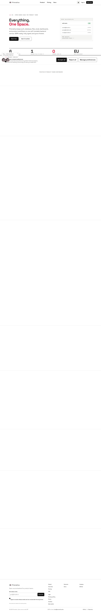

# Prismatica redesign: report

Status on 2026-10-16.

| Phase | State |
|---|---|
| 0 Discovery and baseline | Done |
| 1 Plan | Done, approved (D-028) |
| 2 Arlet demo seed | Done on baas, additive only (D-039). The P1 mount check waits on the Funnel 403 (D-044) |
| 3 Design system and site | Done |
| 4 Media | Partial. S1, S8, S9, S11 and S12 are captured; V1, V2 and V4 are drawn. S2–S7, S10, V3 and the tour wait on the Funnel 403 (D-044) |
| 5 Verification and reset | Code done, with devil conditions C1–C14. pr1–pr4 have not run against a stack with Mailpit |
| 6 Quality gate | Done (results below) |
| 7 Ship | Stopped before the production migration and the real Titan send. Nothing is pushed |

## Before and after

Lab numbers from the same seat, against a production-like build: `scripts/serve-site.sh`, the
site image's nginx behind TLS. Before is [baseline/summary.md](baseline/summary.md), measured at
`https://localhost:4322`. After is [final/summary.md](final/summary.md), the pinned site
(97ec501). Lighthouse takes the median of 3 runs.

Caveat: these are lab numbers only, so there is no INP and no field CLS (`scripts/site-audit.sh`
header).

Mobile, default throttling; each cell is before → after.

| Route | Perf | A11y | LCP s | CLS | Total KB |
|---|---|---|---|---|---|
| / | 96 → 99 | 100 → 100 | 2.53 → 2.01 | 0 → 0 | 174 → 78 |
| /legal/privacy-policy | 97 → 100 | 93 → 100 | 2.36 → 1.76 | 0 → 0 | 152 → 35 |
| /legal/terms | 97 → 100 | 100 → 100 | 2.36 → 1.76 | 0 → 0 | 150 → 34 |
| /legal/cookies | 97 → 100 | 100 → 100 | 2.37 → 1.76 | 0 → 0 | 151 → 34 |
| /legal/data-rights | 97 → 99 | 95 → 100 | 2.36 → 1.76 | 0 → 0 | 150 → 47 |
| /auth/confirm | 98 → 99 | 100 → 100 | 2.06 → 1.67 | 0.044 → 0 | 152 → 39 |
| /auth/reset-password | 97 → 100 | 100 → 100 | 2.16 → 1.28 | 0.041 → 0 | 153 → 42 |
| /newsletter/confirm | 97 → 100 | 100 → 100 | 2.36 → 1.61 | 0 → 0 | 150 → 34 |
| /newsletter/unsubscribe | 97 → 100 | 100 → 100 | 2.36 → 1.76 | 0 → 0 | 150 → 34 |
| /docs/ | 72 → 100 | 94 → 100 | 20.70 → 1.56 | 0.020 → 0 | 5458 → 236 |
| /tour (new) | – → 100 | – → 100 | – → 1.76 | – → 0 | – → 72 |

- **Desktop:** every route scores 100 for performance after the redesign. /docs/ was 80, with
  a 3.56 s LCP. The home page scores 100 on all four categories.
- **axe (WCAG 2.2 AA) at 390, 768 and 1440 px:**
  - Before, 5 routes had a serious violation: `nested-interactive`, `color-contrast`,
    `link-in-text-block` ×2, `html-has-lang`. After, 0, in light and dark.
- **Horizontal overflow:**
  - Before, it hit 6 routes, by up to 455 px. After, none at any width.
- **Console errors:** 0, except /404's own status line, which is there by design.
- **SEO 66 on the token pages:** this is expected. `/auth/*` and `/newsletter/*` are `noindex`,
  so their links never leak into search.

## Screenshots

| Before | After |
|---|---|
|  |  |
|  |  |
|  |  |
|  |  |

`screenshots/` is git-ignored, so these show only on the seat that ran the audit.
`scripts/site-audit.sh final all` regenerates them: every route at 390, 768 and 1440 px, with
reduced-motion and dark variants.

## What changed

- **Site** (opposite-osiris `redesign/site`, 97ec501):
  - A new design system: tokens (D-017), one subset display font at 14 KB (D-016), light and dark
    themes, and motion only when the visitor allows it.
  - A new home page:
    - the claim, and the silo (V2), convergence (V1) and saved-view (V4) drawings;
    - product sections framed around real captures of the Arlet demo (S1, S8, S9, S11);
    - the local release `osionos-v0.5.2-local` (D-031);
    - a two-click path: the tour, then sign-up (D-018).
  - The invented logos, testimonials, pricing and FAQ claims, the mascot and the scroll fade-ups
    are deleted (D-021).
  - The auth pages are rebuilt around the signed links: confirm, reset with MFA, and resend
    (D-038). "Forgot password?" now opens a working flow; before, it had no listener.
  - The docs are one static page per doc. The /docs/ page went from 5.4 MB to 236 KB, and its
    mobile LCP from 20.7 s to 1.56 s (D-035, D-036).
- **Demo data** (Phase 2, ADR 0005 amended, D-039 to D-043, D-046):
  - Arlet Équipement is generated deterministically (seed 42): 14,395 records, 4.3 links per
    record, 0 orphans.
  - It was loaded into baas without changing anything already there:
    - a CRM database `demo_980ce747_crm` under its own login;
    - 145 osionos pages across two workspaces;
    - two users, Inès and Jules.
  - The bootstrap proves its guards on the VM itself:
    - the demo login cannot read `auth.users` (G2);
    - the 811 rows present before the run are still there;
    - Jules opens the shared page and gets 403 on Operations.
- **Media** (Phase 4):
  - `scripts/media/capture.sh` logs in as the demo users, shoots the masters at 1440×900 @2x, and
    cuts AVIF, WebP and JPEG at 720, 1440 and 2880 px. The 35 files total 2.5 MB.
- **Email flows** (Phase 5, ADR 0006):
  - GoTrue sends the mail, and the auth-gateway enforces the policy on it:
    - signed links that expire after 24 h, with one use per link;
    - a reset ticket with MFA;
    - the same answer for every address on recover and resend;
    - a per-address cap.
  - A session cut-off table voids old sessions after a reset (`models/auth-session-cutoffs.sql`).
  - The token pages send `no-referrer` at both the edge and the site's nginx.
- **Tooling:**
  - the `groot-tools` image, with the MCP servers in Docker (D-004 to D-006);
  - `scripts/site-audit.sh`, which fails on a budget breach (D-034);
  - `scripts/serve-site.sh`; `scripts/media/subset-fonts.sh`; `scripts/media/capture.sh`;
  - a Mailpit guard that refuses the mail specs unless every message reaches Mailpit.
- **Repairs**, each with a mutation-checked test and its own commit:
  - `.mcp.json` home paths;
  - the e2e docker helper, extracted;
  - the dead Forgot-password button;
  - notification cards were `role=alert` buttons;
  - reset-page CLS (0.041, fixed by server-rendered rules);
  - unlabelled task checkboxes in the docs;
  - overflow at 390 px on six routes;
  - axe `nested-interactive`, `link-in-text-block` and `html-has-lang` on /404;
  - the /docs/ title test, red since 1449dfa (D-048);
  - in the demo seed:
    - the deploy-mountlist guard matched its own `pgrep`;
    - a closed write window looked like a hang ("it's stuck") and used the UTC clock;
    - re-runs printed 33 NOTICEs;
    - pages showed the seed's bookkeeping (D-046);
  - V4's inline stagger, which the CSP blocked, and its faded cards, which failed axe contrast (D-047);
  - the gitleaks baseline, after the osionos pin and the per-doc pages moved fixtures.

Commits: groot `redesign/brief` (49 since 5188e8e9) and `redesign/auth` (15); site
`redesign/site` (27 since 8559d6d); osionos `redesign/bridge-auth` (8 since fabe846b). The reasons
are in [DECISIONS.md](DECISIONS.md), D-001 to D-048.

## Reproduce

```sh
# build the site (from apps/opposite-osiris)
../../scripts/tools.sh pnpm install --frozen-lockfile --ignore-scripts --config.node-linker=hoisted --store-dir .pnpm-store </dev/null
../../scripts/tools.sh pnpm run build </dev/null
../../scripts/tools.sh pnpm exec vitest run </dev/null     # unit
../../scripts/tools.sh pnpm exec eslint . --max-warnings 0 </dev/null
../../scripts/tools.sh pnpm exec astro check </dev/null

# serve, test and measure it (from the groot root)
scripts/serve-site.sh start 4390
E2E_PRISMATICA_URL=https://127.0.0.1:4390 bash tests/e2e/run.sh -c site.config.ts   # st1-st6
E2E_PRISMATICA_URL=https://127.0.0.1:4390 scripts/site-audit.sh final all          # Lighthouse, axe, screenshots
scripts/serve-site.sh stop 4390

# the demo seed on baas (additive; waits out the backup windows) and the captures
bash scripts/demo/seed-baas.sh
bash scripts/media/capture.sh

# stack specs: need a local stack with Mailpit (make all), refused otherwise
bash tests/e2e/run.sh specs/pr1-signup-verify.spec.ts specs/pr2-reset.spec.ts specs/pr3-no-enumeration.spec.ts specs/pr4-recover-cap.spec.ts
```

The bats suites run in `bats/bats:1.11.1` as CLAUDE.md shows. `tests/demo-seed` and
`tests/site-nginx` need the docker socket mounted. The demo node tests run with
`scripts/tools.sh node --test 'scripts/demo/tests/*.test.mjs'`.

## Results

Run on 2026-10-16 against the pinned site, 97ec501.

| Check | Result | Evidence |
|---|---|---|
| Site unit tests (vitest) | 282/282 | `pnpm exec vitest run` |
| eslint, whole site, `--max-warnings 0` | 0 problems | `pnpm exec eslint .` |
| astro check | 0 errors, 0 warnings | `pnpm exec astro check` |
| Site e2e, st1–st6 (12 routes × 2 themes × 3 widths, plus two-click, reduced motion, auth links, docs) | 44/44 | `tests/e2e/test-results/final-site-e2e.log` |
| Lighthouse budgets, mobile and desktop (asserted, D-034) | Pass, exit 0 | [final/summary.md](final/summary.md) |
| Demo seed: node tests (determinism, integrity, links, page contract, write window) | 47/47 | `node --test 'scripts/demo/tests/*.test.mjs'` |
| Demo seed: bats (`tests/demo-seed`, VM bootstrap against a throwaway postgres) | 15/15 | `bats tests/demo-seed` |
| Demo seed on baas (final run) | 145 pages reshaped, 0 kept as edited. G2 refused. The 811 rows present before the run are all still there. Directory clean. The shared page opens. Jules gets 403 on Operations | seed log, 2026-10-16 |
| Secret scan (`make secrets-scan`) | 0 new, 82 baselined | `bash scripts/gitleaks-gate.sh` |
| Root bats (`scripts/tests`) | 327/332 | Run on 2026-10-16 00:43. The 5 failures come from the worktree, not from the branch. 231–232 need `apps/grobase` checked out. 240–242 clone `apps/graph_render` into a `.git` the container mounts read-only. Not re-run on a full checkout |
| pr1–pr4 (sign-up, reset, no enumeration, recover cap) | Not run | They need a local stack with Mailpit, and they refuse a remote link |
| Devil P1 (the demo mounts open in osionos) | Not run | The Funnel answers 403 on the adapter registry (D-044) |

## What is left

| Item | Blocked on | Next step |
|---|---|---|
| S2–S7, S10, V3, the 75 s tour, st4 snapshots (D-033, D-044); the devil's P1 check | The Funnel answers 403 on the bridge's adapter-registry call: ADR 0004's deploy, owned by groot-69 | Once it is deployed, run `bash scripts/media/capture.sh` with the S2–S10 specs added, then flip `ready` in `shots.ts` |
| pr1–pr4 against a real stack | A local stack with Mailpit | Run the specs above when a local window is free |
| Push | Your approval | Submodules first: osionos `redesign/bridge-auth`, then opposite-osiris `redesign/site`. Then groot `redesign/auth` and `redesign/brief`, as PRs into `develop` |
| `auth-session-cutoffs.sql` on baas, then the C14 check | You run it (a production migration; the classifier refused it from this session) | Outside HH:58–HH:07 and 00:30–00:50: `ssh b2b -o ClearAllForwardings=yes 'docker exec -i mini-baas-postgres psql -X -q -U postgres -d postgres -v ON_ERROR_STOP=1' < /goinfre/dlesieur/groot-auth/models/auth-session-cutoffs.sql` |
| Fly secret `AUTH_LINK_SIGNING_KEY` for the gateway | You set it (vault42 value) | `fly secrets set`, then deploy after the push |
| The one real Titan send | Your approval, and a `TEST_INBOX` (D-010) | Run after the push, to your inbox |
| The "Not done yet" Share line (D-037) | The bridge deploy at pin 750346b2 | Remove the line in the same change as the deploy |
| Handed over | Their owners | osionos markdown engine `renderTaskListItems` labels (D-036). C12 teardown. C13 flip, together with `ac1` and `session.ts freshLogin` (register now answers 202) |
| `docs/redesign/*.md` fail prettier | `make pretty-check` only selects root markdown | A separate decision about widening `SEL_MD` |
| `$HOME` is at its 4.7 GB quota | Yours to clean up | buildx state and job temp files were redirected to `/goinfre/dlesieur`; nothing was deleted |
