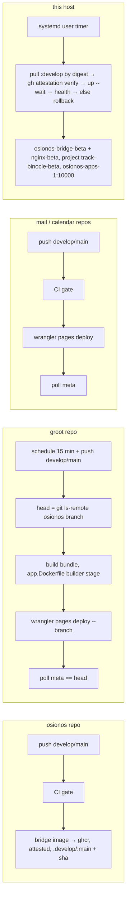

# Beta and release deploys for the osionos apps, on Cloudflare Pages and this host

*Design, 2026-10-26. Status: revision 3, **approved by the user on 2026-10-26** (rev 2 after the
 devil's BLOCK on rev 1, rev 3 after the builder check). The devil's thirteen lift conditions are
folded in and tagged `C1`–`C13` where they land. User decisions: Phase 1 scope, portal login for
beta, the existing `osionos` Pages project, 15-minute polling with no cross-repo token.*

## Intent

A push to `develop` must update a **beta** copy of each osionos web app, and a push to
`main` must update the **release** copy, with nothing run by hand in between. The user
opens the beta URL and sees the develop head; opens the release URL and sees the main
head. Beta and release serve different users, so a develop push never touches what a
release user sees.

The website (prismatica) already works this way on Vercel (`apps/opposite-osiris/.github/
workflows/ci.yml`: gate → deploy hook → wait until the site serves the pushed commit).
This design gives the same arc to the osionos app, its bridge, Mail and Calendar, on
Cloudflare Pages for the static bundles and on this host for the bridge.

**Scope after the verdict.** The devil ruled that a beta bridge auto-pulled from `develop`
runs develop code with the release secrets (session secret, service-role key, MFA and
seal keys), so the whole weight of this design is on *who can put code in that image* and
*what the image can reach*. It also ruled that auto-pulling the **release** bridge while
the release bundle on `baas:8443` is still hand-built makes the two drift on every main
merge. So this change is **Phase 1**: beta end to end, release static bundles on Pages,
release bridge still hand-deployed (`C7`). **Phase 2** (its own design, later) cuts
`baas:8443` over to Pages and turns on the release pull.

## Facts the design rests on (measured 2026-10-26; rev 1 errors struck)

- The osionos app, bridge, auth gateway and AI run as containers on this host, published by
  the b2b VM's Tailscale Funnel as `https://baas.tail10f2ea.ts.net:8443` (app, `/api/auth`
  and `/api/newsletter` to the gateway, and the gateway's `/auth/v1 /rest/v1 /realtime/v1
  /storage/v1 /query/v1 /meta/v1 /v1/tenants`, `nginx.conf:129-139`) and `:10000` (bridge
  behind the `:4000` vhost of `nginx.conf:144-149`, which sets `x-real-ip` at `nginx.conf:50,179`,
  plus `bridge-public.conf` and `http-limits.conf`). Funnel allows
  only ports 443, 8443 and 10000; 443 is grobase's entrance and must never be reset.
- The live release bridge (`track-binocle-osionos-bridge-1`) was composed from **four**
  files, read from its `com.docker.compose.project.config_files` label: `docker-compose.yml`,
  `docker-compose.grobase-link.yml`, `groot-wt/deploy/account-release-build.yml`,
  `docker-compose.public.yml`. The worktree overlay hard-codes
  `image: track-binocle/osionos-bridge:public` (which overrides `OSIONOS_BRIDGE_IMAGE`) and
  injects the Redis URL, the client-IP header, the MFA key, the recovery pepper and the
  email seal/lookup keys. Rev 1's "set one variable, everything else untouched" was wrong.
- A second container carries the same compose labels (`project=track-binocle`,
  `service=osionos-bridge`): the user's `ai-dev-bridge` on `:local`. `docker compose up`
  on that service sees two containers.
- The app bundle is built by **groot's** `infrastructure/docker/osionos/app.Dockerfile`
  (graph-studio pack pinned by digest, 30 `VITE_*` build args; the public values live in
  `docker-compose.public.yml`; the deployable bundle is the **runtime** stage's
  `/usr/share/nginx/html`, because the pack copy and the `graph-studio-base` meta are added
  there, `app.Dockerfile:160-171`, not in the builder stage). The bridge image is built from groot's
  `infrastructure/docker/osionos/bridge.Dockerfile` with the osionos checkout as context.
  `docker-compose.yml:71` reads `OSIONOS_BRIDGE_IMAGE`, default `:local`.
- **Auth runs through the bridge, not the gateway.** The app's only credentialed fetch is
  `${API_BASE}/api/auth/bridge/consume` (`userStore.helpers.ts:34,123-128`, `API_BASE` =
  `VITE_API_URL`). The bridge calls the gateway server-side. The app never carries the
  gateway cookie, so rev 1's same-origin `/api/*` proxy solved a problem that does not exist.
- **Two login flows exist.** With `VITE_AUTH_MODE` empty (the public build today,
  `app.Dockerfile:62`) the app shows "Open osionos from Prismatica": website → gateway →
  the **release** bridge (`docker-compose.yml:1035`), which redirects to its own
  `OSIONOS_APP_URL` (`bridge-api.mjs:1618`), and the gateway rejects any return URL not under
  `PUBLIC_OSIONOS_APP_URL` (`auth-gateway.mjs:1006`). That flow can never land on a beta
  origin. With `VITE_AUTH_MODE=portal` the app posts to `${VITE_API_URL}/api/auth/login` on
  **its own** bridge, which calls the gateway server-side (`bridge-api.mjs:4038,4135`) and
  hands the session back on the same origin. Only the portal flow reaches beta without a
  gateway change.
- The bridge keeps its handoff records in Redis (`OSIONOS_BRIDGE_REDIS_URL`, read at
  `bridge-api.mjs:231`, `bridge-shared-store.mjs`) at the commit the release is built from
  (`groot-wt/deploy/app` @ 3be8dc7); the groot pin (6642d64) predates that. A bridge that
  mints and consumes its own handoffs needs no other bridge's Redis.
- `VITE_BAAS_URL` is used for live sync: realtime connects to
  `${VITE_BAAS_URL}/realtime/v1/ws` (`liveRealtime.ts:86`), and shared spaces are on in
  public. It must stay `https://baas.tail10f2ea.ts.net:8443` (`C9`).
- The bridge allows exactly one origin, `OSIONOS_ALLOWED_ORIGIN` (`bridge-perms.mjs:100,144`),
  today `https://baas.tail10f2ea.ts.net:8443`. Session tokens are signed with
  `OSIONOS_APP_SESSION_SECRET` (`bridge-api.mjs:443-453`): a token minted by one bridge is
  valid on any bridge holding the same secret. The origin check protects browsers, not curl.
- The second Funnel node **is running** as `osionos-apps-1.tail10f2ea.ts.net`
  (`systemctl --user is-active osionos-apps-node.service` → active; `tailscale --socket
  ~/.local/state/tailscale-osionos-apps/tailscaled.sock funnel status`): 443 → Mail preview
  (:3102), 8443 → Calendar preview (:3103), **10000 free**. `public-node.sh status` reports
  "not running" because of a client/daemon version skew (1.104.2 vs 1.104.1); a defect to fix,
  not a fact about the node.
- `make public-verify --pre` already fails `node-name` and `nobridge`
  (`wiki/runbooks/public-funnel.md:81`). There is no green baseline; `C13` records the
  actual output before any change and judges "as before" against it.
- ghcr refuses anonymous manifest pulls of the osionos packages (401 measured). The host's
  `~/.docker/config.json` holds a plaintext login of unknown scope.
- Mail and Calendar are self-contained Vite apps (`npm ci && npm run build` → `dist/`),
  built public with every `VITE_*_URL` empty. Their repos have `main` and `develop`; so does
  groot. **Univers42/osionos has `main` plus feature branches, no `develop`.** Its only
  ruleset protects `~DEFAULT_BRANCH`. osionos is public with 16 collaborators who can push,
  and `ci.yml` grants `packages: write` to every run, including `feat/**` pushes.
- groot's Actions hold `VAULT42_KEYSTORE_B64`, `VAULT42_PASSPHRASE`, `VAULT42_CONTRACT_B64`,
  `DOCKER_HUB_TOKEN` (names only). The vault42 identity is irreplaceable.
- Old bridge Dockerfile path is named by `scripts/tests/bridge-image-closure.bats:18`,
  `scripts/tests/make-all-footprint.bats:41`, `scripts/tests/ide-compose-shape.sh:321`,
  `docker-compose.yml:74` and the worktree overlay.
- No Cloudflare token exists anywhere yet. `wrangler`/`node` are not installed here; CI
  runs them. `https://osionos.pages.dev/` answers **522** (a Pages project of that name
  exists and **is the user's** (answered 2026-10-26); `osionos-mail`, `osionos-calendar` are free.
- The host's `gh` is 2.45.0 (Ubuntu package) and has **no** `attestation` subcommand; that
  arrived in gh 2.49. The osionos `ci.yml` has no `attest-build-provenance` step; its web
  image only carries buildx `provenance:`/`sbom:` on main (`ci.yml:80-81`), which
  `gh attestation verify` does not consume. The Sigstore TUF root fetch returned 200 today,
  so verification can run from this host once a verifier is installed; the memory note saying
  the TUF CDN 403s is stale for this check.
- The gateway's realtime server accepts any origin while `REALTIME_ALLOWED_ORIGINS` is unset
  (`origin.rs:42`), so a Pages origin's `/realtime/v1/ws` handshake is expected to pass.

## Goals

1. `develop` push → beta URL serves that commit, for: osionos app, osionos bridge, Mail,
   Calendar. `main` push → release URL serves it, for: Mail, Calendar, and the osionos app
   bundle on Pages (built and verified on every main push but **dark**: not linked, and not
   accepted by the release bridge until Phase 2, `C7`, `C10`).
2. Every deploy is gated by the repo's existing quality gate and verified: a static deploy
   ends only when the live URL serves the pushed commit (build hash in a `<meta>`); the beta
   bridge deploy ends only when a **logged-in round trip** from `develop.osionos.pages.dev`
   to the beta bridge succeeds (`C10`).
3. Nothing new is exposed from this host except the beta bridge, behind the same nginx
   hardening as release (`C5`); CI gets no shell here and no token that can write to groot (`C1`).
4. Code reaches the beta bridge only from `Univers42/osionos` `develop` or `main`, built by
   that repo's own `ci.yml`, proven by attestation before it runs (`C2`, `C3`).
5. Backward compatible: `make public-up`, the `:local`/`:public` builds and the live release
   stack keep working unchanged; "unchanged" is judged against `C13`'s recorded baseline.

## Non-goals

- A beta grobase/database or a beta gateway. Beta shares the release data and the one
  gateway, like the website's beta today.
- The release bridge auto-pull and the `baas:8443` cut-over (Phase 2).
- Drawnosaurus (own Funnel; user excluded it), prismatica, the IDE, LiveKit.
- Custom domains. `*.pages.dev` is on the Public Suffix List, so beta and release cookies
  never mix.
- Automating the groot submodule pin bump.

## Anti-goals (a failure even if it "works")

- CI holds a token that can push to groot or read groot's secrets (`C1`).
- A self-hosted runner on this host.
- `tailscale funnel reset` on either node; the apps node gains 10000 with
  `funnel --bg --https=10000` only (`C11`).
- A beta deploy that recreates, renames or shadows a release container (`C4`), or a
  tag-trusting pull that runs code nobody attested (`C2`).
- A secret value in a workflow file, a script, a commit or a log.

## Shape

### 1. Static bundles on Cloudflare Pages

One Pages project per app: `osionos`, `osionos-mail`, `osionos-calendar` (production
branch `main`). The `osionos` project already exists in the user's account; the create step adopts it.
Pages gives the two URLs natively: `main` → `https://<project>.pages.dev`,
`develop` → `https://develop.<project>.pages.dev`.

The deploy job (one per repo, appended to the existing CI workflow, same pattern as
prismatica's `deploy-vercel`):

- `if:` push to `develop`/`main` or the schedule, never a pull request; `concurrency` per
  target, no cancel.
- `needs:` the repo's full gate. For the osionos app that is groot's gate plus the osionos
  `quality` **and** `test-gate` results of the head commit, read from the osionos check-runs
  API; a head whose gate is red or missing is not deployed. My call: full gate for both
  branches. The user can relax beta to `quality` only.
- Build with `VITE_APP_VERSION=<sha>`; `index.html` gains
  `<meta name="osionos-build" content="%VITE_APP_VERSION%">` (Vite HTML env replacement).
  Mail and Calendar get the same meta under their own names.
- `wrangler pages project create <name> --production-branch main` (ignore "already
  exists"), then `wrangler pages deploy <dir> --project-name <name> --branch <branch>`
  via `cloudflare/wrangler-action` pinned to a tag. Secrets `CLOUDFLARE_API_TOKEN`
  (Pages: Edit only) and `CLOUDFLARE_ACCOUNT_ID`, set by the user with `gh secret set` in
  groot, osionos-mail and osionos-calendar. A missing secret fails the job naming the secret.
- Poll the branch URL until the meta equals the sha, bounded (15 min).
- SPA routing: `_redirects` with `/* /index.html 200`. `_headers` carries the security
  headers the public nginx sends today, and for Mail and Calendar a
  `Content-Security-Policy: frame-ancestors` naming all three app origins that may frame
  them: `https://baas.tail10f2ea.ts.net:8443`, the beta and the release Pages origins (my call).
- **Beta login = portal mode.** The beta bundle is built with `VITE_AUTH_MODE=portal` so a
  login started on `develop.osionos.pages.dev` goes to the beta bridge and ends on the
  same origin; the legacy "Open from Prismatica" flow structurally cannot return to a beta
  origin (Facts). The release bundle keeps the empty mode as today. This is the one place
  beta and release differ in behaviour, stated on the beta login screen's build line.
  Recommended; the alternative is a gateway return-URL allowlist, which is auth code and
  Phase 2 territory (user's decision, 2026-10-26).
- **No Pages Function** (`C9`). The bundle keeps `VITE_BAAS_URL=https://baas.tail10f2ea.ts.net:8443`
  for realtime and the gateway routes, and sets `VITE_API_URL` per target:
  beta → `https://osionos-apps-1.tail10f2ea.ts.net:10000`, release → `https://baas.tail10f2ea.ts.net:10000`.
  The gateway's `/realtime/v1/ws` handshake from both Pages origins is measured as part of
  Done-when; if the gateway rejects the Pages origin, that is a Phase 2 gateway change and
  beta live sync is reported as not working, not papered over.

**Where the osionos deploy job lives: groot.** The bundle recipe is groot's, so groot's
workflow builds it: `docker build` of `app.Dockerfile` (runtime stage) with the public args
from `docker-compose.public.yml` and the per-target `VITE_API_URL`/`VITE_AUTH_MODE`, copies
`/usr/share/nginx/html` out of the image, deploys. It checks out osionos at the **branch head**, resolved by `git ls-remote
https://github.com/Univers42/osionos refs/heads/<branch>` inside the job, never from an
external input (`C1`: a fork's commit is reachable through the parent repo, so any sha
passed in would have to be checked against this anyway). Triggers: a groot push (recipe
change) and a `schedule` every 15 min that compares the deployed meta to the head and exits
early when equal. **No dispatch token** (`C1`). Upgrade path, the user's call: an
Actions-only fine-grained token stored in an osionos *environment* restricted to `main` and
`develop` could `workflow_dispatch` groot's job for sub-minute latency; the head check stays.

Release Pages for the osionos app is deployed and verified by meta on every main push but
labelled **dark** in the workflow summary and in `wiki/runbooks/public-funnel.md` until
Phase 2 (`C7`, `C10`): the release bridge allows only `baas:8443`, so the release Pages URL
cannot log in yet, by design.

### 2. The beta bridge on this host, pulled from ghcr with provenance

- **Dockerfile move, staged** (`C12`). A copy of the bridge Dockerfile lands in the osionos
  repo (`docker/services/bridge/Dockerfile`) and osionos CI builds from it. groot keeps its
  copy and its tests until the groot pin includes the osionos copy; in that same groot
  change `docker-compose.yml:74`, the three tests and the worktree overlay are repointed and
  groot's copy is deleted. Until then the two files are byte-identical, checked by a test.
- osionos CI pushes `ghcr.io/univers42/osionos-bridge:develop|main` and `:sha-<sha>` and
  signs them with a **new** `actions/attest-build-provenance` step (`push-to-registry: true`;
  the web image's buildx `provenance:` is not this and is left as is), **only** from the
  image-push job, **only** on `main`/`develop` pushes; `packages: write` moves from the
  workflow's top level to that job (`C3`). My call: the package is made **public** so the
  host needs no ghcr login (the source is public; the builder verifies the image carries
  nothing but the repo's scripts and `node_modules`, `docker history` + file list).
- **Branch protection first** (`C3`). Before the beta stack ever runs, `develop` exists on
  Univers42/osionos with a ruleset equal to main's (the user's bypass kept). Creating the
  branch and the ruleset are the user's pushes.
- **Beta stack**: overlay `docker-compose.beta.yml`, project `track-binocle-beta`,
  `make beta-up`, three services: `osionos-bridge-beta` (image
  `OSIONOS_BRIDGE_BETA_IMAGE`, default `ghcr.io/univers42/osionos-bridge:develop`, replaced
  by the timer with a digest reference), `nginx-beta` (the public nginx image carrying the
  `:4000` vhost of `nginx.conf:144-149` with its upstream repointed to `osionos-bridge-beta`,
  plus `bridge-public.conf` + `http-limits.conf`, published `127.0.0.1:4001` only; `C5`) and
  `redis-beta` (beta's own handoff store; my call, see env below). The bridge is never published directly. The service name
  differs from release so Docker DNS for `osionos-bridge` keeps resolving to one container
  (`C4`), and the project joins **only** `mini-baas_mini-baas` (external), where Redis and
  grobase-link live; the builder confirms both are reachable there with `docker compose config`
  and a `nslookup` from the network.
- **Beta env, written out** (`C6`): the same public env block as release, `.env.local` for
  the shared secrets, plus what the worktree overlay carries today:
  `OSIONOS_BRIDGE_REDIS_URL=redis://redis-beta:6379` (**not** the release Redis: in portal
  mode the beta bridge mints and consumes its own handoffs, so sharing a keyspace would only
  let one stack's records reach the other; recorded in ADR 0028),
  `OSIONOS_BRIDGE_CLIENT_IP_HEADER=x-real-ip`, the MFA/seal/lookup keys and the pepper
  (shared with release, because beta reads and writes the release accounts).
  `OSIONOS_APP_URL`/`OSIONOS_ALLOWED_ORIGIN=https://develop.osionos.pages.dev`.
- **Funnel** (`C11`): `tailscale --socket <apps sock> funnel --bg --https=10000 http://127.0.0.1:4001`
  on the running `osionos-apps-1` node; never `reset`. Its 443/8443 previews stay until Pages
  serves Mail and Calendar, then are removed with `funnel --https=443 off` (not reset), and
  `.env.public`'s `PUBLIC_MAIL_ORIGIN`/`PUBLIC_CALENDAR_ORIGIN` move to the Pages URLs by
  the normal hand `make public-up`. `public-funnel.sh verify` learns the 10000 mapping.
  Documented: `make public-down` and `reset_both` also take the beta bridge offline.
  `public-node.sh status`'s version-skew false "not running" is fixed in passing.
- **Pull timer** (`C2`, `C8`): `scripts/release-pull.sh` +
  `infrastructure/systemd/user/osionos-release-pull.{service,timer}.in`, `make release-autostart`,
  every 2 min, **beta only** in Phase 1 (release is a config entry left unset). Each tick:
  1. Resolve the tag to a digest (`docker manifest inspect` / `crane digest`); exit "unchanged"
     when equal to the running container's `.Image` digest.
  2. `gh attestation verify oci://<image>@<digest> --repo Univers42/osionos
     --signer-workflow Univers42/osionos/.github/workflows/ci.yml` and check the predicate's
     source ref is `refs/heads/develop` (or `main`). Any failure, including "cannot reach
     Sigstore", means the image does not run and the tick logs why (`C2`). This needs
     gh ≥ 2.49 on the host: my call is to install `gh` from GitHub's apt repository (one
     `apt` change, recorded in the runbook); the fallback is `cosign verify-attestation` run
     from a pinned container if the user prefers no host package change.
  3. Take a `flock` that `make public-up`/`beta-up` also take (`C8`). Refuse when the target
     service has more than one container (`ai-dev-bridge` case).
  4. Re-create with the exact compose file list from the running container's
     `config_files` label, or refuse (`C8`); pull and run **by digest**; `up -d --no-build
     --wait --wait-timeout 120` on that service; confirm the running image digest equals the
     verified one; probe health through nginx-beta.
  5. On any failure after step 3, roll back to the previous image id (kept in a state file)
     with the same `up --wait`, and exit non-zero so the timer's failure is visible.
  Every command is bounded by `timeout`. `--once --dry-run` prints the plan. Caveat lines: a
  tag moved and moved back between two ticks is one change; a Sigstore outage stops beta
  updates until it returns (fail closed, by design).
- Rollback by hand: `OSIONOS_BRIDGE_BETA_IMAGE=ghcr.io/univers42/osionos-bridge:sha-<prev>` and
  `make beta-up`; the timer verifies and respects a pinned digest.

### 3. Phase 2 (not this change)

Cut `baas:8443` over to `https://osionos.pages.dev` (website `PUBLIC_OSIONOS_APP_URL`,
gateway redirect target, release bridge `OSIONOS_ALLOWED_ORIGIN`), then enable the release
entry of the pull timer with the same provenance rule on `refs/heads/main`. Needs its own
devil verdict.

## Constraints

- Secrets are pasted by the user (`gh secret set`), never written by Claude anywhere.
- Every image pull in CI goes through `mirror.gcr.io` under the public.ecr.aws names.
- Workflows pin actions to tags; wrangler to an exact version.
- Every new shell script passes shellcheck and ships a bats test; every heuristic carries
  a `Caveat:` line (`rules/caveat.md`).
- Backward compatible: all new behaviour is off until a variable or secret is set.
- **Baseline before change** (`C13`): `make public-verify --pre` output is recorded to
  `wiki/runbooks/public-funnel.md` before the first commit; "behaves as before" means equal
  to that output.
- **Records owed** (devil): ADR `docs/adr/0028-beta-release-pipeline.md` (beta's own Redis,
  portal login for beta, fail-closed provenance, Phase 1/2 split) and `.out-of-scope/groot-dispatch-pat.md` (the
  fact that would change the answer: groot holding no long-lived secrets and protected branches).
- **Landing (user's rule, 2026-10-26).** Work lands by a local merge into `develop`, then `main`,
  pushed straight to the ssh remote with the user's bypass; no pull-request merges. A landing is
  done only when every workflow on the pushed commit is green. A workflow that fails because it
  encodes the old behaviour is repaired against the new expected behaviour in the same change,
  never skipped, disabled or marked `continue-on-error`.

## Done when

| Push | Within ~20 min |
|---|---|
| osionos `develop` | `https://develop.osionos.pages.dev` serves `<meta name="osionos-build" content="<sha>">`; the beta bridge runs the digest attested to `refs/heads/develop` at `<sha>`; a portal login started on the beta URL ends logged in on the beta URL and `GET /api/auth/bridge/health` through `osionos-apps-1…:10000` is 200 (`C10`); a `/realtime/v1/ws` handshake from that origin is measured and its result recorded |
| osionos `main` | `https://osionos.pages.dev` serves its meta and the job summary says **dark until Phase 2**; the release bridge is untouched (same container id as before the push) |
| osionos-mail / osionos-calendar `develop`/`main` | `https://develop.osionos-mail.pages.dev` / `https://osionos-mail.pages.dev` (and `-calendar`) serve their meta with the sha |
| nothing | the timer logs "unchanged" and recreates nothing; `nslookup osionos-bridge` on `mini-baas_mini-baas` returns one address before and after `beta-up` (`C4`) |
| a forged `X-Real-IP`/`X-Forwarded-For` through `osionos-apps-1…:10000` | the beta bridge records nginx's address, not the forged one (`C5`) |
| an image tagged `:develop` by hand from a feature branch or `workflow_dispatch` | the timer refuses it and logs the attestation failure (`C2`, `C3`) |
| groot | `make public-up` with no new variables set produces the `C13` baseline output |

## Rejected alternatives

- **Dispatch PAT from osionos to groot** (rev 1). Contents: write on groot, readable by 16
  pushers' feature-branch runs, next to groot's vault42 secrets. Rejected by the devil; the
  schedule costs 15 min of latency and no token.
- **Pages Function proxying `/api/*`** (rev 1). The app never carries the gateway cookie, and
  pointing `VITE_BAAS_URL` at Pages breaks realtime and the gateway routes.
- **Release auto-pull in Phase 1.** Drifts the hand-built `baas:8443` bundle from an
  auto-deployed bridge on every main merge.
- **Beta published raw on 127.0.0.1:4001.** Skips the rate limits, the AI/MCP 404s and the
  nginx-set `x-real-ip`; visitors could forge the IP written to release account data.
- **No Cloudflare, Funnel only**; **Cloudflare named Tunnel**; **self-hosted runner**;
  **build the bundle in the osionos repo**; **cross-origin gateway**: as in rev 1.

## Left to the builder

- Exact job/step wiring, action versions, `_headers` contents copied from the public nginx.
- Reading the osionos head's check-run conclusions from groot's job.
- `gh attestation verify` flags for the source-ref check on the installed `gh`; fall back
  to `--format json` + `jq` on the predicate if no flag exists.
- The gateway credentials the beta bridge's portal login needs, copied from the release
  bridge's env (names only). Reachability of the gateway and grobase-link from
  `mini-baas_mini-baas` alone (measured today: `mini-baas-kong`, `auth-gateway` and
  `grobase-link-redis` resolve there).
- The `public-funnel.sh verify` extension and the `public-node.sh status` version-skew fix.
- Whether `wrangler pages project create` needs a separate token permission; if so, the
  user creates the three projects once in the dashboard and the step becomes a check.
