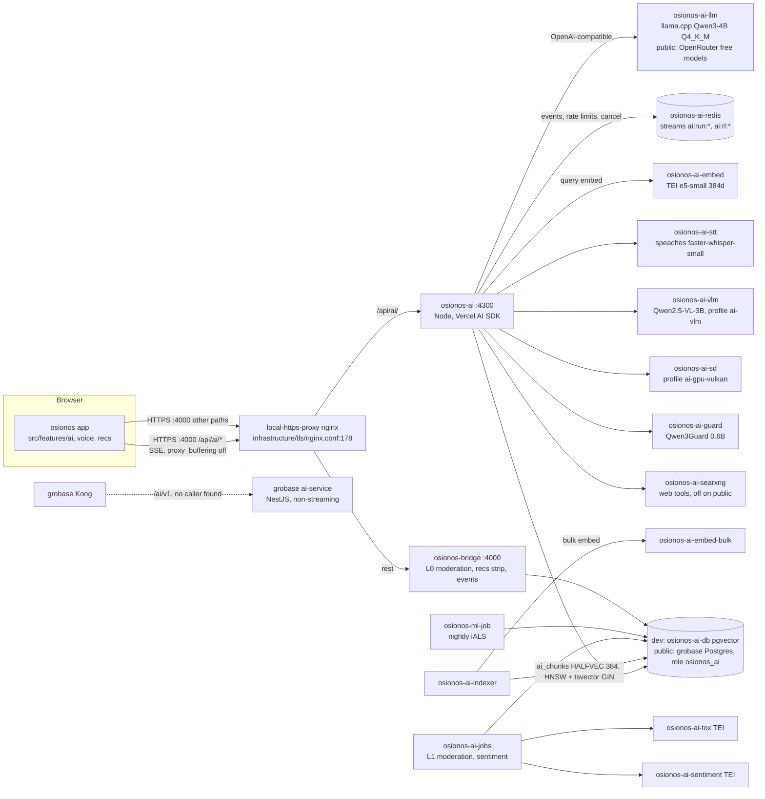

# AI audit — 2026-10-28

> **Status:** Partial · 2026-10-28
> **Evidence:** read-only `git grep` / `git ls-tree` against named refs (commands at the bottom);
> no test suite and no AI container was run for this page
> **To check:** every line marked ⟨unverified⟩; the five open questions at the end
> **Sources:** groot #155 · osionos `docs/ai/README.md` and `docs/ai/modules/m1…m7` (on osionos
> `develop`) · [02-modules](02-modules.md) · [runbooks/osionos-ai](../runbooks/osionos-ai.md)

What exists today for the seven AI modules of groot #155, where it lives, and what a new AI
module would collide with. It audits; it changes no code and no pin.

**The one fact that shapes everything below:** every AI service lives on osionos `develop`. The
osionos commit groot pins has none of it.

| Ref | SHA | Relation |
|---|---|---|
| groot `develop` (audited) | `fdf1f9de` | — |
| osionos pin (`apps/osionos/app`) | `74075b7e` | 2 ahead / 2121 behind osionos `develop`; reachable only from `refs/pull/138/head` — on no branch, not in `main`, not in `develop` |
| osionos `origin/develop` | `eec9396d` | holds `services/osionos-ai/`, `services/osionos-ml/`, `docs/ai/` |
| notion-database-sys pin | `1f0be6d7` | 143 behind its `develop`; the `sentiment` autofill is develop-only |
| grobase pin | `dfe1c282` | 49 behind its `develop`; no AI difference between the two |

`git -C apps/osionos/app ls-tree HEAD services` is empty. groot's compose already builds
`osionos-ai` and `osionos-ml-job` from `apps/osionos/app/services/…`
(`infrastructure/docker/osionos/ai.Dockerfile:50-62`, `docker-compose.yml:1096`), so
`--profile ai` against the pin cannot build ⟨unverified: derived from the `COPY` lines, no build
was run⟩.

---

## Module matrix

Status per ref. **Done** = the subject's bullets are implemented in code; **partial** = some are,
or the demonstration is blocked; **missing** = no code. The confidence letter is the one in the
groot README Modules table (`README.md:575-581`).

| # | Module (pts) | Pin `74075b7e` | osionos `develop` | Evidence on `develop` | Demo today | Tests on `develop` (not run here) |
|---|---|---|---|---|---|---|
| M1 | LLM interface (Major 2) | **missing** — only a key probe to the provider's model list (`scripts/bridge-connector.mjs:25`) | **done** for text; images **partial** | SSE `services/osionos-ai/src/http.ts:110`; OpenAI-compatible upstream `src/gateway/platform.ts:30`; per-user run limit `src/rateLimit.ts:84`, default 20/min `src/config.ts:47`; budget 402 `budget_exhausted` (README of the service) | B — `docker compose --profile ai up -d --build`, Assistant in the app; images need `OSIONOS_AI_IMAGES=on`, `--profile ai-gpu-vulkan`, the guard, `?osio.ai.images=1`, `/imagine` | `tests/runs.test.ts`, `runRateLimit.test.ts`, `complete.test.ts`, `images.test.ts`, `imagesOff.test.ts`, `imagesOutputCheck.test.ts` |
| M2 | RAG (Major 2) | **missing** | **done** in code; large-dataset demo **partial** | RRF fuse `src/retrieval/search.ts:277`, ACL re-check `:354`, `retrieve` `:564`, abstention `:469`; rerank timeout `src/retrieval/rerank.ts:16`; chunker `src/indexer/chunker.ts:190`; `HALFVEC(384)` + HNSW `models/osionos-ai-rag-migration.sql:60,91-93` | A in osionos docs, **B** in groot README; citations on the ai-dev stack; the 110 363-chunk corpus lives on a throwaway stack | `tests/retrieval.test.ts`, `aclAgreement.test.ts`, `rerank.test.ts` + `eval/wiki/*.test.mjs` (≈30 files match the RAG name pattern) |
| M3 | Recommendations (Major 2) | **missing** | **partial** | iALS via `implicit` `services/osionos-ml/osml/train.py:13`; flag `scripts/bridge-recs.mjs:73`; nightly job `docker-compose.yml:1096` | B — `OSIONOS_RECS_FOR_YOU=1`; beacon opt-in; job skips under 20 users; every offline number is SYNTHETIC; non-personalised fallback (C48) not met | `services/osionos-ml/tests/test_*.py` (10), `tests/bridge/bridge-recs*.test.mjs` (7), `bridge-events`, `bridge-personalization` |
| M4 | Moderation (Minor 1) | **missing** | **done** (warn + hold); auto-removal deliberately off | L0 gate `scripts/bridge-moderation-gate.mjs:70,122`; L1 scorer `services/osionos-ai/src/moderation/l1.ts:99`; TEI toxicity model `docker-compose.yml:669` | B — `OSIONOS_MODERATION_ACTIONS=hold`, `OSIONOS_MODERATION_STATE=1`; public runs `log` | `tests/moderation*.test.ts` (4), `tests/bridge/bridge-*moderation*.test.mjs` (6), `tests/canvas/*moderation*.test.ts` (6) |
| M5 | Voice / speech (Minor 1) | **missing** | **done** | `handleVoiceTranscribe` `src/routes/voice.ts:104`; speaches `faster-whisper-small` `docker-compose.yml:773`; nginx bucket `infrastructure/tls/nginx.conf:207-225`; read-aloud on the device ⟨unverified: browser API, per the M5 sheet⟩ | A in osionos docs, **B** in groot README; `--profile ai` + STT model in its volume; public answers `503 voice_unavailable` | `tests/voice.test.ts` (+ `voiceChild.ts`, `voiceFixtures.ts`) |
| M6 | Sentiment (Minor 1) | **missing** | **done** in code; licence blocks public | `handleSentimentPulse` `src/routes/sentimentPulse.ts:15`; TEI model `docker-compose.yml:714`; notion-database-sys `develop` `src/components/AutofillConfigPanel.tsx:39` (not in its pin) | C — owner/admin opt-in in Settings › AI; model licence undeclared | `tests/sentimentHandler`, `sentimentIsolation`, `sentimentPulse`, `sentimentRows`, `sentimentSettings` `.test.ts`, `tests/canvas/ai-sentiment-rows.test.ts` |
| M7 | Image tagging (Minor 1) | **missing** | **partial** | `handleMediaDescribe` `src/routes/mediaDescribe.ts:18`; VLM client `src/media/vlmClient.ts`; Qwen2.5-VL-3B `docker-compose.yml:989` | C — `--profile ai --profile ai-vlm`; browser flow and in-app search unverified (M7 sheet); no background tagging | `tests/mediaDescribe.test.ts`, `mediaDescribeOff.test.ts`, `mediaDescribeRate.test.ts` |

Every `src/` and `tests/` path above without a prefix is under `services/osionos-ai/` on osionos
`origin/develop`; `docker-compose.yml`, `models/` and `infrastructure/` are groot `develop`. Test
counts come from file-name patterns. Caveat: a name match neither proves the file tests that
module nor finds a test with an unrelated name.

**Points.** The groot README lists 10 AI points (3 majors, 4 minors). Under groot's own rule — a
module that cannot be demonstrated scores zero ([02-modules](02-modules.md)) — **0 of the 10 are
demonstrable from the pinned tree**, because nothing builds. osionos `docs/ai/README.md` counts 3
demonstrable (M2 + M5, rated A) against a develop checkout.

---

## Architecture as it is (osionos `develop` + groot `develop` compose)



| Concern | As it is | Where |
|---|---|---|
| Model providers | Dev: local llama.cpp, Qwen3-4B-Instruct-2507 Q4_K_M, alias `qwen3-4b`, 8192 ctx. Public: OpenRouter, zero-price models only. The SDK also carries `@ai-sdk/anthropic` and `@ai-sdk/google` for user connections ⟨unverified: which routes use them⟩ | `docker-compose.yml:537-581`, `docker-compose.public.yml:148-150`, osionos `services/osionos-ai/package.json` |
| Inference location | All in-cluster on CPU, except image generation (Vulkan GPU, `/dev/dri`) and the public text model (OpenRouter) | compose profiles `ai`, `ai-gpu-vulkan`, `ai-vlm`, `ai-classify` |
| Embedding model | `intfloat/multilingual-e5-small` (384 dims) on TEI `cpu-1.9.4`, two instances: query and bulk | `docker-compose.yml:582,622` |
| Vector store / index | pgvector 0.8.0, `ai_chunks.embedding HALFVEC(384)`, 16 hash partitions, HNSW `halfvec_cosine_ops` m=16 ef_construction=64, plus a `simple` tsvector GIN; page vectors also HNSW | `models/osionos-ai-rag-migration.sql:60,91-97`, `models/osionos-ai-graph-migration.sql:72` |
| Chunking | Sections at `heading_1..3`, chunks of ~300–500 tokens counted as `ceil(chars/4)`; only changed hashes re-embedded | osionos `src/indexer/chunker.ts:190`, `src/indexer/sections.ts:43` |
| Retrieval path | One SQL statement: top 50 lexical + top 50 vector, RRF (k=60), 20 chunks with at most 3 per page; SQL ACL pre-filter, then every page re-checked with the bridge's rule; optional cross-encoder rerank (off by default: p95 22 s vs 1.5 s timeout) | osionos `src/retrieval/search.ts:277,354,564`, `rerank.ts:16` |
| Streaming transport | SSE from `osionos-ai`, events persisted in a Redis Stream so a reconnect resumes on any replica. Path: browser → nginx `:4000` → `osionos-ai:4300`. **Not through Kong.** | `infrastructure/tls/nginx.conf:178-199` |
| Rate limiting | Three layers: nginx `public_ai` 2 r/s per client (public overlay) and `public_ai_voice` 1 r/s; service Redis counters `ai:rl:<user>:<minute>` (runs 20/min default, plus image/describe/related/sources prefixes); money budget reserved before the upstream call (per user and platform, daily) | `infrastructure/tls/public.d/http-limits.conf:19`, `nginx.conf:23`, osionos `src/rateLimit.ts:24-27,62-100`, `src/config.ts:47` |
| Error handling | Config errors stop the service and name the variable; refused budget → 402; failed retrieval → run continues without sources; failed rerank → fused order stands; L1 classifier down → job retries, never hides | osionos `services/osionos-ai/README.md` (sections "The search of a workspace", "The money", "L1 moderation worker") |
| Evals | `eval/run.ts` (golden set n=68), `eval/wiki/measure-rag.ts` (110k), `eval/answers/` (LLM judge), `eval/provider-routing.ts`, `eval/summary-recall.ts` — the last is the `feat/ai-context-eval` branch, fully merged (0 ahead) | osionos `services/osionos-ai/eval/` |
| Legacy AI | grobase `src/apps/ai-service` (NestJS, Anthropic/OpenAI/Ollama, non-streaming `complete`), behind Kong `/ai/v1` with key-auth + jwt. Zero references to `/ai/v1` in osionos `develop` | grobase `infra/docker/services/kong/conf/kong.yml:1145`, `src/apps/ai-service/src/chat/chat.service.ts:110` |

**Env var names** (values never read for this page). `osionos-ai` in `docker-compose.yml:352-484`:
`OSIONOS_AI_BRIDGE_URL`, `OSIONOS_AI_DATABASE_URL`, `OSIONOS_AI_EMBED_URL`, `OSIONOS_AI_IMAGES`,
`OSIONOS_AI_IMAGE_CHECK_DIR`, `OSIONOS_AI_IMAGE_MICROUSD`, `OSIONOS_AI_IMAGE_URL`,
`OSIONOS_AI_MCP_CLIENT`, `OSIONOS_AI_PLATFORM_MODELS`, `OSIONOS_AI_PORT`,
`OSIONOS_AI_PROMPT_GUARD_MODEL`, `OSIONOS_AI_PROMPT_GUARD_URL`, `OSIONOS_AI_REDIS_URL`,
`OSIONOS_AI_RESEARCH`, `OSIONOS_AI_RESEARCH_PLATFORM_DAILY`, `OSIONOS_AI_SEARXNG_URL`,
`OSIONOS_AI_STT_MODEL`, `OSIONOS_AI_STT_SECONDS_PER_DAY`, `OSIONOS_AI_STT_TIMEOUT_MS`,
`OSIONOS_AI_STT_URL`, `OSIONOS_AI_SUMMARY`, `OSIONOS_AI_UPSTREAM_BASE_URL`, `OSIONOS_AI_VLM_URL`,
`OSIONOS_AI_WEB`, `OSIONOS_ALLOWED_ORIGIN`, `OSIONOS_BAAS_URL`. Public overlay adds
`OSIONOS_AI_PUBLIC_DATABASE_URL`, `OSIONOS_AI_PUBLIC_UPSTREAM_API_KEY`,
`OSIONOS_AI_PUBLIC_PLATFORM_MODELS`, `OSIONOS_AI_PUBLIC_KEK`,
`OSIONOS_AI_PUBLIC_USER_DAILY_MICROUSD`, `OSIONOS_AI_PUBLIC_PLATFORM_DAILY_MICROUSD`,
`OSML_PUBLIC_DATABASE_URL`. Module switches: `OSIONOS_RECS_FOR_YOU`,
`OSIONOS_MODERATION_ACTIONS`, `OSIONOS_MODERATION_STATE`, `OSIONOS_SENTIMENT_URL`,
`OSIONOS_AI_RUNS_PER_MINUTE`, `OSIONOS_AI_USER_DAILY_MICROUSD`,
`OSIONOS_AI_PLATFORM_DAILY_MICROUSD`.

---

## Ownership and collisions

Open PRs and remote branches with a commit since 2026-10-07 that are **not** merged into their
`develop` and touch AI paths.

| Repo | Ref | Author | Last commit | What it does | Collision |
|---|---|---|---|---|---|
| groot | PR #165 `fix/ci` → **`main`** (open, ready) | danielfdez17 | 2026-10-28 | 31 files: submodule bumps, `[[ ]]` shell style, adds 3 bridge modules to `ai.Dockerfile` + `.dockerignore` | **High** — edits the AI image's import closure and pins; targets `main`, not `develop` |
| groot | `feat/hydrawn-service` | LESdylan | 2026-10-28 | serves the whiteboard as its own service; touches `docker-compose.yml` / nginx host ports | Low — same compose and nginx files every AI service lives in, but no `osionos-ai` or `/api/ai` line changed |
| osionos | `fix/ci-knn-partition-flake` | LESdylan | 2026-10-26 | one commit: `services/osionos-ai/tests/relatedKnn.test.ts` | Low — branched before 38 files under `services/` changed; a two-dot diff shows them all |
| grobase | PRs #58, #59 | SMOSTAFAH1 | 2026-10-28 | release / shfmt | None — no AI path (an `ai` substring in `availability` matched) |

No open PR in osionos. Every groot `feat/ai-*` / `ml-*` branch and every osionos `ai-*` branch
from the last three weeks is merged into its `develop` (0 ahead). Of 365 commits since
2026-10-07 on osionos `develop` under `services/osionos-ai`, `services/osionos-ml` and `docs/ai`,
360 carry the names LESdylan, dylan or dlesieur ⟨unverified: one person⟩; the rest are Seyed
Mostafa Hashemian (1), coderabbitai (1) and opencode (3).

**Where a new module would collide**

1. **The osionos pin.** Any AI work has to land on osionos `develop` and then be pinned; the
   current pin is 2121 commits behind and on no branch. Whoever bumps it inherits all 7 modules,
   their migrations and their flags at once.
2. **`infrastructure/docker/osionos/ai.Dockerfile` + `docker-compose.yml`.** One image and one
   compose file carry every AI service; #165 is editing the image now.
3. **`services/osionos-ai/src/rateLimit.ts`, `src/config.ts`, `src/http.ts`.** The shared
   rate-limit prefixes, the zod config schema and the route table; any new route edits all three.
4. **`models/osionos-ai-*-migration.sql` ordering.** `scripts/apply-models-migrations.sh` documents
   filename-sort dependencies (lines 83-156); a new file name can sort before the table it needs.

---

## Open questions

1. **Bump the osionos pin?** Until it moves, groot's AI compose and README rows describe code the
   pinned tree does not contain. The bump also has to satisfy "pins reachable from `main` AND
   `develop`", which `74075b7e` does not today (nor does opposite-osiris `ea8836db`).
2. **A or B for M2 and M5?** osionos `docs/ai/README.md` says A; groot `README.md:576,579` says B.
   One of them is stale.
3. **Is the M1 prompt guard still missing?** The M1 sheet (2026-10-23) says the `ai-guard` service
   is not deployed; groot `docker-compose.yml:947` now defines `osionos-ai-guard` under
   `ai-gpu-vulkan` ⟨unverified: not started⟩.
4. **Does "auto deletion" in the M4 subject text require removal?** The project ships warn + hold
   and refuses auto-removal on measured precision (< 0.95). An evaluator may read the minor as
   requiring it ⟨unverified: grading interpretation⟩.
5. **Retire or document grobase `ai-service`?** It is routed by Kong at `/ai/v1` and has no caller
   found in osionos `develop`. Report only — grobase is not changed by this page.

Also stale: the RAG sheet cites `search.ts:223 / :332 / :339`; on osionos `develop` those
functions are now at `:354` (`readablePages`), `:469` (`shouldAbstain`), `:476`
(`abstainThreshold`). `claude/WORKFLOW.md`, named in the task, exists in no repo or ref checked.

---

## How this page was produced

All from the groot root, after `git fetch origin && git pull --ff-only && git submodule update
--init --recursive` (exit 0 each; the fetch printed a warning that submodule `apps/hydrawn` commit
`e36f10a9` could not be fetched — that path is not in `develop`'s tree).

```sh
git -C <submodule> fetch origin                                   # exit 0, all 13
git -C <submodule> rev-list --left-right --count HEAD...origin/develop
git -C apps/osionos/app branch -r --contains HEAD                 # empty
git -C apps/osionos/app ls-remote origin | grep 74075b7e          # refs/pull/138/head only
git -C apps/osionos/app ls-tree HEAD services                     # empty
git -C <repo> grep -I -n -i -E '<AI term regex>' <ref> -- . ':(exclude)…lockfiles…'
git -C apps/osionos/app show origin/develop:<file> | sed -n '<line>p'   # each file:line above
gh pr list --repo Univers42/{groot,osionos,grobase} --state open  # exit 0
git for-each-ref --sort=-committerdate refs/remotes/origin        # + diff vs origin/develop
```

Caveat: the search is a keyword regex over tracked files. It misses AI code named without any of
the terms, and the lockfile exclusion did not apply to root-level lockfiles (counts only, no
conclusion rests on them).
