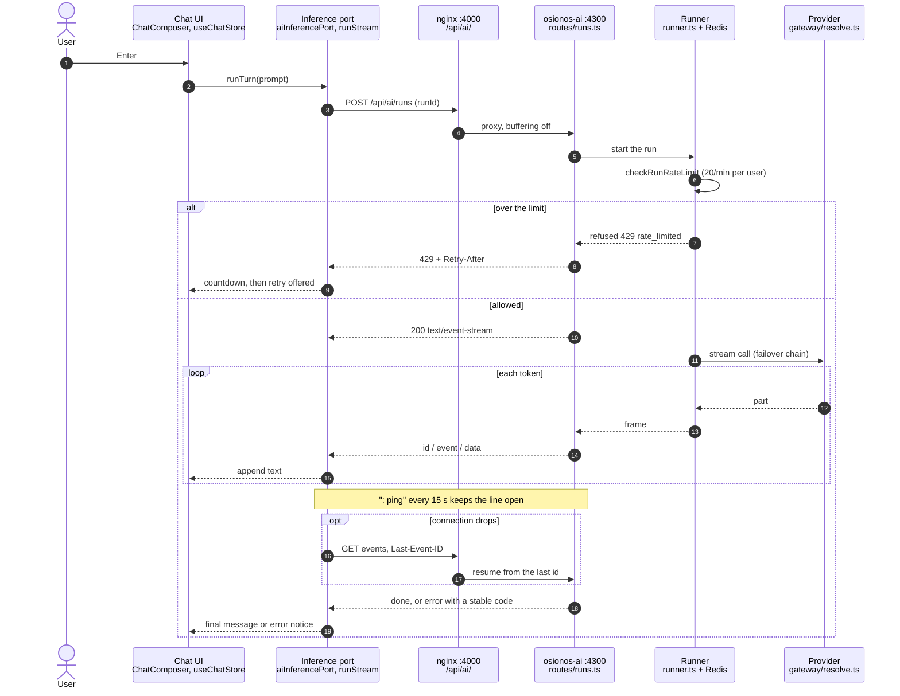

# The LLM interface, explained

> **Status:** Partial · 2026-11-04
> **Evidence:** read-only reads of osionos at groot's `develop` pin `1c1d5d84` (the AI code is
> identical to osionos `develop` `d374c21f`, per `git diff --stat` on `services/`, `docs/ai` and
> `src/features/{ai,voice,recs}`). Each cited `file:line` was opened at that pin. #275 was read
> at its merge commit `1e757c3a`. No container was run and no question was asked for this page
> **To check:** the nginx buffering and timeouts (no test covers them); the provider-error
> patterns against live providers (`upstreamError.ts:14-19`); the groot pin bump that brings in
> #275
> **Sources:** groot #155 · osionos #270, #275 · osionos `docs/adr/0007-upstream-error-codes.md`,
> `0008-quota-aware-failover.md` · [ai-stall-diagnosis-2026-10-29](ai-stall-diagnosis-2026-10-29.md)
> · [runbooks/osionos-ai](../runbooks/osionos-ai.md)

The README claims the **Complete LLM system interface** major (row 15) for text, streaming,
error handling and rate limiting. This page follows one question from the keyboard to the model
and back, so a reviewer can open each step and check that claim. Image generation exists, but it
is off by default and is not part of the claim.

Paths are in osionos (`apps/osionos/app`) unless prefixed `G` (groot). Paths under
`services/osionos-ai/` drop that prefix after the first hop that enters the service (hop 5).

---

## One question, start to finish

## The twelve hops

| # | Hop | file:line |
|---|---|---|
| 1 | Send (Enter or the button) | `src/widgets/chat-shell/ui/ChatComposer.tsx:204`, `:305`; slash expansion `src/widgets/chat-shell/model/useSlashPalette.ts:159-169`; `ChatShell.tsx:169-179` |
| 2 | Chat store `send` and `runTurn` | `src/features/chat/model/useChatStore.ts:373`, `:204`, `:409`; error patch `:222-232`; stop `:434` |
| 3 | Inference port | `src/features/ai/model/aiInferencePort.ts:111-157` (runId `:113`, abort → cancel `:121`) |
| 3b | Stream client and resume | `src/features/ai/model/runStream.ts:77-135`: 3 resumes after 500, 1000 and 2000 ms (`:34`, `:124`); dedup + `Last-Event-ID` (`:89-95`); 410 → `run_expired` (`:115`); a 4xx is never resumed (`:109`) |
| 3c | Transport | `src/features/ai/api/aiClient.ts:118` (`/api/ai`), `:188-207`, `:330` start, `:350` resume, `:358` cancel |
| 4 | nginx | `G infrastructure/tls/nginx.conf:178-200`: upstream `osionos-ai:4300` `:179`, `proxy_buffering off` `:195`, `proxy_read_timeout 300s` `:197`. Public limit: `G infrastructure/tls/public.d/ai-public.conf:4` + `public.d/http-limits.conf:19` (2 r/s, burst 10) |
| 5 | Route table | `services/osionos-ai/src/routes/table.ts:148` (POST /runs), `:151` (events), `:157` (cancel), `:141` (/images) |
| 6 | `handleRuns` | `routes/runs.ts:178-293`: refusal + `Retry-After` `:276-280`; SSE opens `:283`; ping every 15 s `:118`; resume endpoint `:295-324` |
| 7 | Runner and per-user limit | `runs/runner.ts:205`; `checkRunRateLimit` `:260-264`; `orderByRest` `:388`; `reserveTarget` `:397` |
| 8 | Failover loop | `runs/upstream.ts:241`, `:248` (`maxRetries` 0 when a chain exists), `:274-289` move on, catch `:362-390`; `chain.ts:26`, `cooldown.ts:99,172`, `moveOn.ts:32-66`, `attempt.ts:49` (3 attempts) |
| 9 | Stream pump | `runs/streamPump.ts:232-252`; timeouts 30 s idle and 120 s total (`:25`, `:27`) |
| 10 | Provider | `gateway/resolve.ts:124-140` (anthropic, google, openai-compatible), `:176`; `gateway/platform.ts:28-32`; `connections/providers.ts:13,16` |
| 11 | SSE framing | `http.ts:108-129` (`x-accel-buffering: no`, id/event/data, `: ping`) |
| 12 | Frame dispatch → UI error | `src/features/chat/model/runEventDispatch.ts:204-214`; `ChatThread.tsx:278-285`; `src/features/chat/model/runErrorNotice.ts:42-59`; `src/features/chat/model/runErrors.ts:79-124` |

**Why the hops are shaped this way.** The browser never talks to a provider (hops 4–10 run on
the server), so a provider key never reaches the client. The answer streams over SSE instead
of one long response, and nginx must not buffer it (hop 4, hop 11). A dropped connection resumes
from the last event id instead of starting the question again (hop 3b). And every failure ends
as a stable code the UI can name (hop 12).

---

## Subject bullet → code → tests → CI

The CI jobs are in osionos `.github/workflows/ci.yml`. "AI service" is the job
`AI service (tsc + suite)` (`:314`), which runs `services/osionos-ai/scripts/ci.sh`. "Canvas" is
the `Canvas unit tests` step of `quality (root)` (`:285`).

| Subject bullet | Main files | Tests that prove it | CI job | What is not proven |
|---|---|---|---|---|
| Generate text | hops 1–12 | `tests/canvas/ai-chat-store.test.ts`, `ai-run-dispatch.test.ts`; `services/osionos-ai/tests/runs.test.ts`, `complete.test.ts` | Canvas; AI service | — |
| Streaming | `runStream.ts`, `aiInferencePort.ts`, `routes/runs.ts:283-324`, `http.ts:108-129` | `tests/canvas/ai-run-stream.test.ts`; `runs.test.ts`; `failover.test.ts` | Canvas; AI service | nginx buffering and timeouts; the ping and the idle/total timeouts on the happy path |
| Error handling | `runs/upstreamError.ts`, `upstream.ts:362-390`, `failover.ts`, `routes/complete.ts`; client `runErrors.ts:79-124` | `tests/upstreamError.test.ts`, `upstreamErrorRuns.test.ts`, `upstreamErrorLeak.test.ts`; `tests/canvas/ai-run-dispatch.test.ts` | AI service; Canvas | the UI shows one sentence for all the new codes (`runErrors.ts:72`, `:87-90`); the patterns were not checked against live providers |
| Rate limiting | `src/rateLimit.ts:62-84` (fixed 60 s window, Redis `INCR` + `EXPIRE NX`), `OSIONOS_AI_RUNS_PER_MINUTE` default 20 (`config.ts:48`), used at `runner.ts:260`; nginx `public_ai`; UI countdown `runErrorNotice.ts` | `tests/runRateLimit.test.ts`, `approvalRateLimit.test.ts`; `tests/canvas/ai-run-stream.test.ts` | AI service; Canvas | no direct unit test of `rateLimit.ts`; a fixed window lets up to twice the limit through at a boundary (its own caveat, `rateLimit.ts:6-9`) |
| Generate images (**not claimed**) | `routes/images.ts:141-282`, `images/engine.ts`, `promptGate.ts`, `outputCheck.ts`; client `imageRun.ts`, `AiImageJobView.tsx` | `tests/images.test.ts`, `imagesOff`, `imagesOutputCheck`, `imagesPromptGate`; `tests/canvas/ai-image-run.test.ts` | AI service; Canvas | off by default (404 unless `imagesEnabled`, `images.ts:144`); CI uses a mock engine only |

**No groot workflow builds `--profile ai`.** The tests above run in osionos CI against the
service alone. Nothing in groot CI starts the composed stack with the AI profile.

---

## What #270 and #275 added

**osionos #270: stable codes for provider failures** (merged 2026-11-03, on develop as
`553f2afc`, **in** groot's pin). Before it, every provider failure reached the browser as
`upstream_error`, so a 429, a daily cap and an oversized prompt looked the same.

- `runs/upstreamError.ts` maps a failure to `rate_limited`, `quota_exhausted`,
  `provider_unavailable`, `context_too_long` or `upstream_error`. The error frame carries the
  code, and `ai_runs.error` records `code[:status[:type]]`.
- Provider bodies and prompts are kept out of the service logs (`upstreamErrorLeak.test.ts`).
- The client reads the new codes (`runErrors.ts:88-90`), but still shows them as one sentence.
- Decision record: `docs/adr/0007-upstream-error-codes.md`.

**osionos #275: failover that knows the free quota is shared** (merged 2026-11-04 by LESdylan,
on develop as `1e757c3a`, **not yet in groot's pin `1c1d5d84`**). Every public user spends one
OpenRouter key on `:free` routes, and the SDK retried each step twice, so one question could
spend 15 calls.

- The SDK never retries (`maxRetries: 0`). The chain is the retry, and a run with one route
  retries once on a 5xx or a network failure.
- `runs/quota.ts`: one Redis key rests every free route for everyone, for up to 300 s. While it
  rests, a run whose routes are all free is refused with 429 and `Retry-After`.
- A run makes at most 7 provider calls (14 in research mode).
- Tests: `tests/quota.test.ts`, `tests/quotaFailover.test.ts`. Decision record:
  `docs/adr/0008-quota-aware-failover.md`.
- It does not touch `rateLimit.ts`, the per-user limit.

---

See also: [README Modules](../../README.md#-modules-and-points) · [02-modules](02-modules.md) ·
[ai-stall-diagnosis-2026-10-29](ai-stall-diagnosis-2026-10-29.md) ·
[runbooks/osionos-ai](../runbooks/osionos-ai.md)
