# AI stall diagnosis — 2026-10-29

> **Status:** Diagnosis only · 2026-10-29
> **Evidence:** read-only reads of osionos `origin/develop` at `1cc17e5c` (worktree
> `~/wt/osionos-ai-stall`) and groot `develop` at `fdf1f9de`; no test, no container and no
> request was run for this page; baas logs **not read** (ssh refused, see Evidence)
> **To check:** every line marked ⟨unverified⟩; the experiment in § Hypotheses
> **Sources:** groot #155 ("the assistant stops answering after a couple of questions") ·
> [ai-audit-2026-10-28](ai-audit-2026-10-28.md) · [runbooks/osionos-ai](../runbooks/osionos-ai.md)

Why could the assistant answer one or two questions and then stop? This page traces one question
end to end and lists every limit along the way that can make a later question fail or hang. It
ends with three ranked hypotheses and one experiment that tells them apart. It changes no code.

Paths without a prefix are under `services/osionos-ai/src/` on osionos `1cc17e5c`. A path
under `src/features/…` or `src/widgets/…` is the osionos frontend at the same SHA.
`infrastructure/`, `docker-compose*.yml` and `wiki/` are groot `develop`. As
[ai-audit](ai-audit-2026-10-28.md) records, the osionos commit groot pins (`74075b7e`) has no
`services/`. So what is described here is osionos `develop`, not the pin.

---

## 1. The request path of one question

| # | Hop | file:line | What it does |
|---|---|---|---|
| 1 | Composer | `src/widgets/chat-shell/ui/ChatShell.tsx:179` | `send(active.id, value, sel)` |
| 2 | Chat store | `src/features/chat/model/useChatStore.ts:373` (`send`), `:399` (one-run lock), `:203-232` (`runTurn`) | Adds the user message, opens an assistant message `status: "streaming"`, registers an `AbortController` in `activeRuns` |
| 3 | Inference port | `src/features/ai/model/aiInferencePort.ts:111-157` | Mints `runId`, attaches fallbacks/effort, wires abort → `POST /runs/:id/cancel` |
| 4 | Resume loop | `src/features/ai/model/runStream.ts:77-135` | Relays frames once each; on a drop resumes up to 3× (500/1000/2000 ms) via `GET /runs/:id/events` |
| 5 | HTTP client | `src/features/ai/api/aiClient.ts:316` (`startRun`), `:336` (`resumeRun`), `:174-193` (`requestStream`), `aiContract.ts:412` (`toAiError`) | `POST {base}/api/ai/runs`, `Accept: text/event-stream`; a non-2xx becomes `AiError(status, code)` |
| 6 | nginx :4000 | `infrastructure/tls/nginx.conf:154`, `location /api/ai/` `:178-199` | `proxy_buffering off`, `proxy_read_timeout 300s`, `client_max_body_size 64k`; public overlay adds `limit_req` (`infrastructure/tls/public.d/ai-public.conf:4-5`) |
| 7 | Dispatch | `routes/table.ts:136` → `server.ts:137` | `POST /api/ai/runs` → `handleRuns`; one `request` log line per request (`server.ts:80`) |
| 8 | Run route | `routes/runs.ts:179-293` | Zod body (`:27-115`), `resolveTarget` (`:184`), `resolveFallbacks` (`:189`), research gate, `startRun` (`:238`), SSE headers + 15 s ping (`:117-126`, `:283-284`) |
| 9 | Preflight | `runs/runner.ts:203-456` | Insert row (`:212`; 409 if one already runs `:224-227`), rate limit (`:258-263`), attachments, history window (`:284-287`), pages/sources/skills/memories, estimate, `orderByRest` (`:378-381`), budget reserve (`:387-391`), user turn (`:400`) |
| 10 | Model router | `gateway/resolve.ts` (`resolveTarget`, `reserveTarget:80-98`), `routes/fallbacks.ts`, `runs/chain.ts:14-34`, `runs/cooldown.ts:172-183` | Target = platform model or user connection; ≤2 client-sent fallbacks; a resting model is skipped while a later one is ready |
| 11 | Provider call | `runs/upstream.ts:232-288` → `runs/streamPump.ts:178-307` → `gateway/platform.ts:28-32` | `streamText` on `@ai-sdk/openai-compatible` at `OSIONOS_AI_UPSTREAM_BASE_URL`; tool loop ≤ `MAX_STEPS = 5` (`tools/loop.ts:17`) |
| 12 | Failover | `runs/moveOn.ts:32-67`, `runs/attempt.ts:103-117`, `runs/failover.ts:65-83` | Moves only when nothing was emitted yet, and only on 429 / 5xx / network / attempt timeout |
| 13 | Stream back | `runs/upstream.ts` `emit(...)` → `http.ts:118` (`writeSseFrame`) + `runs/runStore.ts:48-49` (Redis stream, TTL 900 s) | Frames `text.delta`, `tool.*`, `route`, `usage`, `done` / `error`; resume reads `runStore.follow` (`:120-148`) |
| 14 | UI | `src/features/chat/model/runEventDispatch.ts:203-205`, `runErrors.ts:73-105` | `error` frame → assistant message `status: "error"` + sentence per code |

**"C393 routing" is not the run router.** C393 is the provider-routing proof of the *summary*
call (`services/osionos-ai/eval/provider-routing.ts:3`). The summary sits behind
`OSIONOS_AI_SUMMARY`, which is empty in public (`docker-compose.public.yml:142`) and by default
in dev (`docker-compose.yml:430`). The router a question really goes through is hops 10 and 12.

---

## 2. Everything that can fail or hang the Nth question

"Logged" means a line on the container's stdout. The service logs exactly one `request` line per
HTTP request, carrying the status (`server.ts:80`). **A run that fails *inside* the SSE stream
still logs `status: 200`.** Its failure code lives only in `public.ai_runs.error` and the frame
the client got. `upstream.ts` has no `console.*` call.

| Limit | Threshold / default (env) | Where | What the user sees | Logged? |
|---|---|---|---|---|
| Per-user run rate | 20 runs / fixed 60 s window (`OSIONOS_AI_RUNS_PER_MINUTE`) | `config.ts:47`, `rateLimit.ts:62-91`, `runner.ts:258-263` | 429 → "Too many requests — try again in N s" (`runErrors.ts:74`) | yes, `request` status 429 |
| Daily $ budget, user | 200 000 µUSD = $0.20 (`OSIONOS_AI_USER_DAILY_MICROUSD`) | `config.ts:45`, `budget.ts:33-56`, `runner.ts:387-391` | 402 → "Today's AI budget is used up" | yes, status 402 |
| Daily $ budget, platform | 20 000 000 µUSD (`OSIONOS_AI_PLATFORM_DAILY_MICROUSD`) | `config.ts:46` | same 402 | yes, status 402 |
| Reservation size | 2 step ceilings: (prompt + `TOOL_DEFINITION_CHARS`)/4 tokens in + `OSIONOS_AI_MAX_OUTPUT_TOKENS` (1024) out, twice, the 2nd with +20 000 chars | `runs/estimate.ts:118-169`, `tools/loop.ts:25` | — (only bites with a priced model; both shipped model lists are zero-price: `docker-compose.yml:393`, `docker-compose.public.yml:150`) | — |
| One run per conversation | partial unique index `ai_runs_one_running_per_conversation` | `runner.ts:224-227` | 409 → "A run is already going on in this conversation" | yes, status 409 |
| Client one-run lock | `activeRuns.has(conversationId)` → **silent `return`** | `useChatStore.ts:397-399` | **nothing at all** — no message, no error | no |
| History window | newest-first up to 24 000 chars (`HISTORY_CHAR_BUDGET`); the newest message is always kept, whatever its size | `runs/prompt.ts:56`, `:101-117` | — (input grows with N until the cap) | no |
| Quoted pages / tool pool | ≤3 pages × 12 000 chars; tools ≤20 000 chars/step, ≤80 000/run | `runs/prompt.ts:183`, `tools/loop.ts:17-39` | — | no |
| Model context window (local) | llama.cpp `-c 8192`, Qwen3-4B Q4_K_M, image `server-b11580`, no `-np` | `docker-compose.yml:537-555` | prompt over the window → upstream 400 → `upstream_error` "The AI service failed — try again" ⟨unverified: llama.cpp's reply to an over-long prompt and its default slot count were not exercised⟩ | no (only llama.cpp's own log) |
| Model context window (public) | ≥200 000 tokens for the recorded OpenRouter free list | `agents/prefix.ts:26-41` | — | — |
| Upstream 429 / 5xx, no fallbacks | SDK retries 2× (`SDK_DEFAULT_RETRIES`), then the run ends | `streamPump.ts:30`, `:252`; `upstream.ts:361-377` | `upstream_error` "The AI service failed — try again" | no (row `error = 'upstream_error'`) |
| Upstream 429 / 5xx, with fallbacks | 0 SDK retries (`upstream.ts:241`); ≤3 attempts (`attempt.ts:49`); moves only if **nothing emitted** (`attempt.ts:108`) | `moveOn.ts:44-66` | `route` frame, then the next model; a 429 on step ≥2 of a tool loop (after a `tool.called`) does **not** move → `upstream_error` | no (row `usage.attempts`) |
| Every route fails | last attempt's error ends the run (`moveOn` → `stay`) | `upstream.ts:268-288` | `upstream_error` / `timeout` | no |
| Model rest (cooldown) | 60 s default, Retry-After honoured up to 300 s; platform-wide only after ≥3 failures from ≥2 users in 30 s | `runs/cooldown.ts:27-31` | resting model skipped if a fallback exists; if all rest, the primary is tried anyway (`tests/cooldownRuns.test.ts:55`) | no |
| Idle upstream | 30 s with no stream part (`IDLE_TIMEOUT_MS`), incl. prompt processing before the first token and tool execution | `streamPump.ts:25`, `:230-244` | `timeout` "The model took too long — try again" | no |
| Total upstream | 120 s per attempt (`TOTAL_TIMEOUT_MS`) | `streamPump.ts:27` | `timeout` | no |
| Stale run sweep | a row `running` for 10 min (`STALE_RUN_MS`), swept once a minute | `runner.ts:64`, `runs/repo.ts:163-186`, `server.ts:26` | until swept: 409 `run_in_progress` on the same conversation; the sweep writes **no** terminal frame | `sweep_failed` only on error |
| Run stream TTL | 900 s, MAXLEN ~2000 | `runs/runStore.ts:19-21` | resume after → 410 `run_expired` | yes, status 410 |
| Client resume | 3 resumes, 500/1000/2000 ms, then gives up | `runStream.ts:34`, `:124-131` | `resume_failed` — **the run keeps going on the server** and holds the conversation (409 above) | no |
| Resume follow | ONE blocking Redis connection per process (30 s command timeout) shared by every follower; `XREAD BLOCK 15000` | `server.ts:161`, `runs/runStore.ts:23`, `:120-148` | with ≥2 concurrent resumes, reads queue behind each other ⟨unverified: inferred from ioredis serialising one connection; not measured⟩ | `request_failed` if it times out |
| SSE keep-alive | ping every 15 s | `routes/runs.ts:118` | keeps nginx's 300 s read timeout from firing; also keeps a stuck follow open indefinitely | — |
| nginx read timeout | 300 s (`/api/ai/`); 1 h globally | `nginx.conf:197`, `:66` | 504 — not reachable while pings flow | nginx access log |
| nginx public bucket | 2 r/s per client, burst 10, `nodelay`, 429, over **every** `/api/ai/*` path | `public.d/ai-public.conf:4-5`, `public.d/http-limits.conf:19` | 429 with nginx's HTML body → `toAiError` yields code `unknown`, which `runErrors.ts` has no sentence for ⟨unverified: fallback sentence not traced⟩ | nginx access log only |
| Client stream reader | no client-side idle timeout | `@osionos/http-gate` `src/sse.ts:116-130` (submodule `35b398e3`) | a stream that never closes keeps `activeRuns` set → the silent lock above | no |
| Abort | Stop → `AbortController.abort()` → `POST /runs/:id/cancel` | `useChatStore.ts:434-437`, `aiInferencePort.ts:119-123` | `cancelled`; the lock clears in `finally` (`useChatStore.ts:230-231`) | status 202 |

---

## 3. Hypotheses for "stops after 2–3 questions"

Ranked by how well each one explains "a couple of questions, then nothing". Each is labelled with
the environment it can happen in.

### H1 — Public: the shared OpenRouter free-tier key runs out (rate per minute / per day)

Every user of public spends **one** platform key (`docker-compose.public.yml:148-150`), and the
models are `:free` only (`agents/prefix.ts:26-30`). One question is 1 to 5 upstream requests
(tool loop, `tools/loop.ts:17`). Without fallbacks the SDK adds 2 retries on a 429
(`streamPump.ts:30`), so a question can cost up to 15 requests. OpenRouter caps free models per
key, per minute and per day ⟨unverified: external quota, not read from OpenRouter for this
page⟩. A 429 maps to `upstream_error` (`upstream.ts:361-377`), and the model then rests 60–300 s
for that user (`cooldown.ts:27-28`).

- **Confirms:** `ai_runs.error = 'upstream_error'` for the failing runs, with
  `usage.attempts[].outcome = 'rate_limited'` when a chain was sent. A fresh conversation fails
  the same way at the same moment, and so does a second user. Waiting a minute (or until the
  next UTC day) fixes it.
- **Kills:** the failure follows the conversation, not the clock. Or it happens on the local
  `qwen3-4b` stack, which has no third-party quota.

### H2 — Local: the prompt grows past what Qwen3-4B on llama.cpp can take (window or 30 s idle)

Each turn adds the previous answer (up to 1024 tokens) to the history, up to 24 000 chars ≈
6 000 tokens (`prompt.ts:56`). On top of that come the system prompt, the tool definitions
(`TOOL_DEFINITION_CHARS`, counted on every step, `estimate.ts:49-51`) and up to 20 000 chars of
tool output per step. The local model is served with `-c 8192` (`docker-compose.yml:550-551`).
So around question 3, two things can happen: the prompt plus 1024 output tokens no longer fits
(upstream 400 → `upstream_error`, which never fails over, `failover.ts:78`), or CPU prompt
processing passes the 30 s idle clock before the first token (`timeout`) ⟨unverified: the real
size of `TOOL_DEFINITION_CHARS` and llama.cpp's prompt speed on this host were not measured⟩.

- **Confirms:** the failing frame is `upstream_error` or `timeout` *inside* a 200 stream. The
  osionos-ai-llm log shows a context-size refusal or a long prompt-eval. A **fresh**
  conversation answers again at once.
- **Kills:** it also fails in a fresh conversation on question 1. Or it happens on public
  (200 000-token models).

### H3 — Any environment: a run that never settles locks the conversation

The client allows one run per conversation and refuses a second send **silently**
(`useChatStore.ts:397-399`). The server allows one `running` row per conversation (409,
`runner.ts:224-227`). If the client gives up on a stream (3 resumes in ≈3.5 s,
`runStream.ts:34`) while the server run keeps going, the next send gets a 409. That lasts until
the run ends (≤120 s per attempt × 3) or the sweep fails it at 10 min (`runner.ts:64`). If
instead the client's stream never closes (a `follow` that waits for a terminal frame the sweep
never writes, kept open by 15 s pings), the next send does **nothing** and makes no request.

- **Confirms:** the failing send makes **no** network request (client lock), or gets a 409
  `run_in_progress`. An `ai_runs` row of that conversation sits in `running`, or later shows
  `error = 'timeout'` written by the sweep. A page reload clears it (`activeRuns` is in memory).
- **Kills:** every failing send shows a POST that streams and ends with an `error` frame.

### The single cheapest experiment that separates them

In the affected environment, with DevTools › Network open, filtered on `/api/ai/runs`:

1. In **one** conversation, send four one-word questions ("hi"), waiting for each answer.
2. When one fails, at once send "hi" in a **new** conversation.

| What the failing send shows | Then the new conversation | Verdict |
|---|---|---|
| No request at all, or `409 run_in_progress` | answers | **H3** |
| `200` stream ending in an `error` frame (`upstream_error` / `timeout`) | answers | **H2** |
| `200` stream ending in `upstream_error` (or a `route` frame first) | fails too, and recovers after ~60 s | **H1** |

One read-only follow-up confirms it without the UI:
`select created_at, status, error, model, usage->'attempts' from public.ai_runs where
conversation_id = '<id>' order by created_at;`

---

## 4. Tests that cover these paths (none run here)

| File | What it asserts | N questions in one conversation? |
|---|---|---|
| `tests/runs.test.ts:30-283` | stream + keep answer; replay; foreign 404; resume once; **second run on same conversation → 409** (`:116`); no money → refused (`:129`); cancel; allowlist; page ACL; **sweep frees a stale run** (`:254`) | 2, and only concurrent (the 409 case) |
| `tests/runRateLimit.test.ts:42` | the 2nd run in a window → 429 + seconds | 2 runs, **2 different conversations** |
| `tests/failover.test.ts:53-234` | 429→fallback books the fallback; 500,500,ok; reset before first byte; fallback the day can't pay → 402; ledger exact; route frame replayed; no-fallback keeps retries (C262) | 1 run each |
| `tests/cooldownRuns.test.ts:39-105` | cooled primary skipped; all cooled → primary tried; rest per user / platform | 1 run each |
| `tests/cooldown.test.ts:67` | loops 10 runs | unit loop over the rest logic, not a conversation |
| `tests/loopMoney.test.ts:84-181` | answer paid with tool output; money never cuts after a tool call | 1 run |
| `tests/summary.test.ts:84-300` | window drop + summary (C377-C391) on a **seeded** thread | 1 run on seeded history |
| `tests/editResend.test.ts:55-93` | replaced turns never reach the model | 1 run on seeded history |
| `tests/canvas/ai-run-stream.test.ts:114-274` | frames in order; resume after drop, no duplicates; 410 → `run_expired`; 3 resumes max; abort quiet; 4xx thrown; 429 keeps seconds; network / 503 resumed | 1 run |
| `tests/canvas/ai-chat-store.test.ts:51-203` | deltas accumulate; server conversation remembered; error frame → error; **2nd send while streaming refused** (`:121`); sources; title | 2, concurrent |

**No test sends N > 2 consecutive questions in one conversation**, and none drives a real model
with a growing history. groot `tests/e2e/specs/` has no assistant spec (only
`dw10-mail-calendar.spec.ts` matches "ai"). The test names come from `rg` on the test titles.
Caveat: a title match neither proves what the body asserts nor finds a test with an unrelated
title.

---

## Request path with the failure points

```mermaid
flowchart LR
  UI["ChatShell → useChatStore.send<br/>useChatStore.ts:373"] -->|"F1 silent lock :399"| PORT["aiInferencePort.stream<br/>+ runStream resume ×3"]
  PORT -->|"POST /api/ai/runs"| NGX["nginx :4000 /api/ai/<br/>F2 public 2 r/s burst 10<br/>read 300 s"]
  NGX --> ROUTE["handleRuns<br/>routes/runs.ts:179"]
  ROUTE --> PRE["startRun preflight<br/>F3 409 one run/conv<br/>F4 429 20/min<br/>F5 402 $0.20/day"]
  PRE --> ROUTER["resolveTarget + fallbacks<br/>orderByRest (cooldown)"]
  ROUTER --> PUMP["streamText, ≤5 steps<br/>F6 idle 30 s / total 120 s"]
  PUMP -->|"OpenAI-compatible"| LLM["dev: llama.cpp Qwen3-4B -c 8192 (F7 window)<br/>public: OpenRouter :free (F8 key quota)"]
  PUMP -->|"429/5xx, nothing emitted"| ROUTER
  PUMP -->|"SSE frames + Redis stream 900 s"| PORT
  PORT -->|"F9 gives up after 3 resumes;<br/>server run keeps the conversation"| UI
  classDef fail fill:#fde2e1,stroke:#c0392b,color:#000;
  class NGX,PRE,PUMP,LLM fail;
```

---

## Evidence

| Command | Exit |
|---|---|
| `git switch develop && git pull --ff-only` (groot) | 0, 0 — already up to date at `fdf1f9de` |
| `git -C apps/osionos/app fetch origin` | 0 |
| `git -C apps/osionos/app worktree add ~/wt/osionos-ai-stall origin/develop --detach` | 0 — HEAD `1cc17e5c1523461ef47bb1d9f4c06a55e2bd9809` |
| `git -C apps/osionos/app rev-parse HEAD` (submodule checkout, not moved) | 0 — `74075b7e` |
| `gh pr view 166 --json state,headRefName,baseRefName` | 0 — `OPEN`, `docs/ai-audit` → `develop` |
| `ssh -o BatchMode=yes baas "bash -c 'hostname; docker ps --format {{.Names}}'"` | **255** — `Permission denied (publickey,password)`; step skipped, no log read |
| `rg` / `sed -n` / `grep -n` over the worktree and groot (every file:line above) | 0 |
| `git --git-dir=.git/modules/apps/osionos/app/modules/packages/http-gate show 35b398e3:src/sse.ts` | 0 (the worktree's submodules are not initialised) |

## How to verify on develop

1. `git -C apps/osionos/app worktree add <dir> origin/develop --detach` and open the file:line
   anchors above. Line numbers are for `1cc17e5c`; a newer develop may shift them.
2. Bring up the AI profile per [runbooks/osionos-ai](../runbooks/osionos-ai.md), then run the
   experiment in § 3 against `https://localhost:4000`. On public, run it against the public
   origin once someone with baas access reads the `osionos-ai` and `osionos-ai-llm` logs.
3. For the logs: count `"status":429`, `"status":402`, `"status":409` and `request_failed` in
   `osionos-ai`. In-stream failures (`upstream_error`, `timeout`) are **not** in those logs;
   read them from `public.ai_runs.error`.
